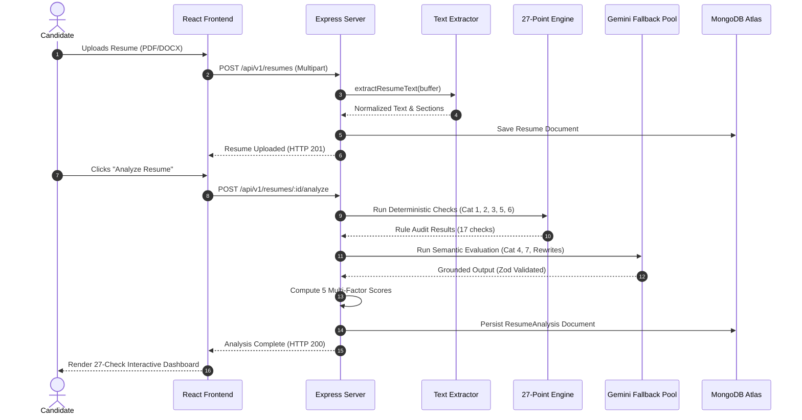

# PrepForge AI — Application Workflow & UX Architecture (APP_FLOW)
## Advanced Resume Intelligence Engine

**Document Version:** 2.0.0  
**Status:** Approved Application Workflow Specification  
**Product Name:** PrepForge AI — Advanced Resume Intelligence Engine  
**Author:** Principal UX Architect & Full-Stack Systems Lead  
**Date:** 2026-10-26  
**Baseline Codebase:** PrepForge AI Full-Stack Platform (Phase 0 Audit Verified)  

---

## 1. Route Map & Protection Matrix

The application routes are structured around verified production entry points defined in `client/src/App.jsx`:

| Route Path | View Component | Access Level | Description & Architectural State |
| :--- | :--- | :--- | :--- |
| `/` | `HomePage` | Public | High-converting landing hero, feature overview, live demo preview, and call-to-actions. |
| `/login` | `LoginPage` | Public (Guest) | Secure authentication with password visibility toggle, remember-me, and redirects to dashboard. |
| `/register` | `RegisterPage` | Public (Guest) | Account creation with live password strength scoring and career level selection. |
| `/forgot-password`| `ForgotPasswordPage`| Public (Guest) | Password reset request with clear pending-integration confirmation states. |
| `/dashboard` | `DashboardPage` | **Protected** | Central candidate command hub: score summary gauges, recent checks, quick actions, KPI cards. |
| `/resume-analyzer`| `ResumeAnalyzerPage`| **Protected** | **Core Intelligence Engine:** Upload dropzone, 27-point check audit, 5 scores, improvement studio. |
| `/resumes` | Alias to `/resume-analyzer`| **Protected** | Canonical redirect for document management. |
| `/mock-interviews`| `MockInterviewsPage`| **Protected** | Dynamic interview simulation based on candidate experience and target role. |
| `/job-match` | `JobMatchPage` | **Protected** | Semantic job description matching, skill gap badges, and role tailoring. |
| `/question-bank` | `QuestionBankPage` | **Protected** | Curated repository of technical and behavioral interview questions by role. |
| `/interview-history`| `InterviewHistoryPage`| **Protected** | Historical interview attempts with transcript reviews and AI answer feedback. |
| `/analytics` | `AnalyticsPage` | **Protected** | Progress charts, ATS score trends over time, and competency benchmarks. |
| `/applications` | `ApplicationsPage` | **Protected** | Full Kanban/table tracker for active job applications and interview stages. |
| `/profile` | `ProfilePage` | **Protected** | Candidate profile, target roles, experience tier, and verified skill tags. |
| `/settings` | `SettingsPage` | **Protected** | Appearance preferences (Dark/Light/System), password security, and 1-Click Total Data Erasure. |
| `*` | `NotFoundPage` | Public | Friendly 404 page with navigation to dashboard or home. |

---

## 2. Complete End-to-End User Journeys (18 Workflows)

### Journey 1: User Login
* **Normal Flow:** User enters email and password on `/login`. Submits form. Client sends `POST /api/v1/auth/login`. Server verifies credentials with bcrypt, sets `prepforge_jwt` HttpOnly cookie, and returns user object. Client `AuthContext` updates user state and navigates to `/dashboard`.
* **Error Flow:** Invalid credentials return HTTP 401 with message "Invalid email or password". Client displays inline red alert without revealing which field was incorrect.
* **Loading State:** Button disables with animated Lucide spinner and text "Authenticating...".

### Journey 2: Dashboard Navigation
* **Normal Flow:** User arrives at `/dashboard`. Client loads cached or live analysis summaries. Renders 4 primary KPI cards (Overall ATS Score, Checks Passed, Missing Skills Count, Active Applications) and navigation quick-links.
* **Empty State:** For new accounts with zero uploaded resumes, displays an illustrative onboarding card: *"Welcome to PrepForge AI! Upload your first resume to unlock the 27-point intelligence audit."*

### Journey 3: Resume Upload
* **Normal Flow:** User navigates to `/resume-analyzer`. Drags a PDF/DOCX/TXT file into the dropzone or clicks "Select File". Client performs instant validation ($\le 5\text{MB}$, valid extension). Renders file card with size, name, and format icon.
* **Error Flow:** File exceeding 5MB or invalid format displays immediate warning toast: *"File size exceeds 5MB limit. Please upload a standard PDF, DOCX, or TXT file."*

### Journey 4: Resume File Validation
* **Normal Flow:** Client dispatches `multipart/form-data` to `POST /api/v1/resumes`. Multer buffers upload in memory. Server inspects header magic bytes (`%PDF-`, `PK\x03\x04`). Valid files proceed to storage service.
* **Error Flow:** Corrupted files or disguised executables fail magic byte inspection, returning HTTP 400. File is discarded immediately from memory.

### Journey 5: Resume Parsing & Text Extraction
* **Normal Flow:** Server invokes `extractResumeText()`. Uses `pdf-parse` for PDF or `mammoth` for DOCX. Sanitizes non-printable binary characters, strips duplicate linebreaks, and confirms character count $\ge 20$.
* **Error Flow:** Scanned or raster image PDF yields $< 20$ characters. Server returns HTTP 400: *"Scanned or image-only PDF detected. Please upload a text-selectable PDF."*

### Journey 6: Analysis Processing Pipeline
* **Normal Flow:** Server segments normalized text into standard sections (Contact, Experience, Education, Skills, Summary). Triggers concurrent rule execution and initiates Gemini fallback model pool.
* **Loading State (Client):** UI transitions to analysis loading state: step-by-step progress checklist (1. Extracting text $\to$ 2. Auditing 27 ATS checks $\to$ 3. Calculating multi-factor scores $\to$ 4. Generating AI rewrites).

### Journey 7: 27-Point Checking Engine Execution
* **Normal Flow:** The engine processes all 27 checks sequentially/concurrently across 7 categories:
  - Cat 1 (ATS Essentials: CHK-01 to CHK-06)
  - Cat 2 (Resume Sections: CHK-07 to CHK-09)
  - Cat 3 (Resume Content: CHK-10 to CHK-14)
  - Cat 4 (Job Tailoring: CHK-15 to CHK-18)
  - Cat 5 (Recruiter Red Flags: CHK-19 to CHK-22)
  - Cat 6 (Bias Prevention: CHK-23 to CHK-24)
  - Cat 7 (Seniority & Impact: CHK-25 to CHK-27)
* **Output:** Generates normalized array of check results with status (`passed`, `warning`, `failed`, `info`).

### Journey 8: Multi-Factor ATS Score Calculation
* **Normal Flow:** Server computes the 5 transparent scores:
  1. $S_{\text{ATS}}$: Weighted sum of Cat 1 (50%), Cat 2 section/contact presence (30%), and CHK-10 parse rate (20%). Hard cap $\le 40$ applies strictly upon genuine critical parsing failure in CHK-01 (corrupted binary or scanned image with $<20$ characters).
  2. $S_{\text{Content}}$: Cat 3 metric density, buzzwords, grammar (60%), and Cat 7 demonstrated skills and impact (40%).
  3. $S_{\text{Structure}}$: Cat 2 section flow CHK-09 (25%) and Cat 5 timeline sanity / red flags (75%). Category 6 is completely excluded ($w_{\text{Cat 6}} \equiv 0$).
  4. $S_{\text{Overall}} = \text{round}(0.35 \times S_{\text{ATS}} + 0.35 \times S_{\text{Content}} + 0.30 \times S_{\text{Structure}})$.
  5. $S_{\text{JobMatch}}$: Computed only if target job description is provided; strictly `null` (displayed as `N/A`) otherwise.

### Journey 9: Analysis Dashboard Exploration
* **Normal Flow:** Client receives HTTP 200 payload. Renders primary score gauge, category tabs, and filterable 27-check grid. User can filter checks by status (All, Issues Only, Passed Only) or by Category.

### Journey 10: Individual Check Details Modal/Drawer
* **Normal Flow:** User clicks on any check card (e.g., `CHK-11: Quantified Achievements`). A slide-over drawer opens displaying:
  - Check severity and category tag.
  - Explanation: Why ATS systems and recruiters audit this.
  - Exact detected failing bullet points with highlighted text.
  - Actionable recommendation with copyable template.

### Journey 11: AI Recommendations & Bullet Rewriting
* **Normal Flow:** User selects the "Recommendations" tab. Renders priority-sorted suggestions. Bullets lacking numbers display bracketed metric rewrites:
  - *Original:* "Responsible for managing database migrations."
  - *PrepForge Rewrite:* "Orchestrated zero-downtime PostgreSQL migrations across [X] production clusters, reducing query latency by [Y]%."

### Journey 12: Interactive Resume Improvement Studio
* **Normal Flow:** User clicks "Open Improvement Studio". Side-by-side view renders original text on the left and interactive suggestions on the right. User clicks "Apply" on a rewrite; text updates in the editor with visual green/red diff markers. One-click "Copy Updated Resume" copies plain text to clipboard.

### Journey 13: Fast-Path Re-Analysis (`POST /api/v1/resumes/:id/recheck`)
* **Normal Flow:** After copying edits back into their source document and re-uploading, user clicks "Re-Check Deterministic Rules". Server executes fast-path regex/rule pipeline ($< 500\text{ms}$) and updates score badges without full LLM roundtrip.

### Journey 14: Job Description Matching Integration
* **Normal Flow:** In `/job-match` or the "Job Tailoring" tab, candidate pastes target job posting text and clicks "Analyze Fit".
  - Engine parses JD keywords and matches against candidate profile.
  - Updates $S_{\text{JobMatch}}$ score ($0-100$).
  - Categorizes skills into Matched (Green), Missing (Red), and Unverified (Yellow).

### Journey 15: Side-by-Side Resume Comparison
* **Normal Flow:** Candidate selects two versions from their history (e.g., *Resume_v1.pdf* vs *Resume_v2.pdf*) and clicks "Compare Versions".
  - Renders comparison matrix: Score Deltas ($\Delta +14$ Overall, $\Delta +20$ ATS).
  - Displays "Resolved Issues" badge list (e.g., CHK-11 and CHK-17 resolved).
  - Side-by-side text diff highlight.

### Journey 16: Executive PDF Report Download
* **Normal Flow:** User clicks "Download PDF Report" on the analysis dashboard. Client renders a print-optimized document view using `@media print` CSS or fetches server-generated PDF buffer via `GET /api/v1/resumes/:id/report/pdf`. The browser initiates download of `PrepForge_Resume_Audit_[CandidateName].pdf`.

### Journey 17: Analysis History Management
* **Normal Flow:** In `/resume-analyzer`, the "History" tab displays paginated table of past analyses with date, file name, overall score badge, and quick actions ("View", "Compare", "Delete").
* **Deletion Flow:** Clicking delete triggers confirmation modal. User confirms $\to$ server deletes analysis document and associated storage file $\to$ table updates optimistically.

### Journey 18: Universal Global Theme Switching
* **Normal Flow:** User clicks the Theme Toggle icon (Sun/Moon) located in the persistent global top navbar from *any* page.
  - System toggles between Dark Mode and Light Mode immediately.
  - Root `html` class changes synchronously (`class="dark"` $\leftrightarrow$ `class="light"`).
  - Preference saved to `localStorage.setItem('prepforge_theme', mode)`.
  - All charts, modals, drawers, cards, and text update instantly with zero flash or page reload.

---

## 3. Workflow Diagrams

### 3.1 27-Point Resume Analysis Flow


---

## 4. Operational State Handling (Loading, Error, Empty)

```
+---------------------------------------------------------------------------------------------------+
|                                     UX STATE HANDLING MATRIX                                      |
+---------------------------------------------------------------------------------------------------+
| STATE       | DASHBOARD & ANALYZER                | JOB MATCH / COMPARISON                        |
|-------------|-------------------------------------|-----------------------------------------------|
| Loading     | Pulse shimmer skeletons for KPI     | Animated radar spinner with contextual status |
|             | cards; 4-step progressive checklist | label ("Comparing candidate skills against    |
|             | with completion checkmarks.         | job description requirements...").            |
|-------------|-------------------------------------|-----------------------------------------------|
| Error       | Dismissible inline alert with       | Error card explaining failure reason with     |
|             | retry button; maintains form inputs | one-click "Try Again" action button.          |
|             | so user never loses entered text.   |                                               |
|-------------|-------------------------------------|-----------------------------------------------|
| Empty       | Illustrative graphic with callout   | Friendly guidance card: "Paste a job posting  |
|             | to upload first resume document;    | or select a previous target to evaluate       |
|             | disabled action buttons with tooltips. alignment."                                   |
+---------------------------------------------------------------------------------------------------+
```
