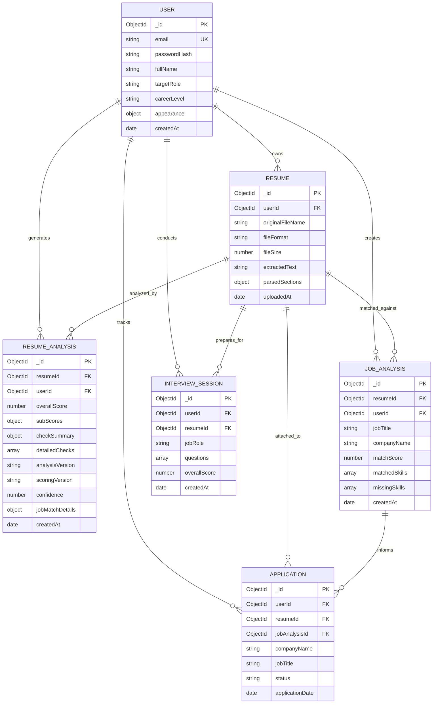

# PrepForge AI — Database Schema & Data Architecture (DATABASE_SCHEMA)
## Advanced Resume Intelligence Engine

**Document Version:** 2.0.0  
**Status:** Approved Data Model Specification  
**Database Engine:** MongoDB Atlas (v7.0+ Managed Cluster)  
**Cluster Hostname:** `cluster0.oy5eebe.mongodb.net`  
**Database Name:** `prepforge_ai`  
**Object Data Modeling (ODM):** Mongoose (`^9.11.2`)  
**Author:** Principal Database Architect & Backend Systems Lead  
**Date:** 2026-10-26  
**Backward Compatibility Guarantee:** 100% Additive Schema Design (Zero Data Migrations Required)  

---

## 1. Architectural Principles & Non-Duplication Policy

PrepForge AI enforces strict data preservation and schema governance:
1. **Zero Duplicate Models:** No parallel or shadow models (e.g., `ResumeAudit`, `NewResumeAnalysis`) shall be created. All checking functionality builds directly upon the existing `ResumeAnalysis` model.
2. **Additive Schema Evolution:** New fields are appended as optional or defaulted subdocuments. Pre-existing records stored in `prepforge_ai` remain valid without executing destructive migrations.
3. **User Isolation & Ownership Integrity:** Every query must enforce the authenticated candidate's `userId` as a top-level filter key, eliminating Insecure Direct Object References (IDOR).
4. **Optimized Compound Indexing:** Indexes are designed to serve frequent access patterns (paginated history queries, latest resume retrieval) without excessive write overhead.

---

## 2. Complete Entity-Relationship (ER) Architecture



---

## 3. Verified Existing Mongoose Models

The Phase 0 audit confirmed 6 active, registered Mongoose models in `server/src/models/`:

### 3.1 `User` Model (`server/src/models/User.js`)
* **Collection:** `users`
* **Core Fields:**
  - `email`: `String`, required, unique, trim, lowercase, index.
  - `passwordHash`: `String`, required, selected: false.
  - `fullName`: `String`, required, trim.
  - `targetRole`: `String`, default: 'Software Engineer'.
  - `careerLevel`: `String`, enum: `['entry', 'mid', 'senior', 'lead', 'executive']`.
  - `appearance`: `{ theme: { type: String, enum: ['dark', 'light', 'system'], default: 'dark' } }`.
  - `tokenVersion`: `Number`, default: 0.

### 3.2 `Resume` Model (`server/src/models/Resume.js`)
* **Collection:** `resumes`
* **Core Fields:**
  - `userId`: `ObjectId`, ref: `User`, required, index.
  - `originalFileName`: `String`, required.
  - `storedFileName`: `String`, required.
  - `fileFormat`: `String`, enum: `['pdf', 'docx', 'txt']`, required.
  - `fileSize`: `Number`, required (max 5242880 bytes).
  - `rawText`: `String`, required.
  - `extractedText`: `String`.
  - `parsedSections`: `Mongoose.Schema.Types.Mixed`.
  - `uploadedAt`: `Date`, default: Date.now.
* **Indexes:** `{ userId: 1, uploadedAt: -1 }`.

### 3.3 `JobAnalysis` Model (`server/src/models/JobAnalysis.js`)
* **Collection:** `jobanalyses`
* **Core Fields:** `userId`, `resumeId`, `jobTitle`, `companyName`, `jobDescription`, `matchScore`, `matchedSkills`, `missingSkills`, `tailoringRecommendations`.
* **Indexes:** `{ userId: 1, createdAt: -1 }`.

### 3.4 `InterviewSession` Model (`server/src/models/InterviewSession.js`)
* **Collection:** `interviewsessions`
* **Core Fields:** `userId`, `resumeId`, `jobRole`, `experienceLevel`, `questions` (subdocuments with evaluation and model answers), `overallScore`.
* **Indexes:** `{ userId: 1, createdAt: -1 }`.

### 3.5 `Application` Model (`server/src/models/Application.js`)
* **Collection:** `applications`
* **Core Fields:** `userId`, `resumeId`, `jobAnalysisId`, `companyName`, `jobTitle`, `status` (Saved, Applied, Interview, Offer, Rejected), `applicationDate`.
* **Indexes:** `{ userId: 1, status: 1 }`, `{ userId: 1, createdAt: -1 }`.

---

## 4. Additive Extensions to `ResumeAnalysis` Model

To implement the 27-point checking engine, the existing `ResumeAnalysis` model (`server/src/models/ResumeAnalysis.js`) is extended with the following optional, additive fields:

```javascript
// Additive Subdocument Definition
const detailedCheckResultSchema = new mongoose.Schema({
  checkId: { 
    type: String, 
    required: true,
    enum: [
      'CHK-01', 'CHK-02', 'CHK-03', 'CHK-04', 'CHK-05', 'CHK-06',
      'CHK-07', 'CHK-08', 'CHK-09',
      'CHK-10', 'CHK-11', 'CHK-12', 'CHK-13', 'CHK-14',
      'CHK-15', 'CHK-16', 'CHK-17', 'CHK-18',
      'CHK-19', 'CHK-20', 'CHK-21', 'CHK-22',
      'CHK-23', 'CHK-24',
      'CHK-25', 'CHK-26', 'CHK-27'
    ]
  },
  checkName: { type: String, required: true },
  category: { 
    type: String, 
    required: true,
    enum: [
      'ATS Essentials',
      'Resume Sections',
      'Resume Content',
      'Job Tailoring',
      'Recruiter Red Flags',
      'Bias and Discrimination',
      'Seniority and Impact'
    ]
  },
  status: { 
    type: String, 
    required: true, 
    enum: ['passed', 'warning', 'failed', 'info'] 
  },
  score: { type: Number, min: 0, max: 100, default: 0 },
  severity: { 
    type: String, 
    required: true, 
    enum: ['critical', 'high', 'medium', 'low', 'info'] 
  },
  summary: { type: String, required: true },
  details: { type: mongoose.Schema.Types.Mixed, default: {} },
  recommendation: { type: String, default: null }
}, { _id: false });
```

---

## 5. Specification of Additive Fields

### 5.1 `detailedChecks`
* **Data Type:** `[detailedCheckResultSchema]` (Array of Subdocuments)
* **Purpose:** Stores the granular audit result for all 27 checks, including status, score, detected issues, and specific remediation text.
* **Validation:** Validated against `detailedCheckResultSchema` enum boundaries.
* **Default Value:** `[]`
* **Index Requirements:** None (nested array accessed in full payload).
* **Relationship:** Subdocument of `ResumeAnalysis`.

### 5.2 `subScores`
* **Data Type:** `Object` (Embedded Schema)
* **Purpose:** Stores the 4 individual dimensional scores that compose the overall evaluation.
* **Schema Definition:**
  ```javascript
  subScores: {
    atsScore: { type: Number, min: 0, max: 100, default: 0 },
    contentScore: { type: Number, min: 0, max: 100, default: 0 },
    structureScore: { type: Number, min: 0, max: 100, default: 0 },
    jobMatchScore: { type: Number, min: 0, max: 100, default: null }
  }
  ```
* **Validation:** Min 0, Max 100; `jobMatchScore` allows `null` when no job description was evaluated.
* **Default Value:** `{ atsScore: 0, contentScore: 0, structureScore: 0, jobMatchScore: null }`.
* **Index Requirements:** None.

### 5.3 `checkSummary`
* **Data Type:** `Object`
* **Purpose:** Caches aggregate check counts for rapid UI badge rendering without looping over array in client.
* **Schema Definition:**
  ```javascript
  checkSummary: {
    totalChecks: { type: Number, default: 27 },
    passedCount: { type: Number, default: 0 },
    warningCount: { type: Number, default: 0 },
    failedCount: { type: Number, default: 0 },
    infoCount: { type: Number, default: 0 }
  }
  ```
* **Default Value:** `{ totalChecks: 27, passedCount: 0, warningCount: 0, failedCount: 0, infoCount: 0 }`.

### 5.4 `analysisVersion`
* **Data Type:** `String`
* **Purpose:** Identifies the software release of the analysis engine that generated the record (enables phased migration and telemetry).
* **Validation:** Semantic version string pattern.
* **Default Value:** `'2.0.0'`

### 5.5 `scoringVersion`
* **Data Type:** `String`
* **Purpose:** Tracks the mathematical formula version used to compute composite and sub-scores.
* **Validation:** String format (`'1.0.0'`).
* **Default Value:** `'1.0.0'`

### 5.6 `confidence`
* **Data Type:** `Number`
* **Purpose:** Represents parser and extraction confidence ($0.0$ to $1.0$) based on clean character counts and section recognition certainty.
* **Validation:** `min: 0.0, max: 1.0`.
* **Default Value:** `0.95`

### 5.7 `jobMatchDetails`
* **Data Type:** `Object`
* **Purpose:** Encapsulates the job matching metadata when the resume is analyzed against a specific posting.
* **Schema Definition:**
  ```javascript
  jobMatchDetails: {
    targetJobTitle: { type: String, default: null },
    targetCompany: { type: String, default: null },
    rawJobDescriptionSnippet: { type: String, default: null },
    hardSkillsMatchScore: { type: Number, min: 0, max: 100, default: null },
    softSkillsMatchScore: { type: Number, min: 0, max: 100, default: null },
    matchedKeywords: { type: [String], default: [] },
    missingKeywords: { type: [String], default: [] }
  }
  ```
* **Default Value:** `null` (or empty defaults when job match is requested).

---

## 6. Indexing Strategy & Performance Optimization

```
+---------------------------------------------------------------------------------------------------+
|                                 DATABASE COMPOUND INDEX DEFINITIONS                               |
+---------------------------------------------------------------------------------------------------+
| COLLECTION      | INDEX SPECIFICATION                 | PERFORMANCE JUSTIFICATION                 |
|-----------------|-------------------------------------|-------------------------------------------|
| resumeanalyses  | { userId: 1, createdAt: -1 }        | Powers candidate analysis history table   |
|                 |                                     | with fast, sorted pagination.             |
| resumeanalyses  | { resumeId: 1, createdAt: -1 }      | High-speed lookup for the latest analysis |
|                 |                                     | associated with a specific resume document|
| resumeanalyses  | { userId: 1, resumeId: 1 }          | IDOR validation and candidate ownership   |
|                 |                                     | verification during recheck & comparison. |
+---------------------------------------------------------------------------------------------------+
```

---

## 7. Data Retention, Cleanup & Privacy Compliance

1. **Cascading Erasure:** When a user executes "Delete Account" in `/settings`, a Mongoose transaction or cascade controller deletes:
   - User record from `users`.
   - All uploaded files and metadata from `resumes`.
   - All analyses from `resumeanalyses`.
   - All interview logs from `interviewsessions`.
   - All applications from `applications`.
2. **Local Storage Cleanup:** Storage service removes all physical files associated with deleted resumes from the disk storage directory (`server/uploads/resumes/`).
3. **No Soft Deletes on Personal Assets:** Resumes and extracted text are permanently purged to comply with strict GDPR/CCPA data minimization mandates.
