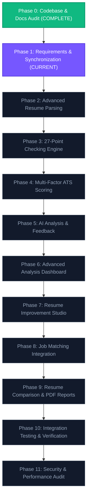

# PrepForge AI — Master Implementation Roadmap (Phases 0 to 11)
## Advanced Resume Intelligence Engine

**Document Version:** 2.0.0  
**Status:** Approved Master Engineering Roadmap  
**Product Name:** PrepForge AI — Advanced Resume Intelligence Engine  
**Author:** Principal Software Architect & Technical Lead  
**Date:** 2026-10-26  
**Governance:** Non-Regression Policy & Extension Over Replacement  

---

## 1. Master Phase Progression Graph

---

## 2. Phase-by-Phase Implementation Specifications

---

### Phase 0: Codebase and Documentation Audit
* **Status:** **COMPLETE** (Signed off 2026-10-26)
* **Objectives:** Conduct an exhaustive, non-destructive audit of the existing PrepForge AI full-stack application, Mongoose models, Express routing, Gemini integration, frontend components, and dark/light UI tokens.
* **Dependencies:** None.
* **Implementation Tasks:**
  - Inspected `package.json`, `server/package.json`, `client/package.json`.
  - Verified runtime MongoDB Atlas connection and the 6 registered models.
  - Audited `@google/genai` model pool and document extraction libraries.
  - Inspected frontend CSS and design tokens in `tailwind.config.js` and `index.css`.
* **Expected Deliverables:** `docs/PHASE_0_CODEBASE_AND_DOCUMENTATION_AUDIT.md`.
* **Acceptance Criteria:** [x] Codebase audited without source modification; [x] Tech stack verified; [x] Missing capabilities inventoried.
* **Completion Conditions:** Phase 0 audit report authored and approved.

---

### Phase 1: Requirements & Documentation Synchronization
* **Status:** **CURRENT (IN PROGRESS)**
* **Objectives:** Create and synchronize the full 11-document specification suite in `docs/` based on Phase 0 audit findings. Maintain strict documentation-only scope with zero code modification.
* **Dependencies:** Phase 0 Audit approval.
* **Implementation Tasks:**
  - Update 8 existing documents: `PRD.md`, `TRD.md`, `SRS.md`, `APP_FLOW.md`, `UI_UX.md`, `DATABASE_SCHEMA.md`, `API_DOCUMENTATION.md`, `IMPLEMENTATION_ROADMAP.md`.
  - Author 3 new technical specifications: `AI_ANALYSIS_SPECIFICATION.md`, `RESUME_CHECKS_SPECIFICATION.md`, `TESTING_STRATEGY.md`.
  - Conduct full cross-document consistency audit and author `docs/PHASE_1_DOCUMENTATION_COMPLETION_REPORT.md`.
* **Expected Files:** 11 synchronized specification files in `docs/` + 1 completion report.
* **Acceptance Criteria:**
  - [x] All 27 check IDs (`CHK-01` to `CHK-27`) present and mapped across 7 categories.
  - [x] All 5 scores defined with explicit formulas.
  - [x] Design system synchronized with `#080B14` dark and `#F8FAFC` light tokens.
  - [x] Zero application source code modified.
* **Testing Requirements:** Cross-document link and terminology verification.
* **Completion Conditions:** Sign-off on Phase 1 Completion Report and awaiting user approval before Phase 2.

---

### Phase 2: Advanced Resume Parsing & Section Segmentation Engine
* **Status:** PLANNED
* **Objectives:** Upgrade document parsing pipeline to perform robust section segmentation and structure boundary detection across PDF, DOCX, and TXT files.
* **Dependencies:** Phase 1 sign-off.
* **Implementation Tasks:**
  - Extend `server/src/utils/textExtractor.js` with regex-based section segmentation.
  - Segment text into standard sections: Contact, Experience, Education, Skills, Projects, Summary.
  - Extract structured date ranges, line-by-line bullet arrays, and link URLs.
  - Implement unreadable/scanned PDF heuristic detector.
* **Expected Files:**
  - `server/src/utils/sectionSegmenter.js`
  - `server/src/utils/textExtractor.js` (refactored)
  - `server/tests/unit/sectionSegmenter.test.js`
* **Acceptance Criteria:**
  - Correctly segments $\ge 90\%$ of standard single and multi-column resumes.
  - Accurately tokenizes bullet points and normalizes dates to `YYYY-MM`.
* **Testing Requirements:** Unit tests with standard PDF/DOCX test fixtures.
* **Completion Conditions:** Parsing tests pass with zero regression of existing upload routes.

---

### Phase 3: 27-Point Resume Checking Engine Implementation
* **Status:** PLANNED
* **Objectives:** Implement the core auditing engine executing all 27 checks across 7 categories.
* **Dependencies:** Phase 2 (Segmentation Engine).
* **Implementation Tasks:**
  - Create category-specific check modules in `server/src/services/resumeChecks/`:
    - `atsEssentialsChecks.js` (CHK-01 to CHK-06)
    - `sectionChecks.js` (CHK-07 to CHK-09)
    - `contentChecks.js` (CHK-10 to CHK-14)
    - `jobTailoringChecks.js` (CHK-15 to CHK-18)
    - `recruiterRedFlagChecks.js` (CHK-19 to CHK-22)
    - `biasMitigationChecks.js` (CHK-23 to CHK-24)
    - `seniorityImpactChecks.js` (CHK-25 to CHK-27)
  - Create master check orchestrator `server/src/services/resumeCheckEngine.js`.
* **Expected Files:**
  - `server/src/services/resumeCheckEngine.js`
  - `server/src/services/resumeChecks/*.js`
  - `server/src/constants/clicheDictionary.js`
  - `server/src/constants/actionVerbTaxonomy.js`
  - `server/tests/unit/resumeChecks.test.js`
* **Acceptance Criteria:**
  - All 27 checks execute and output standardized `{ checkId, status, score, severity, summary, details, recommendation }`.
  - Deterministic checks execute in $< 50\text{ms}$.
* **Testing Requirements:** Unit test suite validating pass/warning/fail triggers for every check.
* **Completion Conditions:** 100% check coverage verified with synthetic resume fixtures.

---

### Phase 4: Multi-Factor ATS Scoring Engine Implementation
* **Status:** PLANNED
* **Objectives:** Implement transparent, server-side score calculation computing 5 independent scores.
* **Dependencies:** Phase 3 (27-Point Engine).
* **Implementation Tasks:**
  - Create scoring module `server/src/services/scoringEngine.js`.
  - Implement formulas:
    - Overall Score ($0.35 \times \text{ATS} + 0.35 \times \text{Content} + 0.30 \times \text{Structure}$)
    - ATS Score with critical failure caps (CHK-01, CHK-08)
    - Content Score
    - Structure Score
    - Job Match Score (Conditional)
  - Integrate score calculation into `ResumeAnalysis` model lifecycle.
* **Expected Files:**
  - `server/src/services/scoringEngine.js`
  - `server/src/models/ResumeAnalysis.js` (additive fields)
  - `server/tests/unit/scoringEngine.test.js`
* **Acceptance Criteria:**
  - Bounded in $[0, 100]$; zero NaN or unhandled exceptions.
  - Scores are 100% reproducible for identical inputs.
* **Testing Requirements:** Mathematical boundary unit tests.
* **Completion Conditions:** Scoring tests pass; backward compatibility verified.

---

### Phase 5: AI Deep Analysis, Rewrites & Recommendations Integration
* **Status:** PLANNED
* **Objectives:** Enhance generative AI pipeline to synthesize grounded bullet rewrites using bracketed metric templates without hallucinations.
* **Dependencies:** Phase 3 & Phase 4.
* **Implementation Tasks:**
  - Update `server/src/services/geminiService.js` with structured prompt templates.
  - Implement anti-hallucination guardrails and bracketed placeholder generator (`[X]%`, `[Y] users`).
  - Update Zod validators in `server/src/validators/resumeAnalysisValidators.js`.
  - Maintain Gemini multi-model fallback pool (`gemini-3.7-flash` $\to$ `gemini-3.5-flash-lite` $\to$ `gemini-3.1-flash-lite`).
* **Expected Files:**
  - `server/src/services/geminiService.js`
  - `server/src/validators/resumeAnalysisValidators.js`
  - `server/tests/integration/geminiAnalysis.test.js`
* **Acceptance Criteria:**
  - AI outputs validated against Zod schema.
  - Zero fabricated employer names or degrees.
* **Testing Requirements:** Integration tests with mocked and live Gemini responses.
* **Completion Conditions:** Gemini failover resilient; JSON repair successfully tested.

---

### Phase 6: Advanced Resume Checker Dashboard UI
* **Status:** PLANNED
* **Objectives:** Build responsive, dual-theme frontend interface for the 27-check audit and multi-factor scores.
* **Dependencies:** Phase 4 & Phase 5.
* **Implementation Tasks:**
  - Enhance `client/src/pages/ResumeAnalyzerPage.jsx`.
  - Build `ScoreRadar.jsx` / `RadialScoreGauge.jsx`.
  - Build filterable `ChecklistGrid.jsx` and `CheckCard.jsx`.
  - Build slide-over `CheckDetailDrawer.jsx`.
  - Implement Header quick theme toggle with Sun/Moon icons.
* **Expected Files:**
  - `client/src/components/resume/ScoreGauge.jsx`
  - `client/src/components/resume/ChecklistGrid.jsx`
  - `client/src/components/resume/CheckCard.jsx`
  - `client/src/components/resume/CheckDetailDrawer.jsx`
  - `client/src/components/layout/ThemeToggle.jsx`
* **Acceptance Criteria:**
  - Displays all 27 checks filterable by category and status.
  - Flawless appearance in both Dark (`#080B14`) and Light (`#F8FAFC`) modes.
* **Testing Requirements:** UI component rendering tests; responsive viewport checks.
* **Completion Conditions:** Dashboard renders cleanly without console warnings.

---

### Phase 7: Interactive Resume Improvement & Rewrite Studio
* **Status:** PLANNED
* **Objectives:** Build interactive split-screen studio allowing candidates to review, edit, and apply AI bullet rewrites.
* **Dependencies:** Phase 6 (Dashboard UI).
* **Implementation Tasks:**
  - Create `ResumeImprovementStudio.jsx` component.
  - Implement visual text diff highlighter (green additions, red removals).
  - Implement one-click copy to clipboard.
  - Hook up fast-path recheck endpoint (`POST /api/v1/resumes/:id/recheck`).
* **Expected Files:**
  - `client/src/components/resume/ResumeImprovementStudio.jsx`
  - `client/src/components/resume/DiffViewer.jsx`
  - `server/src/controllers/resumeAnalysisController.js` (`recheckResume` endpoint)
* **Acceptance Criteria:**
  - Fast-path recheck executes in $< 500\text{ms}$.
  - Copy to clipboard functions reliably with toast confirmation.
* **Testing Requirements:** User interaction tests and recheck API integration tests.
* **Completion Conditions:** Rewrite studio tested end-to-end.

---

### Phase 8: Advanced Job Description Matching Integration
* **Status:** PLANNED
* **Objectives:** Deepen job description matching with semantic skill gap analysis and role tailoring suggestions.
* **Dependencies:** Phase 3 & Phase 4.
* **Implementation Tasks:**
  - Connect job tailoring checks (CHK-15 to CHK-18) to `POST /api/v1/jobs/analyze`.
  - Render categorized badges for Matched, Missing, and Unverified competencies.
  - Calculate conditional $S_{\text{JobMatch}}$ score ($0-100$).
* **Expected Files:**
  - `client/src/pages/JobMatchPage.jsx` (enhanced)
  - `server/src/services/jobMatcher.js`
* **Acceptance Criteria:**
  - Computes match percentage based on required skills weighting.
  - Accurately distinguishes hard technical skills from soft communication skills.
* **Testing Requirements:** Job description fixture matching tests.
* **Completion Conditions:** Seamless flow between Resume Analyzer and Job Matcher.

---

### Phase 9: Resume Comparison & Exportable PDF Reports
* **Status:** PLANNED
* **Objectives:** Enable candidates to compare two resume iterations side-by-side and export executive PDF reports.
* **Dependencies:** Phase 6 & Phase 7.
* **Implementation Tasks:**
  - Implement `POST /api/v1/resumes/compare` controller.
  - Build `ResumeComparisonModal.jsx` displaying score deltas and resolved checks.
  - Implement `GET /api/v1/resumes/:id/report/pdf` generating formatted PDF report.
  - Configure print CSS media queries for client-side print export.
* **Expected Files:**
  - `server/src/services/pdfReportGenerator.js`
  - `client/src/components/resume/ResumeComparisonModal.jsx`
  - `client/src/components/resume/PdfReportTemplate.jsx`
* **Acceptance Criteria:**
  - Comparison correctly highlights resolved checks and score deltas ($\Delta +X$).
  - PDF report exports clean 2-page executive summary matching brand tokens.
* **Testing Requirements:** PDF generation tests; dual-resume comparison unit tests.
* **Completion Conditions:** PDF exports verified across Chromium and Firefox.

---

### Phase 10: Complete Automated Integration Testing & Parsing Benchmarks
* **Status:** PLANNED
* **Objectives:** Execute exhaustive automated testing covering unit, integration, API, frontend, parsing accuracy, and scoring reproducibility.
* **Dependencies:** Phases 2 through 9.
* **Implementation Tasks:**
  - Run full test suite with test database environment.
  - Validate parsing accuracy against 20 standard synthetic resumes.
  - Validate scoring reproducibility (10 runs with identical input = identical scores).
  - Verify zero regression across all pre-existing routes.
* **Expected Deliverables:** Automated test execution report.
* **Acceptance Criteria:**
  - 100% test pass rate across unit and integration suites.
  - Zero IDOR vulnerabilities; all endpoints enforce user isolation.
* **Testing Requirements:** `npm.cmd --workspace=server test`.
* **Completion Conditions:** All regression tests passing cleanly.

---

### Phase 11: Security, Performance & Production Readiness Audit
* **Status:** PLANNED
* **Objectives:** Conduct security hardening, memory leak checks, rate limit verification, and bundle optimization prior to production release.
* **Dependencies:** Phase 10 (Testing).
* **Implementation Tasks:**
  - Audit Helmet CSP headers, CORS origins, and HttpOnly cookie attributes.
  - Inspect production Vite bundle chunk sizes ($< 500\text{KB}$ initial bundle).
  - Test rate limiting mitigation against rapid duplicate requests.
  - Verify 1-Click Total Data Erasure cascading purge.
* **Expected Deliverables:** Security & Performance Audit Report.
* **Acceptance Criteria:**
  - Clean security scan with zero critical vulnerabilities.
  - Lighthouse performance score $\ge 90$.
* **Testing Requirements:** End-to-end security and performance verification.
* **Completion Conditions:** Production readiness sign-off.
