# PHASE 0: PREPFORGE AI — COMPLETE DOCUMENTATION AUDIT & PLANNING REPORT

**Project Name:** PrepForge AI — Advanced Resume Intelligence Engine  
**Document Version:** 1.0.0  
**Status:** PHASE 0 COMPLETE — PENDING USER REVIEW & APPROVAL  
**Author:** Principal Software Architect & AI Systems Engineer  
**Date:** 2026-10-26  

---

## 1. Executive Summary & Objective

The objective of this phase is to conduct a complete, non-destructive audit of the existing **PrepForge AI** codebase and documentation suite prior to extending it with an **Advanced 27-Point Resume Checker** inspired by industry benchmarks such as Enhancv Resume Checker.

> [!IMPORTANT]
> **Core Architectural Principle: Extension Over Replacement**  
> This is **NOT a new project**, nor is it a rewrite. PrepForge AI possesses a fully functional, highly refined full-stack architecture comprising an Express.js backend, a React 19 frontend, MongoDB Atlas data persistence, multi-format text extraction (PDF, DOCX, TXT), and Google Gemini generative AI integrations.
> 
> All proposed enhancements will seamlessly build upon existing Mongoose schemas, controllers, frontend component systems, and design tokens without breaking backward compatibility or duplicating existing functional endpoints.

---

## 2. Strict Development Safeguards & Non-Regression Rules

The following rules have guided Phase 0 and will govern all subsequent execution phases:

1. **No Project Re-initialization:** The existing workspace layout (`client/`, `server/`, `docs/`) and Git history are strictly preserved.
2. **Zero Code Disruption in Phase 0:** No production source code, environment configurations, or database records have been modified.
3. **No Duplicate Models or Endpoints:** The existing Mongoose models (`User`, `Resume`, `ResumeAnalysis`, `JobAnalysis`, `InterviewSession`, `Application`) and API route structures will be extended via versioned or additive schemas rather than parallel duplicates.
4. **Preservation of Existing AI Pipeline:** The existing Gemini multi-tier fallback architecture in `server/src/services/geminiService.js` and resume extraction in `server/src/utils/textExtractor.js` will remain intact.
5. **Strict No-Fabrication Standard:** Every documented capability in this audit is supported by actual source file inspection and line references.
6. **No Mock Authentication:** Live HttpOnly cookie-based JWT authentication and Argon2/Bcrypt password hashing are respected.
7. **Transparent Scoring Methodology:** No proprietary algorithms are claimed; all ATS checks and rubrics will be transparent, reproducible, and explainable.

---

## 3. Technology Stack Verification

An exhaustive inspection of `package.json`, `server/package.json`, `client/package.json`, and runtime configurations confirms the actual stack:

| Layer | Declared Technology | Actual Verified Version | Source Evidence | Status |
| :--- | :--- | :--- | :--- | :--- |
| **Frontend Framework** | React | `^19.0.0` | `client/package.json:13` | **VERIFIED** |
| **Frontend DOM** | React DOM | `^19.0.0` | `client/package.json:14` | **VERIFIED** |
| **Client Router** | React Router DOM | `^7.1.5` | `client/package.json:15` | **VERIFIED** |
| **Client Build Tool** | Vite | `^6.1.0` | `client/package.json:22` | **VERIFIED** |
| **Styling & CSS** | Tailwind CSS | `^3.4.17` | `client/package.json:21` | **VERIFIED** |
| **Iconography** | Lucide React | `^0.475.0` | `client/package.json:12` | **VERIFIED** |
| **Backend Runtime** | Node.js (ES Modules) | `v20+` (`"type": "module"`) | `server/package.json:5` | **VERIFIED** |
| **Backend Framework** | Express.js | `^4.21.2` | `server/package.json:19` | **VERIFIED** |
| **HTTP Security** | Helmet | `^8.3.0` | `server/package.json:21` | **VERIFIED** |
| **CORS Handling** | CORS | `^2.8.5` | `server/package.json:17` | **VERIFIED** |
| **Cookie Parsing** | Cookie-Parser | `^1.4.7` | `server/package.json:16` | **VERIFIED** |
| **Rate Limiting** | Express-Rate-Limit | `^8.7.1` | `server/package.json:20` | **VERIFIED** |
| **Database Engine** | MongoDB Atlas | MongoDB v7.0+ Cluster | `server/src/config/db.js` | **VERIFIED** |
| **ODM** | Mongoose | `^9.11.2` | `server/package.json:24` | **VERIFIED** |
| **Password Hashing** | Bcryptjs | `^3.0.3` | `server/package.json:15` | **VERIFIED** |
| **JWT Management** | Jsonwebtoken | `^9.0.3` | `server/package.json:22` | **VERIFIED** |
| **Schema Validation** | Zod | `^4.6.7` | `server/package.json:27` | **VERIFIED** |
| **AI Client SDK** | Google Gen AI | `@google/genai ^2.30.0` | `server/package.json:14` | **VERIFIED** |
| **PDF Extraction** | pdf-parse | `^2.4.5` | `server/package.json:26` | **VERIFIED** |
| **DOCX Extraction** | mammoth | `^1.13.0` | `server/package.json:23` | **VERIFIED** |
| **File Uploads** | Multer | `^2.4.0` | `server/package.json:25` | **VERIFIED** |

---

## 4. Existing Feature Implementation Matrix

Every core functional domain was audited against the current code implementation:

| Functional Area | Current Status | Implemented Components & Routes | Source Verification | Audit Notes |
| :--- | :--- | :--- | :--- | :--- |
| **User Authentication** | **IMPLEMENTED** | `POST /api/v1/auth/register`<br>`POST /api/v1/auth/login`<br>`POST /api/v1/auth/logout`<br>`GET /api/v1/auth/me` | `server/src/controllers/authController.js`<br>`client/src/context/AuthContext.jsx` | Full JWT HttpOnly cookie pipeline, password hashing, and auto-session bootstrap. |
| **Resume Upload & Storage** | **IMPLEMENTED** | `POST /api/v1/resumes`<br>`GET /api/v1/resumes`<br>`DELETE /api/v1/resumes/:id` | `server/src/controllers/resumeController.js`<br>`server/src/services/storageService.js` | Supports PDF, DOCX, TXT up to 5MB. Verifies file signature/magic bytes. Local and S3-ready. |
| **Document Text Extraction** | **IMPLEMENTED** | `extractResumeText(filePath, format)` | `server/src/utils/textExtractor.js` | Uses `PDFParse` for PDF, `mammoth` for DOCX, UTF-8 for TXT. Sanitizes control chars. |
| **AI Resume Analysis** | **IMPLEMENTED** | `POST /api/v1/resumes/:id/analyze`<br>`GET /api/v1/resumes/:id/analysis` | `server/src/controllers/resumeAnalysisController.js`<br>`server/src/services/geminiService.js` | Invokes Gemini 3.7/3.5 Flash with prompt engineering, retries, and Zod validation. |
| **ATS Composite Scoring** | **PARTIALLY IMPLEMENTED** | 5-Factor Rubric:<br>Impact (25%), Brevity (20%), Style (15%), Skills (20%), Readability (20%) | `server/src/validators/resumeAnalysisValidators.js:117` | Evaluates 5 dimensions via LLM output. **Lacks standalone deterministic 27-point checks.** |
| **Skills Identification** | **IMPLEMENTED** | Extracted technical and soft skills, plus missing recommended skills | `server/src/models/ResumeAnalysis.js:61`<br>`client/src/pages/ResumeAnalyzerPage.jsx:905` | Categorizes technical, soft, and missing skills in UI and database. |
| **Weakness Identification** | **IMPLEMENTED** | `strengths` and `weaknesses` string arrays | `server/src/models/ResumeAnalysis.js:125`<br>`client/src/pages/ResumeAnalyzerPage.jsx:976` | Identified and displayed in dual-column UI cards. |
| **Actionable AI Recommendations** | **IMPLEMENTED** | `improvementSuggestions`, `sectionWiseRecommendations`, `bulletPointsEvaluated` | `server/src/models/ResumeAnalysis.js:120`<br>`client/src/pages/ResumeAnalyzerPage.jsx:1011` | Provides concrete rewrite suggestions with before/after comparison and priority badges. |
| **Analysis History** | **IMPLEMENTED** | `GET /api/v1/resume-analyses`<br>`DELETE /api/v1/resume-analyses/:analysisId` | `server/src/controllers/resumeAnalysisController.js:260`<br>`client/src/pages/ResumeAnalyzerPage.jsx:169` | Paginated analysis audit logs with historical view and delete capabilities. |
| **Job Description Matching** | **IMPLEMENTED** | `POST /api/v1/jobs/analyze`<br>`GET /api/v1/jobs` | `server/src/controllers/jobAnalysisController.js`<br>`client/src/pages/JobMatchPage.jsx` | Semantic match score (0-100), required/preferred skill gaps, keyword overlap analysis. |
| **Mock Interview Question Generation** | **IMPLEMENTED** | `POST /api/v1/interviews/generate` | `server/src/controllers/interviewController.js`<br>`client/src/pages/MockInterviewsPage.jsx` | Dynamic interview session generation tailored to target role and experience tier. |
| **Interview Answer Evaluation** | **IMPLEMENTED** | `POST /api/v1/interviews/:id/evaluate-answer` | `server/src/controllers/interviewController.js`<br>`client/src/pages/InterviewHistoryPage.jsx` | 5-factor scoring (accuracy, relevance, completeness, clarity, communication) and model answers. |
| **Application Tracking** | **IMPLEMENTED** | CRUD operations on job applications | `server/src/controllers/applicationController.js`<br>`client/src/pages/ApplicationsPage.jsx` | Kanban/list tracker with status stages (Saved, Applied, Interview, Offer, Rejected). |
| **27-Point Enhancv-Style Checks** | **NOT IMPLEMENTED** | Proposed 27 deterministic checks across 7 categories | New engine planned for Phase 3 | Currently absent. To be implemented as the centerpiece of this enhancement. |

---

## 5. Architectural Deep-Dive

### 5.1 Frontend Architecture
* **Routing (`client/src/App.jsx`):** Employs `BrowserRouter` with `AuthProvider`.
  - Public routes: `/` (Home), `/login`, `/register`, `/forgot-password`.
  - Protected routes (`ProtectedRoute.jsx`): `/dashboard`, `/mock-interviews`, `/resume-analyzer`, `/job-match`, `/question-bank`, `/interview-history`, `/analytics`, `/applications`, `/profile`, `/settings`.
  - Aliases: `/resume-analysis` and `/resumes` redirect cleanly to `/resume-analyzer`.
* **State Management:**
  - `AuthContext.jsx`: Manages reactive user state, login, logout, and automatic session restoration on mount via `/api/v1/auth/me`.
  - Component-local async state machines: `idle` $\to$ `loading` $\to$ `success` $\to$ `error` using Lucide spinners and skeletons.
* **Component Library:** Rich atom/molecule suite in `client/src/components/` including `BrandLogo`, `Button`, `Card`, `Badge`, `Modal`, `Toast`, `EmptyState`, `StatCard`, `LoadingSpinner`, and `PageHeader`.

### 5.2 Backend Architecture
* **Server Pipeline (`server/src/app.js`):**
  - Reverse proxy trust (`app.set('trust proxy', 1)`).
  - Security headers via `helmet`.
  - CORS with allowlisted origins and `credentials: true`.
  - Cookie parser and JSON body parsers (50MB payload thresholds).
  - Multi-tier rate limiting: `generalLimiter` (100 req/15m), `authLimiter` (10 req/15m), `aiLimiter` (10 req/1m).
  - Standardized routing with versioned prefixes (`/api/v1/...` with `/api/...` compatibility aliases).
* **AI Service Architecture (`server/src/services/geminiService.js`):**
  - Uses `@google/genai` with `GoogleGenAI` client.
  - Multi-model resilient fallback pool: `gemini-3.7-flash` $\to$ `gemini-3.5-flash-lite` $\to$ `gemini-3.1-flash-lite` $\to$ `gemini-flash-lite-latest` $\to$ `gemini-3.8-flash` $\to$ `gemini-3.5-flash`.
  - JSON repair parser: Handles raw control characters, backslash escape repair, and outer JSON delimiter extraction.
  - Strict output schema validation using Zod (`server/src/validators/`).
* **Document Extraction (`server/src/utils/textExtractor.js`):**
  - Validates file header magic bytes (`%PDF-` for PDF, `PK\x03\x04` for DOCX).
  - Normalizes text line breaks, strips binary control codes, and enforces a 20-character minimum readable threshold.

### 5.3 Database Architecture (Mongoose Models)

All 6 core models are defined in `server/src/models/` and registered under Mongoose 9+:

1. **`User` (`server/src/models/User.js`):**
   - Collection: `users`
   - Fields: `email` (unique collation index), `passwordHash` (`select: false`), `fullName`, `targetRole`, `careerLevel`, `phoneNumber`, `avatar`, `headline`, `location`, `skills`, `education`, `notifications`, `appearance` (`theme: 'dark' | 'light' | 'system'`), `tokenVersion`.
2. **`Resume` (`server/src/models/Resume.js`):**
   - Collection: `resumes`
   - Fields: `userId` (FK ref User), `originalFileName`, `storedFileName`, `fileFormat` (`pdf` | `docx` | `txt`), `fileType`, `fileSize`, `rawText`, `extractedText`, `parsedSections`, `uploadedAt`.
   - Indexes: `{ userId: 1, createdAt: -1 }`, `{ userId: 1, uploadedAt: -1 }`.
3. **`ResumeAnalysis` (`server/src/models/ResumeAnalysis.js`):**
   - Collection: `resumeanalyses`
   - Fields: `userId` (FK ref User), `resumeId` (FK ref Resume), `overallScore`, `categoryScores` (`impact`, `brevity`, `style`, `skills`, `atsReadability`), `summaryFeedback`, `bulletImprovements`, `strengths`, `weaknesses`, `identifiedSkills`, `analysisResults` (Mixed), `modelUsed`.
   - Indexes: `{ userId: 1, createdAt: -1 }`, `{ resumeId: 1, createdAt: -1 }`, `{ userId: 1, resumeId: 1, createdAt: -1 }`.
4. **`JobAnalysis` (`server/src/models/JobAnalysis.js`):**
   - Collection: `jobanalyses`
   - Fields: `userId`, `resumeId`, `jobTitle`, `companyName`, `jobDescription`, `matchScore`, `matchedSkills`, `missingSkills`, `unverifiedSkills`, `tailoringRecommendations`, `analysisResults`.
5. **`InterviewSession` (`server/src/models/InterviewSession.js`):**
   - Collection: `interviewsessions`
   - Fields: `userId`, `resumeId` (optional/nullable), `interviewTitle`, `jobRole`, `experienceLevel`, `category`, `difficulty`, `questions` (subdocuments with evaluations and model answers), `overallScore`, `finalEvaluation`.
6. **`Application` (`server/src/models/Application.js`):**
   - Collection: `applications`
   - Fields: `userId`, `resumeId`, `jobAnalysisId`, `companyName`, `jobTitle`, `status` (`Saved`, `Applied`, `Assessment`, `Interview`, `Offer`, `Rejected`, `Withdrawn`), `salaryExpectation`, `notes`, `applicationDate`.

---

## 6. UI/UX Design System & Theme Analysis

### 6.1 The PrepForge AI Dark Design System (Reference Theme)

The live frontend utilizes a custom dark SaaS design system defined in `client/tailwind.config.js` and calibrated in `client/src/index.css`:

```
+-------------------------------------------------------------------------------+
|                            DESIGN SYSTEM TOKENS                               |
+-------------------------------------------------------------------------------+
| Token Name        | Dark Palette Value   | Semantic Role                      |
|-------------------|----------------------|------------------------------------|
| dark.base         | #080B14 / #080B16    | Main application canvas background |
| dark.sidebar      | #0D1220              | Sidebar container surface          |
| dark.card         | #121A2B              | Primary card and container surface |
| dark.elevated     | #182238 / #1E293B    | Elevated cards, dropdowns, inputs  |
| brand.primary     | #7657FF              | Electric Violet brand accent       |
| brand.secondary   | #3985FF              | Cobalt Blue intelligence gradient  |
| status.success    | #10B981 / #22C98B    | High score / passing check badge   |
| status.warning    | #F59E0B / #F5B942    | Moderate score / warning badge     |
| status.error      | #EF4444 / #F16D78    | Critical issue / failure badge     |
| text.primary      | #F5F7FF / #F8FAFC    | Primary high-contrast text         |
| text.secondary    | #929DB2 / #94A3B8    | Subtitles, timestamps, captions    |
| border.subtle     | rgba(255,255,255,0.08)| Card and divider border            |
| border.strong     | #334155              | Prominent container border         |
+-------------------------------------------------------------------------------+
```

### 6.2 Light Theme Calibration & Requirements

The light mode implementation is calibrated in `client/src/index.css` under the `html.light` selector:
- Canvas Background: `#F8FAFC` (`slate-50`)
- Surfaces & Cards: `#FFFFFF` with borders `#E2E8F0` and subtle shadows (`0 1px 3px rgba(0,0,0,0.05)`)
- Elevated Elements & Sub-cards: `#F1F5F9` (`slate-100`)
- Primary Text: `#0F172A` (`slate-900`)
- Muted Text: `#64748B` (`slate-500`)
- Accent Gradient: Preserves `#7657FF` $\to$ `#3985FF` for brand continuity.

### 6.3 Theme Toggle Architecture
- Managed via `client/src/utils/theme.js` using `getStoredTheme()`, `applyTheme(theme)`, and `initializeTheme()`.
- Preference stored in `localStorage` under key `prepforge_theme` with values `'dark' | 'light' | 'system'`.
- Synchronized with OS preference via `window.matchMedia('(prefers-color-scheme: light)')`.
- Active UI toggle is implemented in `client/src/pages/SettingsPage.jsx` under the Appearance tab.
- **Enhancement Requirement:** Surface a one-click quick theme toggle button directly in the global application header/navbar so users can switch themes effortlessly from any page.

### 6.4 Documentation Gap Identified in `docs/UI_UX.md`
- **Finding:** The existing `docs/UI_UX.md` was authored during Phase 0 prior to the official **PrepForge AI** rebranding and dark design system adoption. It specifies an outdated Indigo palette (`#4f46e5`) and generic layout notes.
- **Action Required:** `docs/UI_UX.md` will be updated to reflect the exact verified tokens, dark/light theme switching rules, and the new Resume Checker UI specs.

---

## 7. Enhancv-Inspired 27-Point Resume Checking Engine Specification

The new Resume Checker will introduce a comprehensive, transparent 27-point auditing engine organized into 7 distinct categories. It combines deterministic rule-based algorithms with targeted LLM semantic evaluation.

```
+---------------------------------------------------------------------------------------+
|                       PREPFORGE AI 27-POINT RESUME CHECKING SUITE                      |
+---------------------------------------------------------------------------------------+
|  CATEGORY 1: ATS ESSENTIALS (6 Checks)                                                |
|    CHK-01: File Format Compatibility    | Deterministic | Checks .pdf, .docx, .txt    |
|    CHK-02: ATS-Friendly Layout          | Rule + LLM    | Column count & parseability |
|    CHK-03: Professional Email Format    | Deterministic | Regex against spam handles  |
|    CHK-04: Header Professional Links    | Deterministic | LinkedIn, GitHub, Portfolio |
|    CHK-05: Resume File Naming           | Deterministic | FirstName_LastName standard |
|    CHK-06: Date Consistency & Links     | Deterministic | Valid formats & live URLs   |
|---------------------------------------------------------------------------------------|
|  CATEGORY 2: RESUME SECTIONS (3 Checks)                                               |
|    CHK-07: Essential Section Presence   | Rule + Regex  | Exp, Edu, Skills, Summary   |
|    CHK-08: Contact Info Completeness    | Deterministic | Phone, Email, Location      |
|    CHK-09: Structural Section Ordering  | Rule-based    | Logical hiring flow         |
|---------------------------------------------------------------------------------------|
|  CATEGORY 3: RESUME CONTENT (5 Checks)                                                |
|    CHK-10: ATS Parse Rate               | Deterministic | % text mapped to schema     |
|    CHK-11: Quantified Achievements      | Regex + NLP   | %, $, numbers, metrics      |
|    CHK-12: Repeated Words & Clichés     | Deterministic | Buzzword dictionary check   |
|    CHK-13: Spelling, Grammar & Casing   | Rule + LLM    | Typos & capitalization      |
|    CHK-14: Bullet Length & Consistency  | Deterministic | 15-30 words, period consistency
|---------------------------------------------------------------------------------------|
|  CATEGORY 4: JOB TAILORING (4 Checks)                                                 |
|    CHK-15: Hard Technical Skills Match  | Semantic/LLM  | Overlap with target JD/role |
|    CHK-16: Soft & Leadership Skills     | Semantic/LLM  | Context-backed competencies |
|    CHK-17: High-Impact Action Verbs     | Deterministic | Strong active verb taxonomy |
|    CHK-18: Target Job Title Alignment   | Semantic/LLM  | Headline role congruence    |
|---------------------------------------------------------------------------------------|
|  CATEGORY 5: RECRUITER RED FLAGS (4 Checks)                                           |
|    CHK-19: Resume Timeline Credibility  | Deterministic | Chronological sanity check  |
|    CHK-20: Interview Risk Signals       | Rule + LLM    | Passive tone, vague scope   |
|    CHK-21: Peer Experience Benchmark   | Rule-based    | Depth vs career level tier  |
|    CHK-22: Professional Presence Match  | Rule-based    | Title & company plausibility|
|---------------------------------------------------------------------------------------|
|  CATEGORY 6: BIAS & DISCRIMINATION (2 Checks)                                         |
|    CHK-23: Age & Date Bias Mitigation   | Deterministic | Grad dates >15y, photos     |
|    CHK-24: Employment Gap Analysis      | Deterministic | Gaps >6mo with context tips |
|---------------------------------------------------------------------------------------|
|  CATEGORY 7: SENIORITY & IMPACT (3 Checks)                                            |
|    CHK-25: Career Progression Trajectory| Rule + LLM    | Scope & title ascension     |
|    CHK-26: Skills Demonstration Context | Semantic/LLM  | Skills proven in bullets    |
|    CHK-27: Ownership & Leadership Marks | Rule + LLM    | Mentorship & stewardship    |
+---------------------------------------------------------------------------------------+
```

### 7.1 Detailed 27-Check Specification Matrix

| Check ID | Check Name | Category | Engine | Severity | Evaluation Logic | Target Outcome |
| :--- | :--- | :--- | :--- | :--- | :--- | :--- |
| **CHK-01** | File Format | ATS Essentials | Rule | Critical | Validates PDF, DOCX, TXT via MIME and magic bytes. File size $\le$ 5MB. | Passed / Failed |
| **CHK-02** | ATS-Friendly Layout | ATS Essentials | Hybrid | High | Detects complex tables, multi-column fragmentation, image-only text. | Clean / Parsing Risk |
| **CHK-03** | Professional Email | ATS Essentials | Rule | Medium | Flags nicknames, excessive digits, unprofessional domain extensions. | Professional / Unprofessional |
| **CHK-04** | Header Links | ATS Essentials | Rule | Medium | Verifies presence and valid formatting of LinkedIn/GitHub/Portfolio URLs. | Found / Missing |
| **CHK-05** | File Naming | ATS Essentials | Rule | Low | Flags generic names like `resume.pdf`, `doc1.docx`. Encourages `Name_Role.pdf`. | Standard / Generic |
| **CHK-06** | Dates & Links | ATS Essentials | Rule | Medium | Checks date format standardization (e.g. `MM/YYYY` or `Month YYYY`) and link protocols. | Consistent / Inconsistent |
| **CHK-07** | Essential Sections | Resume Sections | Rule | Critical | Confirms presence of Experience, Education, Skills, and Summary headers. | Complete / Missing Section |
| **CHK-08** | Contact Info | Resume Sections | Rule | Critical | Verifies Full Name, Email, Phone Number, and City/State location. | Complete / Incomplete |
| **CHK-09** | Section Order | Resume Sections | Rule | Low | Checks logical layout: Header $\to$ Summary $\to$ Experience $\to$ Education $\to$ Skills. | Optimal / Suboptimal |
| **CHK-10** | ATS Parse Rate | Resume Content | Rule | High | Ratio of text successfully tokenized into structured sections vs unparsed text. | Percentage $\ge 85\%$ |
| **CHK-11** | Quantified Achievements | Resume Content | Hybrid | High | Detects metric markers (`%`, `$`, numbers, multipliers, scale indicators). | Ratio $\ge 40\%$ bullets |
| **CHK-12** | Repeated Words & Buzzwords | Resume Content | Rule | Medium | Flags overused buzzwords ("synergy", "hardworker") and verb repetition. | Clean / Overused Words |
| **CHK-13** | Spelling, Grammar & Casing | Resume Content | Hybrid | High | Flags typographical errors, inconsistent capitalization, and punctuation faults. | Flawless / Issues Detected |
| **CHK-14** | Bullet Length & Consistency | Resume Content | Rule | Medium | Flags bullets $<10$ words (too brief) or $>40$ words (run-on). Verifies punctuation. | Balanced / Inconsistent |
| **CHK-15** | Hard Skills Match | Job Tailoring | Semantic | High | Matches extracted technical skills against target role or job description. | Alignment Score (0-100) |
| **CHK-16** | Soft Skills Match | Job Tailoring | Semantic | Medium | Identifies leadership, collaboration, and communication supported by evidence. | Alignment Score (0-100) |
| **CHK-17** | Action Verbs | Job Tailoring | Rule | Medium | Evaluates leading action verbs against taxonomies of Strong vs Passive verbs. | Strong / Moderate / Weak |
| **CHK-18** | Job Title Alignment | Job Tailoring | Semantic | Medium | Checks if resume headline/experience titles match target position title. | Aligned / Misaligned |
| **CHK-19** | Timeline Credibility | Recruiter Flags | Rule | High | Flags overlapping full-time dates or chronological impossibilities. | Clean / Date Discrepancy |
| **CHK-20** | Interview Risk Signals | Recruiter Flags | Hybrid | Medium | Detects vague responsibilities, passive voice, or lack of personal agency. | Low / Moderate / High Risk |
| **CHK-21** | Peer Benchmarking | Recruiter Flags | Rule | Medium | Evaluates depth, bullet count, and skill variety against career level expectations. | Competitive / Thin |
| **CHK-22** | Professional Match | Recruiter Flags | Rule | Low | Validates profile headline coherence with stated work experience history. | Coherent / Disjointed |
| **CHK-23** | Age & Date Bias | Bias Prevention | Rule | Low | Flags graduation dates $>15$ years ago, photos, or personal demographic markers. | Clean / Potential Bias |
| **CHK-24** | Employment Gaps | Bias Prevention | Rule | Medium | Detects unannotated gaps $>6$ months and suggests constructive framing tips. | Continuous / Gaps Detected |
| **CHK-25** | Career Progression | Seniority | Hybrid | Medium | Evaluates progression in title responsibility, scope, and technical complexity. | Upward / Lateral / Unclear |
| **CHK-26** | Skills Demonstration | Seniority | Semantic | High | Verifies that skills listed in the Skills section appear in work bullets. | Substantiated / Unsubstantiated |
| **CHK-27** | Leadership Signals | Seniority | Hybrid | Medium | Identifies mentoring, architecture ownership, hiring, and cross-functional impact. | Evident / Developing |

---

## 8. Multi-Dimensional Scoring Architecture

To avoid arbitrary "black box" numbers, the new scoring engine computes 5 distinct, explainable metrics:

### 1. Overall Resume Score ($0 - 100$)
Composite weighted score reflecting holistic application competitiveness:
$$\text{Overall Score} = \text{round}(0.35 \times \text{ATS Score} + 0.35 \times \text{Content Score} + 0.30 \times \text{Structure Score})$$

### 2. ATS Compatibility Score ($0 - 100$)
Reflects technical parseability by automated recruiting software:
$$\text{ATS Score} = \text{round}\left(\sum_{i \in \text{Cat 1, Cat 2}} w_i \times \text{Score}_i\right)$$
- Evaluates CHK-01 through CHK-09 and CHK-10.
- Rejection of file format or missing contact details immediately caps this score below 50.

### 3. Resume Content Score ($0 - 100$)
Reflects language quality, metric density, and substance:
$$\text{Content Score} = \text{round}\left(\sum_{i \in \text{Cat 3, Cat 7}} w_i \times \text{Score}_i\right)$$
- Evaluates CHK-11 (Quantification), CHK-12 (Repetition), CHK-13 (Grammar), CHK-14 (Bullet Length), and CHK-25-27 (Seniority/Impact).

### 4. Resume Structure Score ($0 - 100$)
Reflects visual balance, section order, timeline sanity, and bias mitigation:
$$\text{Structure Score} = \text{round}\left(\sum_{i \in \text{Cat 2, Cat 5, Cat 6}} w_i \times \text{Score}_i\right)$$
- Evaluates CHK-07, CHK-09, CHK-19, CHK-23, CHK-24.

### 5. Job Match Score ($0 - 100$, Conditional)
Generated **only** when a target job description or target role is provided:
$$\text{Job Match Score} = \text{round}(0.40 \times \text{Hard Skills} + 0.25 \times \text{Soft Skills} + 0.20 \times \text{Action Verbs} + 0.15 \times \text{Title Alignment})$$
- Evaluates CHK-15 through CHK-18. If no job description is provided, this score is reported as `null` with a prompt to provide target job requirements.

---

## 9. AI Analysis Architecture & Ethical Safety Guardrails

All generative AI capabilities are governed by strict safety and privacy controls:

1. **Grounded Ingestion Only:** LLM prompts explicitly prohibit inventing work experience, degrees, certifications, companies, or metrics.
2. **Bracketed Metric Templates:** When recommending bullet rewrites for non-quantified experience, the AI generates bracketed placeholders (e.g., *"Engineered microservice architecture reducing API response latency by [X]% across [Y] daily active users"*) rather than fabricating numbers.
3. **Structured JSON Mode:** Enforces strict Zod output schemas with fallback repair parsers.
4. **Token & Rate Management:** Prompts truncate input text beyond 60,000 characters to prevent token exhaustion; in-memory rate limiting prevents concurrent duplicate analysis of the same resume.
5. **Multi-Model Failover:** Automatically handles transient 429/503 errors by retrying through verified Google Gemini models (`gemini-3.7-flash` $\to$ `gemini-3.5-flash-lite` $\to$ `gemini-3.1-flash-lite`).

---

## 10. Database Schema Evolution & API Strategy

### 10.1 Mongoose Schema Evolution (Backward Compatible)
The existing `ResumeAnalysis` model will be enhanced with an optional, additive subdocument schema `detailedChecks`:
```javascript
// Additive to ResumeAnalysisSchema in server/src/models/ResumeAnalysis.js
const detailedCheckResultSchema = new mongoose.Schema({
  checkId: { type: String, required: true },
  checkName: { type: String, required: true },
  category: { type: String, required: true },
  status: { type: String, enum: ['passed', 'warning', 'failed', 'info'], required: true },
  score: { type: Number, min: 0, max: 100 },
  severity: { type: String, enum: ['critical', 'high', 'medium', 'low', 'info'] },
  summary: { type: String, required: true },
  details: { type: mongoose.Schema.Types.Mixed },
  recommendation: { type: String },
}, { _id: false });

// In ResumeAnalysis:
detailedChecks: {
  type: [detailedCheckResultSchema],
  default: [],
},
subScores: {
  atsScore: { type: Number, min: 0, max: 100 },
  contentScore: { type: Number, min: 0, max: 100 },
  structureScore: { type: Number, min: 0, max: 100 },
  jobMatchScore: { type: Number, min: 0, max: 100, default: null },
}
```
*Zero data migration required. Existing records remain 100% valid.*

### 10.2 API Route Extension
Existing routes (`POST /api/v1/resumes/:id/analyze`, `GET /api/v1/resumes/:id/analysis`) will return the enriched payload. New dedicated endpoints will be introduced:
- `GET /api/v1/resumes/:id/checks`: Returns the 27-check breakdown for quick scanning.
- `GET /api/v1/resumes/:id/checks/:checkId`: Detailed diagnostics and recommendations for a single check.
- `POST /api/v1/resumes/:id/recheck`: Fast-path re-evaluation of deterministic checks without re-running full LLM analysis.

---

## 11. Complete Documentation Inventory & Plan

To establish clear, authoritative project governance, the documentation suite in `docs/` will be maintained across 11 synchronized files:

| # | Document File | Type | Existing State | Planned Action in Phase 1 |
|---|---|---|---|---|
| 1 | `docs/PRD.md` | Core Product | Needs branding & scope update | Update product name to PrepForge AI, add 27-point Resume Checker features. |
| 2 | `docs/TRD.md` | Core Technical | Needs tech stack synchronization | Update with verified packages (@google/genai, pdf-parse, mammoth, etc.). |
| 3 | `docs/SRS.md` | Software Requirements | Complete for baseline platform | Add FRs and use cases for the 27-Point Checking Engine. |
| 4 | `docs/APP_FLOW.md` | User Flow | Accurate for baseline platform | Add navigation flows for 27-check workbench and quick theme toggle. |
| 5 | `docs/UI_UX.md` | Design System | Outdated (mentions indigo palette) | Align with verified `#080B14` dark theme tokens, light theme, and component specs. |
| 6 | `docs/DATABASE_SCHEMA.md`| Data Architecture | Accurate for baseline schemas | Document additive `detailedChecks` and `subScores` fields on `ResumeAnalysis`. |
| 7 | `docs/API_DOCUMENTATION.md`| API Specification | Partially complete | Add `/checks`, `/recheck`, and updated analysis response schemas. |
| 8 | `docs/IMPLEMENTATION_ROADMAP.md`| Master Roadmap | Outdated milestone breakdown | Align with Phases 0 through 11 master roadmap. |
| 9 | `docs/AI_ANALYSIS_SPECIFICATION.md`| AI Architecture | **NEW DOCUMENT** | Author deep-dive Gemini prompt architecture, fallback pool, JSON schema, and guardrails. |
| 10 | `docs/RESUME_CHECKS_SPECIFICATION.md`| Feature Spec | **NEW DOCUMENT** | Author exhaustive specification for all 27 checks (ID, inputs, logic, test cases). |
| 11 | `docs/TESTING_STRATEGY.md` | QA & Testing | **NEW DOCUMENT** | Author comprehensive testing strategy across unit, integration, accuracy, and security. |

---

## 12. Strategic Implementation Roadmap (Phases 0 to 11)

```mermaid
flowchart LR
    P0[Phase 0: Codebase Audit] --> P1[Phase 1: Docs & Specs]
    P1 --> P2[Phase 2: Parsing Engine]
    P2 --> P3[Phase 3: 27-Point Engine]
    P3 --> P4[Phase 4: Scoring Engine]
    P4 --> P5[Phase 5: AI Feedback]
    P5 --> P6[Phase 6: Dashboard UI]
    P6 --> P7[Phase 7: Improvements]
    P7 --> P8[Phase 8: Job Match]
    P8 --> P9[Phase 9: Comparison & PDF]
    P9 --> P10[Phase 10: Testing]
    P10 --> P11[Phase 11: Security Audit]
```



- **Phase 0:** Existing Codebase and Documentation Audit *(Completed in this turn)*.
- **Phase 1:** Requirements and Documentation Synchronization (Update 8 existing docs, author 3 new docs).
- **Phase 2:** Advanced Resume Parsing & Section Segmentation Engine.
- **Phase 3:** 27-Point Resume Checking Engine Implementation (7 categories).
- **Phase 4:** ATS & Multi-Factor Scoring Engine Implementation.
- **Phase 5:** AI Deep Analysis, Rewrites & Recommendations Integration.
- **Phase 6:** Advanced Resume Checker Dashboard UI (Dark/Light theme alignment).
- **Phase 7:** Interactive Resume Improvement & Rewrite Studio.
- **Phase 8:** Advanced Job Description Matching & Alignment Engine.
- **Phase 9:** Resume Comparison & Exportable PDF Reports.
- **Phase 10:** Complete Automated Integration Testing & Parsing Benchmarks.
- **Phase 11:** Security, Performance, and Production Readiness Audit.

---

## 13. Risks, Mitigation Strategies & Dependencies

| Risk Item | Likelihood | Impact | Mitigation Strategy |
| :--- | :--- | :--- | :--- |
| **MongoDB Atlas Dynamic IP Lockout** | Medium | High | For local development, configure `0.0.0.0/0` in Atlas Network Access or utilize local MongoDB daemon when offline. |
| **LLM Output Non-Determinism** | Medium | Medium | Set temperature to `0.1`–`0.2`; validate with strict Zod schemas; recompute composite scores deterministically on server. |
| **Corrupted / Complex PDF Structures** | Low | Medium | Multi-format fallback: extract plain text, validate magic bytes, and provide clear user diagnostics for scanned/image-only PDFs. |
| **Theme Flashing (FOUC)** | Low | Low | Execute `initializeTheme()` synchronously in document head before React mount; mirror class on `document.documentElement`. |
| **Regression of Existing Routes** | Very Low | High | Maintain existing test suites in `server/tests/` (14 suites); run full regression tests before and after each phase. |

---

## 14. Phase 0 Completion Sign-Off

Phase 0 is **fully complete**. The existing codebase, architecture, dependencies, UI tokens, and documentation have been thoroughly audited without modifying application source code.

We are ready to proceed to **Phase 1: Requirements and Documentation Synchronization** upon user approval.
