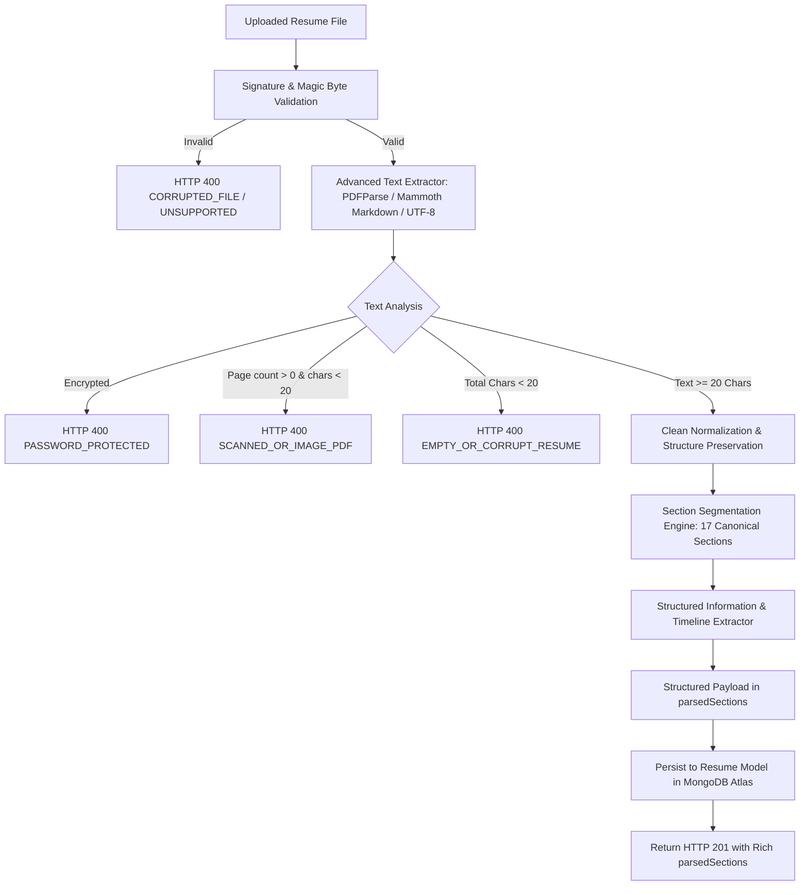

# PrepForge AI — Phase 2 Pre-Implementation Audit Report
## Advanced Resume Parsing & Section Segmentation Engine

**Document Version:** 1.0.0  
**Phase:** Phase 2 Pre-Implementation Codebase Audit (Step 1)  
**Date:** 2026-10-27  
**Status:** Complete & Approved for Implementation  
**Target Codebase:** PrepForge AI Backend (`server/`) & Shared Specifications (`docs/`)  

---

## 1. Executive Summary

In accordance with Phase 2 specifications of the PrepForge AI project, an exhaustive, read-only audit of the existing resume ingestion, text extraction, data modeling, and API routing architecture was conducted prior to writing implementation code.

The existing PrepForge AI codebase contains a functioning base infrastructure for resume upload, disk storage, and plain text extraction. However, text extraction is currently monolithic: it dumps the entire document as a single unstructured text stream (`rawText` / `extractedText`) without section segmentation, structured entity recognition, or timeline analysis.

The `Resume` Mongoose model (`server/src/models/Resume.js`) already possesses a dedicated `parsedSections: { type: Schema.Types.Mixed, default: {} }` attribute, which was intentionally designed for structured parsing results. Populating this field with our section segmentation and structured extraction pipeline is 100% additive, backward-compatible, and requires zero destructive database alterations or duplicate models.

---

## 2. Audit of Existing Parsing Architecture

### 2.1 File Ingestion & Storage Pipeline
* **Upload Controller:** `server/src/controllers/resumeController.js` (`uploadResume`).
* **Upload Middleware:** `server/src/middleware/uploadMiddleware.js` (`handleResumeUpload`).
  - Storage: Disk storage in `server/uploads/resumes/`.
  - Max File Size: 5MB (`5 * 1024 * 1024` bytes).
  - Allowed Extensions: `.pdf`, `.docx`, `.txt`.
  - Allowed MIME Types: `application/pdf`, `application/vnd.openxmlformats-officedocument.wordprocessingml.document`, `application/msword`, `text/plain`, `application/octet-stream`.
  - Unique Stored Name: `resume-${crypto.randomUUID()}-${Date.now()}${ext}`.
  - Safe Unlink: Automatically purges temporary disk files upon processing or extraction errors.

### 2.2 Existing Text Extraction (`server/src/utils/textExtractor.js`)
* **File Signature Verification (`validateFileSignature`):**
  - PDF: Magic bytes `%PDF-` (`0x25 0x50 0x44 0x46`).
  - DOCX: Magic bytes `PK\x03\x04` (`0x50 0x4B 0x03 0x04`).
  - TXT: UTF-8 buffer check.
* **Extraction Libraries:**
  - PDF: `pdf-parse` (`^2.4.5`), using `new PDFParse({ data: fileBuffer }).getText()`.
  - DOCX: `mammoth` (`^1.13.0`), using `mammoth.extractRawText({ path: filePath })`.
  - TXT: `fileBuffer.toString('utf-8')`.
* **Sanitization:**
  - Converts `\r\n` and `\r` to `\n`.
  - Strips non-printable ASCII control characters `[\x00-\x08\x0B\x0C\x0E-\x1F\x7F]`.
  - Checks minimum text threshold: $\ge 20$ characters.

### 2.3 Identified Deficiencies & Architectural Gaps
1. **No Section Segmentation:** The existing engine returns a flat string. It does not identify where Contact info ends, where Experience begins, or where Skills/Education reside.
2. **No Structured Entity Extraction:** Candidate contact channels (email, phone, location, LinkedIn/GitHub links), education degrees, companies, roles, and bullet points are not parsed into queryable objects.
3. **No Timeline or Date Extraction:** Dates are not standardized (`MM/YYYY`, `Month YYYY`, `YYYY`, `DD/MM/YYYY`), and chronological order is unverified.
4. **Coarse Error Categorization:** Does not systematically distinguish between:
   - Password-protected / encrypted PDFs (`PASSWORD_PROTECTED`)
   - Scanned or raster image-only PDFs (`SCANNED_OR_IMAGE_PDF`)
   - Corrupted or damaged files (`CORRUPTED_FILE`)
   - Critical parsing failures (`CRITICAL_PARSING_FAILURE`)
5. **DOCX Structure Flattening:** `mammoth.extractRawText` strips list indentation and bullet formatting; `mammoth.convertToMarkdown` should be leveraged to preserve bullet points and headings.

---

## 3. Database Schema Compatibility Audit

### 3.1 `Resume` Schema (`server/src/models/Resume.js`)
The existing schema fields are:
```javascript
{
  userId: { type: mongoose.Schema.Types.ObjectId, ref: 'User', required: true },
  originalFileName: { type: String, required: true },
  storedFileName: { type: String, required: true },
  fileFormat: { type: String, enum: ['pdf', 'docx', 'txt'], required: true },
  fileType: { type: String }, // Synchronized with fileFormat
  fileSize: { type: Number, required: true, max: 5242880 },
  rawText: { type: String, required: true, minlength: 20 },
  extractedText: { type: String }, // Synchronized with rawText
  parsedSections: { type: mongoose.Schema.Types.Mixed, default: {} },
  uploadedAt: { type: Date, default: Date.now }
}
```
* **Findings:** `parsedSections` is already `Schema.Types.Mixed` with default `{}`. Populating it with section metadata, structured entities, and confidence scores conforms completely to existing validation rules and indexes.

### 3.2 `ResumeAnalysis` Schema (`server/src/models/ResumeAnalysis.js`)
* References `resumeId` and `userId`.
* Uses `analysisResults` (`Schema.Types.Mixed`) and standard rubric categories.
* Does not conflict with `Resume.parsedSections`. In Phase 3, the 27-check engine will consume `Resume.parsedSections` as deterministic inputs.

---

## 4. API Contract Preservation

### 4.1 Endpoints Inspected
1. `POST /api/v1/resumes`: Uploads and parses file. Response shape:
   ```json
   {
     "success": true,
     "message": "Resume uploaded and processed successfully.",
     "resume": {
       "id": "...",
       "_id": "...",
       "userId": "...",
       "originalFileName": "...",
       "fileType": "pdf",
       "fileFormat": "pdf",
       "fileSize": 12345,
       "extractedText": "...",
       "rawText": "...",
       "parsedSections": { ... },
       "uploadedAt": "..."
     }
   }
   ```
2. `GET /api/v1/resumes`: Paginated list of user resumes. Includes `textPreview` and `parsedSections`.
3. `GET /api/v1/resumes/:id`: Fetches detailed resume document.
4. `DELETE /api/v1/resumes/:id`: Unlinks file from disk and deletes document from MongoDB.

### 4.2 Backward Compatibility Guarantee
All existing fields (`extractedText`, `rawText`, `fileType`, `fileFormat`, `fileSize`, `originalFileName`) remain intact and unchanged. The enhancement directly populates `parsedSections` with structured output, enriching API responses without breaking any existing frontend or test assumptions.

---

## 5. Detailed Phase 2 Implementation Plan



### 5.1 Step 2: Advanced Document Parsing (`server/src/utils/textExtractor.js`)
* Enhance PDF extraction:
  - Detect `PasswordException` or encryption headers $\to$ throw `PASSWORD_PROTECTED` (HTTP 400).
  - Inspect page count vs extracted character count: if total pages $\ge 1$ but extractable text is $< 20$ chars, throw `SCANNED_OR_IMAGE_PDF` (HTTP 400).
  - Strip artifact strings (e.g. `-- 1 of 1 --\n\n`) cleanly while preserving section header linebreaks.
* Enhance DOCX extraction:
  - Use `mammoth.convertToMarkdown({ path: filePath })` or combined markdown/text parsing to preserve bullet markers (`*`, `-`) and heading hierarchy.
* Enhance TXT extraction:
  - Normalize linebreaks and strip control characters while preserving list symbols.

### 5.2 Step 3: Resume Section Segmentation Engine (`server/src/services/sectionSegmenter.js`)
Implement deterministic section segmentation recognizing 17 canonical sections with exhaustive synonym mappings:
1. `contact`: Contact Information / Personal Details / Header
2. `summary`: Professional Summary / Executive Summary / Summary / Profile / About Me
3. `objective`: Career Objective / Objective / Professional Goal
4. `experience`: Work Experience / Professional Experience / Experience / Work History
5. `employment`: Employment History / Past Employment / Career History
6. `education`: Education / Academic Background / Academic History / Qualifications
7. `technicalSkills`: Technical Skills / Technical Competencies / Core Technologies / Dev Stack
8. `softSkills`: Soft Skills / Interpersonal Skills / Core Strengths
9. `projects`: Projects / Technical Projects / Key Projects / Personal Projects
10. `certifications`: Certifications / Licenses / Professional Certifications / Accreditations
11. `achievements`: Achievements / Key Accomplishments / Accomplishments
12. `awards`: Awards / Honors / Recognition
13. `publications`: Publications / Research Papers / Articles / Whitepapers
14. `languages`: Languages / Language Proficiency / Multilingual Skills
15. `volunteer`: Volunteer Experience / Community Involvement / Volunteering
16. `leadership`: Leadership / Leadership Experience / Extracurricular Leadership
17. `interests`: Interests / Hobbies / Extracurricular Activities

* **Segmentation Logic:**
  - Multi-line regex matching section headings anchored at line starts with optional styling (all caps, title case, colons, underlines).
  - Position tracking: determines start/end offsets of each section block.
  - Confidence scoring: Computes overall segmentation confidence score ($0.0 - 1.0$) based on heading matches and content length.
  - Fallback mechanism: If no standard headings are found, content is safely captured in an unstructured section rather than dropping text.

### 5.3 Step 4: Structured Information Extraction (`server/src/services/structuredExtractor.js`)
Extract structured entities deterministically from segmented sections:
* **Contact Details (`contact`):**
  - Candidate Full Name (heuristics from top line / header block)
  - Email: RFC-compliant regex
  - Phone: International formats, E.164, US standard `(xxx) xxx-xxxx`, `+1-xxx-xxx-xxxx`, `+91-xxxx-xxxxxx`
  - Location: City, State/Province, Country, ZIP/Postal code
  - Professional Links: LinkedIn URL (`linkedin.com/in/...`), GitHub URL (`github.com/...`), Portfolio / personal website URLs
* **Education Items (`education`):**
  - Degree (B.S., M.S., Ph.D., Bachelor of Science, Master of Arts, B.Tech, etc.)
  - Institution / University name
  - Field of Study / Major
  - Dates (Graduation year, date range)
  - GPA / Honors (if mentioned)
* **Work Experience Items (`experience` / `employment`):**
  - Company / Organization name
  - Job Title / Role
  - Start Date & End Date (or "Present" / "Current")
  - Location
  - Array of bullet points with action verbs preserved
* **Projects Items (`projects`):**
  - Project Title
  - Description / Scope
  - Technologies / Tools detected
  - Link / Repository
* **Skills Inventory (`skills`):**
  - Categorized Technical Skills (Languages, Frameworks, Databases, Cloud/DevOps, Tools)
  - Soft Skills list
* **Certifications Items (`certifications`):**
  - Certification name
  - Issuing authority / organization
  - Issue / Expiration date

### 5.4 Step 5: Date and Timeline Extraction
* Standardize date tokens:
  - `MM/YYYY`, `Month YYYY`, `YYYY`, `DD/MM/YYYY`, `Mon YYYY`
  - "Present", "Current", "Ongoing", "Now" $\to$ parsed as `isCurrent: true`.
* Chronological validation:
  - Sort roles in reverse-chronological order.
  - Detect career gaps ($> 6$ months) without imposing scoring deductions or bias penalties (adhering to Phase 1.1 / 1.2 rules).

### 5.5 Step 6: Pipeline Integration & Error Handling
* Wire `sectionSegmenter` and `structuredExtractor` into `server/src/controllers/resumeController.js`.
* Update `Resume.create` to store the generated structured object in `parsedSections`.
* Ensure error handling produces clear, standardized JSON error envelopes without exposing stack traces or internals.

### 5.6 Step 7: Automated Testing Strategy
* Create isolated unit tests in `server/tests/unit/`:
  - `sectionSegmenter.test.js`: Validates all 17 section headings, synonym variations, order tracking, and confidence scoring.
  - `structuredExtractor.test.js`: Validates contact, education, experience, skills, certifications, and date parsing.
  - `advancedParser.test.js`: Validates PDF, DOCX, TXT edge cases (corrupted bytes, short text, image-only scans, password exceptions).
* Run the existing regression suite (`server/tests/resume.test.js`) to confirm 100% backward compatibility.

---

## 6. Audit Sign-Off

The pre-implementation audit confirms that the planned Phase 2 implementation preserves all existing functionality, avoids duplicate models, strictly respects backward compatibility, and adheres to all documented specifications. Step 1 is complete.
