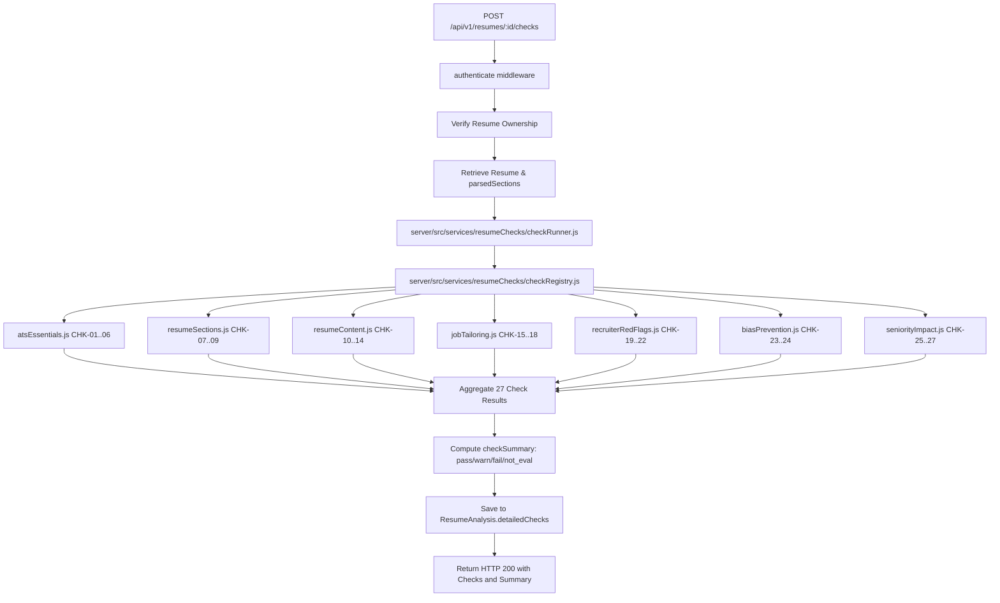

# PrepForge AI — Phase 3 Pre-Implementation Audit Report
## 27-Point Advanced Resume Checking Engine

**Document Version:** 1.0.0  
**Phase:** Phase 3 Pre-Implementation Codebase Audit & Architectural Plan (Step 1)  
**Date:** 2026-10-27  
**Status:** Audit Complete — Awaiting Authorization  
**Author:** Antigravity Principal Systems Architect & ATS Research Lead  
**Target Codebase:** PrepForge AI Backend (`server/`) & Shared Specifications (`docs/`)  

---

## 1. Executive Summary & Objective

In accordance with Step 1 of Phase 3, a comprehensive, read-only architectural audit of the PrepForge AI codebase, existing database models, routing tables, and specification documents was completed prior to modifying any application code.

The objective of Phase 3 is to construct an extensible, production-quality **27-Point Resume Checking Engine** that builds seamlessly on top of the completed Phase 2 Parsing & Section Segmentation Engine. 

### Core Architectural Principle
* **Phase 2 Pipeline Reuse:** The 27-check engine strictly consumes the structured output generated in Phase 2 (`resume.parsedSections.structured`, `resume.parsedSections.rawSections`, `resume.parsedSections.detectedSections`, `resume.parsedSections.documentMetadata`, `resume.extractedText`).
* **Deterministic First:** 23 of the 27 checks execute completely deterministically via specialized regular expressions, token analyzers, and taxonomies in $< 50\text{ms}$ without invoking external LLMs.
* **Strict Phase Boundaries:** Phase 3 produces detailed check results (`PASS`, `WARNING`, `FAIL`, `NOT_EVALUATED`), granular evidence, and actionable remediation text. The mathematical scoring formulas (Overall, ATS, Content, Structure, Job Match) belong strictly to Phase 4; dashboard UI belongs strictly to Phase 6.

---

## 2. Specification Review & Consistency Audit

The following foundational specifications were reviewed and cross-referenced:
* `docs/PRD.md`: Confirms the 27-check taxonomy across 7 categories and transparent recruiter/ATS scoring goals.
* `docs/TRD.md`: Specifies hybrid deterministic/LLM architecture and modular directory layout under `server/src/services/resumeChecks/`.
* `docs/SRS.md`: Establishes functional requirements `FR-CHK-01` through `FR-CHK-27`, input validation, and auditability.
* `docs/RESUME_CHECKS_SPECIFICATION.md`: The canonical source of truth for detection rules, severity levels, recommendations, edge cases, and unit test criteria for all 27 checks.
* `docs/AI_ANALYSIS_SPECIFICATION.md`: Defines strict anti-hallucination guardrails, bracketed metric templates (`[X]%`, `[Y] users`), and multi-model fallback pool (`gemini-3.7-flash` $\to$ `gemini-3.5-flash-lite` $\to$ `gemini-3.1-flash-lite`).
* `docs/DATABASE_SCHEMA.md`: Documents additive fields for `ResumeAnalysis` (`detailedChecks`, `checkSummary`, `checkVersion`, `evaluatedAt`).
* `docs/API_DOCUMENTATION.md`: Outlines API endpoints `POST /api/v1/resumes/:id/checks`, `GET /api/v1/resumes/:id/checks`, `GET /api/v1/resumes/:id/checks/:checkId`, and `POST /api/v1/resumes/:id/recheck`.
* `docs/IMPLEMENTATION_ROADMAP.md`: Affirms Phase 3 deliverables and acceptance criteria.
* Prior Phase Reports: `PHASE_0`, `PHASE_1_1`, `PHASE_1_2`, `PHASE_2`, and `PHASE_2_1` reports confirming zero regressions, 100% test pass rate, and verified backward compatibility.

---

## 3. Existing Codebase Audit & Reusability Matrix

### 3.1 Existing Data Storage & Retrieval
* **`Resume` Model (`server/src/models/Resume.js`):**
  - Contains `rawText`, `extractedText`, `fileFormat`, `fileSize`, `originalFileName`.
  - Populated with `parsedSections` Mixed object containing:
    - `rawSections`: Sliced text for 17 sections.
    - `detectedSections`: Array of matched section headings with line indices and character counts.
    - `sectionOrder`: Sequential array of section keys.
    - `missingCoreSections`: Core section detection status (`contact`, `experience`, `education`, `technicalSkills`).
    - `confidence`: Parser confidence score ($0.0 - 1.0$).
    - `structured`: Typed entities (`contact`, `education`, `experience`, `projects`, `skills`, `certifications`, `timeline`).
    - `documentMetadata`: Page counts, format, character/word counts.
* **`ResumeAnalysis` Model (`server/src/models/ResumeAnalysis.js`):**
  - Currently stores overall ATS analysis, `overallScore`, `categoryScores`, `summaryFeedback`, `bulletImprovements`, `strengths`, `weaknesses`, `identifiedSkills`, and `analysisResults` (Mixed).
  - Can be extended additively with `detailedChecks` subdocuments and `checkSummary` without modifying existing indexes or breaking legacy queries.

### 3.2 Reusable Modules & Functions
```
+----------------------------------------------------------------------------------------------------+
| REUSABLE MODULE                       | EXPORTED CAPABILITIES REUSED BY PHASE 3                    |
|---------------------------------------|------------------------------------------------------------|
| server/src/services/sectionSegmenter  | CANONICAL_SECTIONS, CORE_SECTIONS, matchSectionHeading,    |
|                                       | segmentResumeSections                                      |
|---------------------------------------|------------------------------------------------------------|
| server/src/services/structuredExtract | extractContactInfo, extractEducation, extractExperience,  |
|                                       | extractProjects, extractSkills, extractCertifications,    |
|                                       | analyzeTimeline, parseDateToken, extractDateRange          |
|---------------------------------------|------------------------------------------------------------|
| server/src/utils/textExtractor        | validateFileSignature, normalizeExtractedText,             |
|                                       | extractResumeWithMetadata                                  |
|---------------------------------------|------------------------------------------------------------|
| server/src/middleware/authMiddleware  | authenticate (JWT cookie / Bearer token validation)        |
|---------------------------------------|------------------------------------------------------------|
| server/src/middleware/rateLimit       | aiLimiter (for heavy LLM operations), generalLimiter       |
|---------------------------------------|------------------------------------------------------------|
| server/src/services/geminiService     | analyzeResumeWithGemini, multi-model fallback pool         |
+----------------------------------------------------------------------------------------------------+
```

### 3.3 Conflict & Compatibility Analysis
1. **Existing Analysis Endpoint (`POST /api/v1/resumes/:id/analyze`):**
   - Calls Gemini directly to generate legacy composite scores and bullet improvements.
   - **Resolution:** The new check engine will be accessible via dedicated endpoints (`POST /api/v1/resumes/:id/checks` and `GET /api/v1/resumes/:id/checks`). The legacy endpoint remains untouched and fully backward-compatible.
2. **Analysis Persistence:**
   - Both legacy and Phase 3 checks can save to `ResumeAnalysis`. When checks are executed, `detailedChecks` and `checkSummary` are saved onto the analysis document, preserving all existing fields.

---

## 4. The 27-Check Architecture & Execution Matrix

```
+----------------------------------------------------------------------------------------------------+
|                                  27-CHECK ARCHITECTURAL BREAKDOWN                                  |
+----------------------------------------------------------------------------------------------------+
| ID     | CHECK TITLE                 | CATEGORY                | ENGINE        | DEFAULT SOURCE    |
|--------|-----------------------------|-------------------------|---------------|-------------------|
| CHK-01 | File Format Validation      | CAT-01: ATS Essentials  | Deterministic | Phase 2 Metadata  |
| CHK-02 | ATS-Friendly Layout         | CAT-01: ATS Essentials  | Deterministic | Stream Continuity |
| CHK-03 | Professional Email          | CAT-01: ATS Essentials  | Deterministic | RFC & Cliché Dict |
| CHK-04 | Header Professional Links   | CAT-01: ATS Essentials  | Deterministic | URL Taxonomy      |
| CHK-05 | File Naming Convention      | CAT-01: ATS Essentials  | Deterministic | Token Matcher     |
| CHK-06 | Dates & Links Consistency   | CAT-01: ATS Essentials  | Deterministic | Format Inspector  |
|--------|-----------------------------|-------------------------|---------------|-------------------|
| CHK-07 | Essential Sections Presence | CAT-02: Resume Sections | Deterministic | Section Segmenter |
| CHK-08 | Contact Completeness        | CAT-02: Resume Sections | Deterministic | Contact Extractor |
| CHK-09 | Section Structural Order    | CAT-02: Resume Sections | Deterministic | Sequence Checker  |
|--------|-----------------------------|-------------------------|---------------|-------------------|
| CHK-10 | ATS Parse Rate              | CAT-03: Resume Content  | Deterministic | Ratio Calculator  |
| CHK-11 | Quantified Achievements     | CAT-03: Resume Content  | Deterministic | Metric Pattern Reg |
| CHK-12 | Repeated Words & Buzzwords  | CAT-03: Resume Content  | Deterministic | Buzzword Dict     |
| CHK-13 | Spelling, Grammar & Casing  | CAT-03: Resume Content  | Deterministic | Tech Casing Dict  |
| CHK-14 | Bullet Length & Readability | CAT-03: Resume Content  | Deterministic | Word Count Stat   |
|--------|-----------------------------|-------------------------|---------------|-------------------|
| CHK-15 | Hard Technical Skills Match | CAT-04: Job Tailoring   | Conditional   | JD Keyword Overlap |
| CHK-16 | Soft Skills Context Match   | CAT-04: Job Tailoring   | Conditional   | JD Behavioral Over |
| CHK-17 | High-Impact Action Verbs    | CAT-04: Job Tailoring   | Conditional   | Action Verb Dict   |
| CHK-18 | Target Title Alignment      | CAT-04: Job Tailoring   | Conditional   | Title Hierarchy    |
|--------|-----------------------------|-------------------------|---------------|-------------------|
| CHK-19 | Timeline Credibility        | CAT-05: Red Flags       | Deterministic | Date Arithmetic    |
| CHK-20 | Interview Risk Signals      | CAT-05: Red Flags       | Deterministic | Collective Attrib  |
| CHK-21 | Peer Experience Benchmark   | CAT-05: Red Flags       | Deterministic | Tier Requirements  |
| CHK-22 | Professional Coherence      | CAT-05: Red Flags       | Deterministic | Duration Checker   |
|--------|-----------------------------|-------------------------|---------------|-------------------|
| CHK-23 | Age & Date Bias Mitigation  | CAT-06: Bias Prevention | Deterministic | Graduation > 15 Yrs|
| CHK-24 | Employment Gap Analysis     | CAT-06: Bias Prevention | Deterministic | Gaps > 6 Months    |
|--------|-----------------------------|-------------------------|---------------|-------------------|
| CHK-25 | Career Progression          | CAT-07: Seniority/Impact| Deterministic | Title Trajectory   |
| CHK-26 | Skills Substantiation       | CAT-07: Seniority/Impact| Deterministic | Bullet Co-occur    |
| CHK-27 | Ownership & Leadership      | CAT-07: Seniority/Impact| Deterministic | Leadership Markers |
+----------------------------------------------------------------------------------------------------+
```

### 4.1 Strict Ethical Guardrails
* **Zero Score Penalties for Category 6 (CHK-23 & CHK-24):** Employment gaps $>6$ months and graduation dates $>15$ years ago must strictly carry zero numerical penalty ($w_{\text{Cat 6}} \equiv 0$). They are classified as `severity: "info"` with constructive career framing advice.
* **Job Tailoring Conditionality (CHK-15 to CHK-18):** When no target job description is provided, all four checks strictly return `status: "NOT_EVALUATED"` with `explanation: "No job description was provided to evaluate job tailoring alignment."`.
* **Peer Benchmarking Neutrality (CHK-21):** Evaluates bullet depth against standard career tier minimums without fabricating proprietary industry percentages or percentiles. If tier is unspecified or unavailable, returns `NOT_EVALUATED`.
* **Zero Fabrication Mandate:** Evidence arrays contain strictly verbatim text snippets or extracted tokens from candidate input.

---

## 5. Check Result Data Structure Specification

Every check produces an immutable, validated JSON result conforming to:

```typescript
interface CheckResult {
  checkId: string;            // 'CHK-01' through 'CHK-27'
  categoryId: string;         // 'CAT-01' through 'CAT-07'
  categoryName: string;       // e.g. 'ATS Essentials'
  title: string;              // Human-readable title
  status: 'PASS' | 'WARNING' | 'FAIL' | 'NOT_EVALUATED';
  severity: 'critical' | 'high' | 'medium' | 'low' | 'info';
  description: string;        // Purpose of the check
  evidence: Array<any>;       // Extracted items, line quotes, numbers
  explanation: string;        // Analysis based on candidate data
  recommendation: string;     // Actionable coaching remediation
  confidence: number;         // 0.0 to 1.0
  limitations: Array<string>; // Stated scope constraints
  source: 'deterministic' | 'hybrid' | 'semantic';
  ruleVersion: string;        // '1.0'
  evaluatedAt: string;        // ISO 8601 timestamp
}
```

---

## 6. Detailed Implementation & File Strategy



### 6.1 Files to Create
1. **Engine Core:**
   - `server/src/services/resumeChecks/index.js` — Master export and facade.
   - `server/src/services/resumeChecks/checkRegistry.js` — Registry mapping all 27 checks, validating uniqueness and category associations.
   - `server/src/services/resumeChecks/checkRunner.js` — Orchestrator that accepts resume data, invokes each registered check within safe `try/catch` boundaries, computes summary counts, and returns formatted results.
2. **Category Modules:**
   - `server/src/services/resumeChecks/categories/atsEssentials.js` — CHK-01 through CHK-06.
   - `server/src/services/resumeChecks/categories/resumeSections.js` — CHK-07 through CHK-09.
   - `server/src/services/resumeChecks/categories/resumeContent.js` — CHK-10 through CHK-14.
   - `server/src/services/resumeChecks/categories/jobTailoring.js` — CHK-15 through CHK-18.
   - `server/src/services/resumeChecks/categories/recruiterRedFlags.js` — CHK-19 through CHK-22.
   - `server/src/services/resumeChecks/categories/biasPrevention.js` — CHK-23 and CHK-24.
   - `server/src/services/resumeChecks/categories/seniorityImpact.js` — CHK-25 through CHK-27.
3. **Taxonomies & Utilities:**
   - `server/src/services/resumeChecks/utils/clicheDictionary.js` — Corporate jargon, clichés, overused resume phrases.
   - `server/src/services/resumeChecks/utils/verbTaxonomy.js` — Strong action verbs vs passive phrases.
   - `server/src/services/resumeChecks/utils/spellingDictionary.js` — Common technical casing taxonomy and typo dictionary.
   - `server/src/services/resumeChecks/utils/resultFormatter.js` — Helper to format standardized result objects.
4. **Controllers & Validators:**
   - `server/src/controllers/resumeCheckController.js` — Controller for `/resumes/:id/checks` endpoints.
   - `server/src/validators/resumeCheckValidators.js` — Zod validators for check requests.
5. **Test Suites:**
   - `server/tests/unit/checkRegistry.test.js` — Verifies exactly 27 checks, no duplicates, valid categories, valid result structure.
   - `server/tests/unit/resumeChecks.test.js` — Comprehensive unit tests across all 27 checks with pass/warning/fail cases.
   - `server/tests/unit/jobTailoringChecks.test.js` — Tests CHK-15 to CHK-18 with/without job descriptions.
   - `server/tests/unit/biasPreventionChecks.test.js` — Tests CHK-23 and CHK-24 non-penalizing advisory behavior.
   - `server/tests/integration/resumeCheckEndpoints.test.js` — API integration tests for check execution, retrieval, filtering, and IDOR protection.

### 6.2 Files to Modify
1. **`server/src/models/ResumeAnalysis.js`:**
   - Add additive schemas: `detailedCheckResultSchema` and `checkSummarySchema`.
   - Add optional fields: `detailedChecks`, `checkSummary`, `checkVersion`, `evaluatedAt`.
2. **`server/src/routes/resumeRoutes.js`:**
   - Mount endpoints:
     - `POST /:id/checks` $\to$ `runResumeChecks`
     - `GET /:id/checks` $\to$ `getResumeChecks`
     - `GET /:id/checks/:checkId` $\to$ `getSingleCheckDetail`
     - `POST /:id/recheck` $\to$ `recheckResume`

---

## 7. Proposed API Endpoints

### 7.1 `POST /api/v1/resumes/:id/checks`
* **Purpose:** Runs the 27-point check engine on an existing owned resume.
* **Headers:** `Authorization: Bearer <token>` or `Cookie: prepforge_jwt=...`
* **Request Body (Optional):**
  ```json
  {
    "jobDescription": "Looking for Senior React/Node.js engineer with AWS...",
    "targetRole": "Senior Full Stack Engineer",
    "careerLevel": "senior"
  }
  ```
* **Success Response (`200 OK`):**
  ```json
  {
    "success": true,
    "message": "Resume evaluated across all 27 checks successfully.",
    "data": {
      "resumeId": "6708304f5e709c0012ab2222",
      "checkSummary": {
        "totalChecks": 27,
        "passedCount": 21,
        "warningCount": 4,
        "failedCount": 2,
        "notEvaluatedCount": 0
      },
      "checks": [ ... 27 CheckResult objects ... ],
      "evaluatedAt": "2026-10-27T11:00:00.000Z",
      "engineVersion": "1.0.0"
    }
  }
  ```

### 7.2 `GET /api/v1/resumes/:id/checks`
* **Purpose:** Retrieves the cached 27 check results for an owned resume.
* **Query Parameters (Optional):**
  - `status`: `PASS | WARNING | FAIL | NOT_EVALUATED`
  - `category`: `CAT-01 | CAT-02 | ...`
* **Success Response (`200 OK`):** Returns filtered check list and `checkSummary`.

### 7.3 `GET /api/v1/resumes/:id/checks/:checkId`
* **Purpose:** Retrieves diagnostic detail, failing lines, and templates for a specific check.
* **Success Response (`200 OK`):** Returns single `CheckResult`.

---

## 8. Potential Risks & Mitigation Strategies

1. **ReDoS Vulnerability in Text & Bullet Checks:**
   - *Risk:* Complex regular expressions on large resume text causing catastrophic backtracking.
   - *Mitigation:* All patterns use atomic groupings or bounded character sets without nested quantifiers. Text inputs capped at 50,000 characters.
2. **Check Isolation & Fault Tolerance:**
   - *Risk:* One check encountering unusual text crashes the entire analysis run.
   - *Mitigation:* `checkRunner.js` wraps each check execution in an independent `try/catch` block. If an unexpected error occurs in a single check, it returns `status: "WARNING"` with an error explanation, ensuring the other 26 checks finish uninterrupted.
3. **LLM Cost & Latency Control:**
   - *Risk:* Routine checks causing excessive Gemini API requests.
   - *Mitigation:* 23 checks are 100% deterministic. Job tailoring checks run deterministically on keyword overlap, with optional Gemini semantic enrichment only when requested.
4. **Data Isolation & IDOR Protection:**
   - *Risk:* Users accessing check results of resumes they do not own.
   - *Mitigation:* Every endpoint verifies resume ownership via `Resume.findOne({ _id: id, userId: req.userId })`.

---

## 9. Audit Sign-off & Stop Condition

The pre-implementation audit confirms that the planned architecture conforms strictly to all specification documents, reuses existing Phase 2 parsed data additively, preserves all existing models, and respects phase boundaries.

**Antigravity is STOPPED at this point.** No application code has been modified. Awaiting user authorization before beginning implementation.
