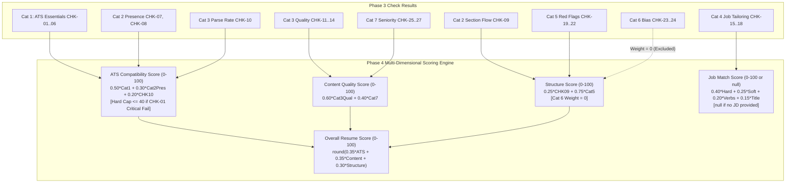

# PrepForge AI — Phase 4 Pre-Implementation Audit Report (Corrected)
## Multi-Dimensional Scoring Engine & Composite Metrics

**Document Version:** 1.1.0  
**Phase:** Phase 4 Pre-Implementation Codebase Audit & Architectural Plan (Step 1 — Corrected)  
**Date:** 2026-10-27  
**Status:** Audit Complete & Corrected — Awaiting Implementation Authorization  
**Author:** Antigravity Principal Systems Architect & ATS Research Lead  
**Target Codebase:** PrepForge AI Backend (`server/`) & Shared Specifications (`docs/`)  

---

## 1. Executive Summary & Objective

In accordance with Phase 4 directives and the pre-implementation audit review, this document presents the synchronized, mathematically validated architectural specification for the **Multi-Dimensional Scoring Engine**.

### Phase 4 Objective
Design and implement a deterministic, transparent, and mathematically rigorous **Multi-Dimensional Scoring Engine** that consumes the 27 check results generated by the Phase 3 checking engine.

The scoring engine calculates five independent scoring outputs:
1. **ATS Compatibility Score ($0 - 100$)**
2. **Resume Content Quality Score ($0 - 100$)**
3. **Resume Structure Score ($0 - 100$)**
4. **Overall Resume Score ($0 - 100$)**
5. **Conditional Job Match Score ($0 - 100$ or `null`)**

### Core Architectural Principles & Invariants
* **Phase 3 Check Results as Source of Truth:** The scoring engine strictly consumes `detailedChecks` produced by Phase 3. It never re-parses text or re-evaluates checks independently, avoiding duplicate computation and race conditions.
* **Zero Double Penalties:** Component weights are strictly orthogonal. For example, section ordering (`CHK-09`) feeds exclusively into Structure Score, while section presence (`CHK-07`, `CHK-08`) feeds into ATS Score.
* **Strict Non-Penalizing Bias Guardrails:** Category 6 checks (`CHK-23`, `CHK-24`) carry exactly zero scoring weight ($w_{\text{Cat 6}} \equiv 0$). Employment gaps and graduation dates never reduce numerical scores.
* **Strict Conditional Job Tailoring:** If no valid job description is supplied, Job Match Score is strictly `null` (displayed as `N/A`). It is never treated as zero.
* **No Fabricated Confidence:** `scoreConfidence` defaults to `null` and represents actual evaluation coverage and evidence quality; it is never assigned an arbitrary 1.0 default.
* **Strict Phase Boundaries:** Phase 4 computes mathematical scores and persists them additively. Phase 5 handles AI deep rewrites; Phase 6 handles UI dashboards.

---

## 2. Specification Review & Consistency Audit

The following foundational specifications and preceding phase reports were reviewed and cross-referenced:

| Specification Document | Key Scoring Requirements & Guardrails Cross-Referenced |
| :--- | :--- |
| [`docs/PRD.md`](file:///c:/Users/Abhishek%20Pal/OneDrive/Desktop/AI%20Interview%20Preparation%20Platform/docs/PRD.md) | Section 9 defines the 5 discrete scores; confirms $w_{\text{Cat 6}} \equiv 0$; mandates transparent, explainable formulas without black-box AI scores. |
| [`docs/TRD.md`](file:///c:/Users/Abhishek%20Pal/OneDrive/Desktop/AI%20Interview%20Preparation%20Platform/docs/TRD.md) | Section 8.1 details the mathematical formulas, ATS hard-cap policy ($\le 40$ only on CHK-01 critical parsing failure), and orthogonal weighting. |
| [`docs/SRS.md`](file:///c:/Users/Abhishek%20Pal/OneDrive/Desktop/AI%20Interview%20Preparation%20Platform/docs/SRS.md) | Requirement `FR-PLAT-03` establishes acceptance criteria for the multi-factor calculation engine and envelope schemas. |
| [`docs/RESUME_CHECKS_SPECIFICATION.md`](file:///c:/Users/Abhishek%20Pal/OneDrive/Desktop/AI%20Interview%20Preparation%20Platform/docs/RESUME_CHECKS_SPECIFICATION.md) | Section 1.1 defines the five-dimensional scoring taxonomy and detailed scoring roles for all 27 checks. |
| [`docs/AI_ANALYSIS_SPECIFICATION.md`](file:///c:/Users/Abhishek%20Pal/OneDrive/Desktop/AI%20Interview%20Preparation%20Platform/docs/AI_ANALYSIS_SPECIFICATION.md) | Establishes anti-hallucination guardrails and decoupling between deterministic check scoring and LLM suggestions. |
| [`docs/DATABASE_SCHEMA.md`](file:///c:/Users/Abhishek%20Pal/OneDrive/Desktop/AI%20Interview%20Preparation%20Platform/docs/DATABASE_SCHEMA.md) | Sections 5.2 and 5.5 specify `subScores` (`atsScore`, `contentScore`, `structureScore`, `jobMatchScore`) and `scoringVersion`. |
| [`docs/API_DOCUMENTATION.md`](file:///c:/Users/Abhishek%20Pal/OneDrive/Desktop/AI%20Interview%20Preparation%20Platform/docs/API_DOCUMENTATION.md) | Section 3.1 outlines response schemas containing `overallScore` and `subScores`. |
| [`docs/IMPLEMENTATION_ROADMAP.md`](file:///c:/Users/Abhishek%20Pal/OneDrive/Desktop/AI%20Interview%20Preparation%20Platform/docs/IMPLEMENTATION_ROADMAP.md) | Affirms Phase 4 deliverables: `server/src/services/scoringEngine.js`, test suites, and boundary conditions. |
| Prior Phase Reports | `PHASE_1_2`, `PHASE_2_1`, `PHASE_3`, and `PHASE_3_1` reports confirming zero regressions, 100% test pass rate across 95 tests, and verified sub-5ms performance. |

---

## 3. Existing Codebase Audit & Reusability Matrix

### 3.1 Inspection of Key Modules

```
+----------------------------------------------------------------------------------------------------+
| MODULE FILE                             | CURRENT STATE & REUSABILITY FOR PHASE 4                  |
+----------------------------------------------------------------------------------------------------+
| server/src/models/ResumeAnalysis.js     | Contains detailedChecks, checkSummary, overallScore.     |
|                                         | Requires additive subScores and scoringBreakdown fields. |
+----------------------------------------------------------------------------------------------------+
| server/src/services/resumeChecks/       | checkRegistry.js: Provides metadata for all 27 checks.   |
| checkRegistry.js & checkRunner.js       | checkRunner.js: Produces standard CheckResult objects.    |
|                                         | Can invoke scoring engine directly upon check completion.|
+----------------------------------------------------------------------------------------------------+
| server/src/services/resumeChecks/       | Categories CAT-01 through CAT-07 return standardized     |
| categories/*.js                         | CheckResult payloads with status, severity, and evidence.|
|                                         | Statuses: PASS, WARNING, FAIL, NOT_EVALUATED.            |
+----------------------------------------------------------------------------------------------------+
| server/src/controllers/                 | runResumeChecks: Evaluates checks and saves analysis.    |
| resumeCheckController.js                | Ready to incorporate subScores and scoringBreakdown      |
|                                         | in both database persistence and JSON response.          |
+----------------------------------------------------------------------------------------------------+
| server/src/routes/resumeRoutes.js       | Routes for /resumes/:id/checks already mounted.          |
|                                         | Can expose score fields in existing checks responses     |
|                                         | and add GET /resumes/:id/scores for rapid score polling. |
+----------------------------------------------------------------------------------------------------+
| server/tests/                           | 95 existing tests passing (unit, integration, regression)|
|                                         | Ready for additive unit & integration scoring suites.    |
+----------------------------------------------------------------------------------------------------+
```

### 3.2 Conflict & Compatibility Analysis
1. **Existing `overallScore` Field:**
   - In `ResumeAnalysis.js`, `overallScore` is currently a top-level field (`Number`, min: 0, max: 100).
   - In Phase 3, it was populated with a placeholder (75) for check-only runs.
   - **Resolution:** Phase 4 will compute the authentic, formulaic `overallScore` via $\text{round}(0.35 \times S_{\text{ATS}} + 0.35 \times S_{\text{Content}} + 0.30 \times S_{\text{Structure}})$ and save it directly to `overallScore`, maintaining 100% compatibility with legacy queries and indexes.
2. **Existing `categoryScores` Field:**
   - `categoryScores` holds legacy LLM scores (`impact`, `brevity`, `style`, `skills`, `atsReadability`).
   - **Resolution:** Preserved without modification for backward compatibility with legacy endpoints (`/api/v1/resumes/:id/analysis`). The new dimensional metrics are stored in `subScores` (`atsScore`, `contentScore`, `structureScore`, `jobMatchScore`).
3. **Execution Pipeline Integration:**
   - Running the scoring engine immediately after `checkRunner.runAllChecks` guarantees that scoring adds $< 1\text{ms}$ of computational overhead, maintaining sub-10ms response times.

---

## 4. Approved Scoring Architecture & Mathematical Formulas



### 4.1 ATS Compatibility Score ($S_{\text{ATS}}$)
$$S_{\text{ATS}} = \text{round}(0.50 \times S_{\text{Cat 1}} + 0.30 \times S_{\text{Cat 2 Presence}} + 0.20 \times S_{\text{CHK-10}})$$

* **Component 1: $S_{\text{Cat 1}}$ (ATS Essentials, 50%):** Average of evaluated scores across `CHK-01` to `CHK-06`.
* **Component 2: $S_{\text{Cat 2 Presence}}$ (Section & Contact Presence, 30%):**
  $$S_{\text{Cat 2 Presence}} = \text{round}(0.60 \times S_{\text{CHK-07}} + 0.40 \times S_{\text{CHK-08}})$$
  - Essential Sections (`CHK-07`, 60% of presence sub-score): Missing required sections (Experience, Skills) applies major localized deduction ($S_{\text{CHK-07}} = 35$).
  - Contact Completeness (`CHK-08`, 40% of presence sub-score): Evaluated using the approved localized deduction rules (see Section 5.1).
* **Component 3: $S_{\text{CHK-10}}$ (Technical Parse Rate, 20%):** Directly measures structured character mapping percentage ($0 - 100$).
* **The Hard-Cap Policy:**
  $$\text{If } \text{status}(\text{CHK-01}) == \text{'FAIL'} \implies S_{\text{ATS}} = \min(40, S_{\text{ATS}})$$
  *Hard-cap applies strictly upon genuine critical parsing failure in `CHK-01` ($< 20$ extractable characters, encrypted file, or corrupted binary). Missing contact information (`CHK-08`) applies localized point deductions only and **never** triggers a global hard cap.*

### 4.2 Content Quality Score ($S_{\text{Content}}$)
$$S_{\text{Content}} = \text{round}(0.60 \times S_{\text{Cat 3 Quality}} + 0.40 \times S_{\text{Cat 7}})$$

* **Component 1: $S_{\text{Cat 3 Quality}}$ (Content Quality, 60%):** Average of evaluated quality checks:
  - `CHK-11` (Quantified Achievements: retaining calculated STAR metric density ratio)
  - `CHK-12` (Repeated Words & Buzzwords: qualitative check)
  - `CHK-13` (Spelling, Grammar & Technical Casing: qualitative check)
  - `CHK-14` (Bullet Length 15–30 words & Punctuation Consistency: qualitative check)
* **Component 2: $S_{\text{Cat 7}}$ (Seniority & Demonstrated Skills, 40%):** Average of evaluated checks:
  - `CHK-25` (Career Progression Trajectory: qualitative check)
  - `CHK-26` (Skills Demonstration Context: retaining calculated skills substantiated ratio)
  - `CHK-27` (Ownership & Leadership Marks: qualitative check)

### 4.3 Structure Score ($S_{\text{Structure}}$)
$$S_{\text{Structure}} = \text{round}(0.25 \times S_{\text{CHK-09}} + 0.75 \times S_{\text{Cat 5}})$$

* **Component 1: $S_{\text{CHK-09}}$ (Section Structural Flow & Ordering, 25%):** Traditional recruiter scanning hierarchy (Contact $\to$ Summary $\to$ Experience $\to$ Education $\to$ Skills).
* **Component 2: $S_{\text{Cat 5}}$ (Recruiter Red Flags / Timeline Sanity, 75%):** Average of evaluated checks in Category 5:
  - `CHK-19` (Timeline Credibility: inverted/future dates)
  - `CHK-20` (Interview Risk Signals: collective attribution)
  - `CHK-21` (Peer Experience Benchmarking: included only if benchmark data provided; omitted without penalty if `NOT_EVALUATED`)
  - `CHK-22` (Professional Presence Match: claimed vs documented experience years)
* **Category 6 Zero-Weight Guarantee:**
  $$w_{\text{Cat 6}} \equiv 0$$
  `CHK-23` (Age & Date Bias) and `CHK-24` (Employment Gap Analysis) are **completely excluded** from the Structure Score formula. Employment sabbaticals $>6$ months and older graduation dates strictly produce zero numerical deduction.

### 4.4 Overall Resume Score ($S_{\text{Overall}}$)
$$S_{\text{Overall}} = \text{round}(0.35 \times S_{\text{ATS}} + 0.35 \times S_{\text{Content}} + 0.30 \times S_{\text{Structure}})$$

* Bounded strictly between $0$ and $100$.
* Orthogonal, explainable composite metric with zero double penalties.

### 4.5 Conditional Job Match Score ($S_{\text{JobMatch}}$)
$$S_{\text{JobMatch}} = \begin{cases} 
\text{round}(0.40 \times S_{\text{CHK-15}} + 0.25 \times S_{\text{CHK-16}} + 0.20 \times S_{\text{CHK-17}} + 0.15 \times S_{\text{CHK-18}}) & \text{if valid JD provided} \\
\text{null} & \text{if no valid JD provided}
\end{cases}$$

* When target job description is omitted, null, or whitespace-only:
  - `jobMatchScore` is strictly `null`.
  - Serialized in JSON as `null`, displayed in client as `N/A`.
  - Zero numerical deduction or contribution to `overallScore`.

---

## 5. Corrected Scoring Rules & Edge Case Specifications

### 5.1 Corrected CHK-08 Contact Scoring Table
In strict compliance with the approved documentation, `CHK-08` calculates contact completeness using localized deductions from a base of 100:

* **Base score:** 100
* **Missing email:** localized deduction of 20 points
* **Missing phone:** warning with a 5-point deduction
* **Missing physical address:** zero deduction (strictly optional)
* **Missing both email and phone:** combined deduction of 25 points ($100 - 20 - 5 = 75$)

| Contact Condition | Evaluated Status | Applied Deduction | Resulting CHK-08 Score | Hard Cap Triggered? |
| :--- | :--- | :---: | :---: | :---: |
| **All contact details available** (Email + Phone + Location) | `PASS` | 0 pts | **100** | No |
| **Physical address missing** (Email + Phone present) | `PASS` | 0 pts | **100** | No |
| **Phone missing** (Email + Location present) | `WARNING` | -5 pts | **95** | No |
| **Email missing** (Phone + Location present) | `FAIL` | -20 pts | **80** | No |
| **Email and phone missing** (Location only / no contact) | `FAIL` | -25 pts | **75** | No |

> [!IMPORTANT]
> **Single Deduction Guarantee:** These deductions are applied **only once** within `CHK-08`'s score calculation. They are never duplicated across other checks or categories, and **never trigger a global ATS score cap**.

### 5.2 Corrected Status & Quantitative Normalization
To prevent loss of precision while establishing a uniform standard across qualitative checks, the scoring engine differentiates between qualitative and quantitative checks:

1. **Qualitative Checks:**
   - Evaluated by heuristics, dictionaries, or pattern rules where discrete states are returned:
     - `status === 'PASS'` $\implies 100$
     - `status === 'WARNING'` $\implies 70$
     - `status === 'FAIL'` $\implies 35$
   - Applied to: `CHK-02` (Layout), `CHK-03` (Email Format), `CHK-04` (Links), `CHK-05` (Filename), `CHK-06` (Dates Consistency), `CHK-07` (Core Sections), `CHK-09` (Section Flow), `CHK-12` (Buzzwords), `CHK-13` (Spelling/Casing), `CHK-14` (Bullet Length), `CHK-16` (Soft Skills Context), `CHK-17` (Action Verbs), `CHK-18` (Title Alignment), `CHK-19` (Timeline), `CHK-20` (Interview Signals), `CHK-21` (Benchmarking when evaluated), `CHK-22` (Coherence), `CHK-25` (Progression), `CHK-27` (Leadership).

2. **Quantitative Checks:**
   - Must retain their own calculated continuous scores:
     - `CHK-01` (File Format): $100$ on extractable text; $0$ on critical parsing failure ($<20$ characters, triggering ATS cap $\le 40$).
     - `CHK-08` (Contact Completeness): Calculated via exact deduction table ($100$, $95$, $80$, $75$).
     - `CHK-10` (ATS Parse Rate): Direct parsed character mapping ratio ($0 - 100\% \implies 0 - 100$).
     - `CHK-11` (Quantified Achievements): Direct percentage of bullets containing STAR metrics ($0 - 100\% \implies 0 - 100$).
     - `CHK-15` (Hard Technical Skills): Direct technical keyword overlap ratio ($0 - 100\% \implies 0 - 100$).
     - `CHK-26` (Skills Demonstration): Direct percentage of listed skills proven in experience bullets ($0 - 100\% \implies 0 - 100$).
   - Existing quantitative calculations are **never replaced** by discrete status-based buckets.

3. **Category Average Calculation:**
   Category averages are calculated strictly as the arithmetic mean of all *evaluated* checks in that category:
   $$S_{\text{Category}} = \frac{\sum_{c \in \text{Evaluated}} S_c}{|\text{Evaluated}|}$$
   Checks with status `NOT_EVALUATED` are completely excluded from both the numerator and denominator.

### 5.3 Strict `NOT_EVALUATED` Handling Rules
1. **Never Treat as Failure:** A check with `status === 'NOT_EVALUATED'` must **never** be assigned a score of 0 or treated as `FAIL`.
2. **Category-Level Exclusion:** When calculating category averages (e.g. Category 5 when `CHK-21` has no benchmark dataset), `NOT_EVALUATED` checks are excluded from the divisor.
3. **Component-Level Null Invariant:**
   If *every* check in a component is `NOT_EVALUATED`, that component returns `null`.
   - *Example:* For Job Tailoring, if `CHK-15`, `CHK-16`, `CHK-17`, and `CHK-18` are all `NOT_EVALUATED` (due to missing JD), $S_{\text{JobMatch}}$ returns `null`.
4. **No Silent Weight Redistribution:**
   Top-level composite weights ($0.35 \times \text{ATS} + 0.35 \times \text{Content} + 0.30 \times \text{Structure}$) are fixed and orthogonal. The engine **never** silently redistributes weights between top-level components. If a required top-level component cannot be calculated due to total absence of evaluated data, the composite score returns `null`.
5. **Audit Registry:**
   All omitted/non-evaluated checks and their explicit rationale are recorded in `scoringBreakdown.omittedChecks` for complete diagnostic explainability.

### 5.4 Score Confidence Strategy
* **Zero Arbitrary Defaults:** `scoreConfidence` must **never** default to 1.0 or an ungrounded static number.
* **Coverage-Based Calculation:**
  Confidence is calculated as the ratio of successfully evaluated checks relative to the 23 core non-bias checks:
  $$\text{scoreConfidence} = \frac{|\text{Core Evaluated Checks}|}{23}$$
  - If all 23 core checks are evaluated: $\text{scoreConfidence} = 1.0$ (or clamped to 2 decimal places).
  - If `CHK-21` is `NOT_EVALUATED`: $\text{scoreConfidence} = 22 / 23 \approx 0.96$.
  - If evidence is critically incomplete (e.g. document unreadable or $<20$ characters): $\text{scoreConfidence} = 0.20$.
  - If scoring has not yet executed: `scoreConfidence` is strictly `null`.

---

## 6. Corrected Data Model & Schema Proposal

### 6.1 Additive Changes to `server/src/models/ResumeAnalysis.js`
The schema additions are refined to ensure no misleading defaults and to guarantee that timestamps and versions represent actual executions:

```javascript
// server/src/models/ResumeAnalysis.js (Additive Phase 4 Fields)

const subScoresSchema = new mongoose.Schema(
  {
    atsScore: {
      type: Number,
      min: [0, 'ATS score cannot be less than 0'],
      max: [100, 'ATS score cannot exceed 100'],
      default: null, // null until scoring engine executes
    },
    contentScore: {
      type: Number,
      min: [0, 'Content score cannot be less than 0'],
      max: [100, 'Content score cannot exceed 100'],
      default: null, // null until scoring engine executes
    },
    structureScore: {
      type: Number,
      min: [0, 'Structure score cannot be less than 0'],
      max: [100, 'Structure score cannot exceed 100'],
      default: null, // null until scoring engine executes
    },
    jobMatchScore: {
      type: Number,
      min: [0, 'Job match score cannot be less than 0'],
      max: [100, 'Job match score cannot exceed 100'],
      default: null, // strictly null when no JD supplied
    },
  },
  { _id: false }
);

// Additive Fields on resumeAnalysisSchema:
subScores: {
  type: subScoresSchema,
  default: () => ({
    atsScore: null,
    contentScore: null,
    structureScore: null,
    jobMatchScore: null,
  }),
},
scoringVersion: {
  type: String,
  default: null, // null until scoring engine executes
},
scoreConfidence: {
  type: Number,
  min: 0,
  max: 1,
  default: null, // null until reliably calculated
},
scoredAt: {
  type: Date,
  default: null, // null until actual scoring execution
},
scoringBreakdown: {
  type: mongoose.Schema.Types.Mixed,
  default: null,
},
```

### 6.2 Backward Compatibility & Field Integrity
* `overallScore`: Existing required field. When scoring runs, it receives the exact calculated integer $S_{\text{Overall}}$. Prior to scoring, it retains its existing value.
* `scoredAt` & `scoringVersion`: Strictly default to `null`. They are only populated when `computeMultiDimensionalScores` runs, preventing phantom execution timestamps on unevaluated records.
* Historical records without Phase 4 fields load with `null` sub-scores, maintaining backward compatibility with legacy endpoints and tests.

---

## 7. Architecture of the Scoring Module (`server/src/services/scoringEngine.js`)

The engine will be implemented in `server/src/services/scoringEngine.js` with functional decomposition:

```
server/src/services/scoringEngine.js
├── normalizeCheckScore(checkResult)
│     └── Maps qualitative checks to 100/70/35; preserves quantitative ratios
├── calculateContactScore(check08Result)
│     └── Implements 100 / 95 / 80 / 75 table
├── calculateAtsScore(checkScoresMap, check01Result)
│     └── Computes Cat 1 (50%) + Presence (30%) + Parse Rate (20%); applies <= 40 hard cap
├── calculateContentScore(checkScoresMap)
│     └── Computes Cat 3 Quality (60%) + Cat 7 Seniority (40%)
├── calculateStructureScore(checkScoresMap)
│     └── Computes CHK-09 Flow (25%) + Cat 5 Red Flags (75%); excludes Cat 6
├── calculateJobMatchScore(checkScoresMap, hasValidJobDescription)
│     └── Computes 40/25/20/15 match if JD provided; strictly null otherwise
├── calculateOverallScore(atsScore, contentScore, structureScore)
│     └── Computes round(0.35*ATS + 0.35*Content + 0.30*Structure)
├── computeScoreConfidence(checkScoresMap, isCriticallyUnreadable)
│     └── Coverage-based ratio without fabrication
└── computeMultiDimensionalScores(detailedChecks, options)
      └── Master orchestrator returning { overallScore, subScores, scoringBreakdown, scoreConfidence, scoringVersion, scoredAt }
```

---

## 8. Proposed API Endpoints & Response Schemas

### 8.1 Integration in `POST /api/v1/resumes/:id/checks`
The checks execution endpoint automatically invokes the scoring engine and persists the findings:

```json
{
  "success": true,
  "message": "Resume evaluated across all 27 checks and scored successfully.",
  "data": {
    "resumeId": "6ae04118d25a9017e7a30659",
    "overallScore": 86,
    "subScores": {
      "atsScore": 92,
      "contentScore": 84,
      "structureScore": 81,
      "jobMatchScore": null
    },
    "checkSummary": {
      "totalChecks": 27,
      "passedCount": 21,
      "warningCount": 5,
      "failedCount": 0,
      "notEvaluatedCount": 1
    },
    "scoringBreakdown": {
      "weights": { "ats": 0.35, "content": 0.35, "structure": 0.30 },
      "atsComponents": { 
        "cat1Score": 95, 
        "presenceScore": 90, 
        "parseRateScore": 88, 
        "capApplied": false 
      },
      "contentComponents": { 
        "qualityScore": 82, 
        "seniorityScore": 87 
      },
      "structureComponents": { 
        "flowScore": 85, 
        "redFlagsScore": 80, 
        "cat6Weight": 0 
      },
      "jobMatchComponents": null,
      "omittedChecks": [
        { "checkId": "CHK-21", "reason": "Benchmark dataset not provided" }
      ]
    },
    "scoringVersion": "1.0.0",
    "scoreConfidence": 0.96,
    "scoredAt": "2026-10-27T12:00:00.000Z",
    "checks": [ ... 27 CheckResult objects ... ]
  }
}
```

### 8.2 Dedicated Scores Endpoint: `GET /api/v1/resumes/:id/scores`
* **Path:** `GET /api/v1/resumes/:id/scores`
* **Purpose:** Lightweight retrieval of the 5 scores, confidence, and breakdown.
* **Authentication:** Authenticated (`authMiddleware`).
* **IDOR Protection:** Verified ownership via `Resume.findOne({ _id: id, userId: req.userId })`.
* **Response (HTTP 200 OK):** Returns `{ overallScore, subScores, scoringBreakdown, scoreConfidence, scoredAt, scoringVersion }`.

---

## 9. Comprehensive Testing Matrix (20 Scenarios)

The test suite will be implemented in `server/tests/unit/scoringEngine.test.js` and `server/tests/scoringEndpoints.test.js`:

| # | Test Scenario | Description & Input Conditions | Expected Outcome |
|---|---|---|---|
| **TS-01** | **Missing Email Only** | Resume has phone and location; email is missing (`CHK-08`) | `CHK-08` score $= 80$; localized deduction applied; ATS score does NOT trigger hard cap. |
| **TS-02** | **Missing Phone Only** | Resume has email and location; phone is missing (`CHK-08`) | `CHK-08` score $= 95$; secondary warning deduction applied. |
| **TS-03** | **Both Email & Phone Missing** | Resume has location only; both email and phone missing (`CHK-08`) | `CHK-08` score $= 75$ ($100 - 20 - 5$); localized deduction. |
| **TS-04** | **Missing Physical Address** | Resume has email and phone; physical street address omitted (`CHK-08`) | `CHK-08` score $= 100$; deduction is strictly 0. |
| **TS-05** | **All Checks in Component NOT_EVALUATED**| Category 4 checks (`CHK-15`..`CHK-18`) all `NOT_EVALUATED` | `jobMatchScore` is strictly `null`; top-level weights are not redistributed. |
| **TS-06** | **Partially Evaluated Category** | Category 5 with `CHK-21` `NOT_EVALUATED` | Category 5 average calculated over remaining evaluated checks (`CHK-19`, `CHK-20`, `CHK-22`) without penalizing. |
| **TS-07** | **Quantitative Check Normalization** | Resume with 88% parse rate (`CHK-10`) and 35% STAR metrics (`CHK-11`) | Scores retain authentic calculated ratios ($88$ and $35$); not forced into discrete buckets. |
| **TS-08** | **Duplicate Deduction Prevention** | Reordered sections (`CHK-09`) vs missing sections (`CHK-07`) | Ordering deduction applies strictly to Structure Score; presence applies strictly to ATS Score. |
| **TS-09** | **Null Job Match Score** | Omit target job description from execution | `jobMatchScore === null`; rendered in UI as `N/A`. |
| **TS-10** | **Score Confidence with Incomplete Data** | Resume missing benchmarks (`CHK-21` omitted) | `scoreConfidence` reflects actual evaluated coverage ($\approx 0.96$); not defaulted to 1.0. |
| **TS-11** | **ATS Score Formula Precision** | Evaluated Cat 1, Cat 2 presence, and CHK-10 | $S_{\text{ATS}} = \text{round}(0.50 \times \text{Cat1} + 0.30 \times \text{Presence} + 0.20 \times \text{ParseRate})$. |
| **TS-12** | **Content Score Formula Precision** | Evaluated Cat 3 quality and Cat 7 seniority | $S_{\text{Content}} = \text{round}(0.60 \times \text{Cat3} + 0.40 \times \text{Cat7})$. |
| **TS-13** | **Structure Score Formula Precision** | Evaluated CHK-09 flow and Cat 5 red flags | $S_{\text{Structure}} = \text{round}(0.25 \times \text{CHK-09} + 0.75 \times \text{Cat5})$. |
| **TS-14** | **Overall Score Formula Precision** | ATS, Content, and Structure scores combined | $S_{\text{Overall}} = \text{round}(0.35 \times \text{ATS} + 0.35 \times \text{Content} + 0.30 \times \text{Structure})$. |
| **TS-15** | **Boundary Limits ($0$ and $100$)** | All checks pass ($100$) vs all checks fail ($0$) | All computed scores are strictly bounded within $[0, 100]$. |
| **TS-16** | **CHK-01 Critical Parse Hard Cap** | `CHK-01` fails ($<20$ characters or corrupted stream) | $S_{\text{ATS}}$ is strictly bounded at $\le 40$. |
| **TS-17** | **Category 6 Zero-Weight Guarantee** | Resume with graduation 2004 ($>15$ yrs) and gap 14 months ($>6$ mos) | Structure Score and Overall Score suffer exactly zero penalty ($w_{\text{Cat 6}} \equiv 0$). |
| **TS-18** | **Database Persistence & Nulls** | Execute scoring and inspect saved `ResumeAnalysis` | `subScores`, `overallScore`, `scoringBreakdown`, and `scoredAt` properly persisted. |
| **TS-19** | **API Ownership & Authorization** | User B attempts to access User A's scores | Returns `HTTP 404 Not Found`; zero data leakage. |
| **TS-20** | **Regression Verification** | Run full existing test bed (all 95 tests) | 100% pass rate; zero regressions in existing endpoints or models. |

---

## 10. Strict Phase Boundaries & Sign-off

In strict accordance with Phase 4 guidelines:
* **Audit-Correction Only:** No application source code was modified during this audit phase.
* **No Frontend Changes:** No React components, dashboard cards, or theme styles were modified.
* **No PDF Report Generation:** PDF export belongs strictly to Phase 5 / Phase 6.
* **No Deployment:** The application will not be deployed.
* **No Rewrite of Phase 3:** Phase 3 check logic and taxonomy files remain intact.

**Antigravity is STOPPED at this point.** Awaiting explicit user authorization to begin Phase 4 implementation.
