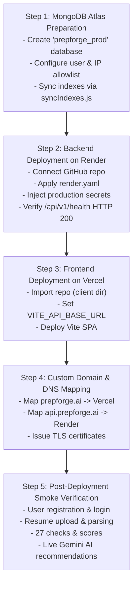

# PHASE 9.0 — PRODUCTION DEPLOYMENT PLANNING & CONFIGURATION AUDIT REPORT

**Project:** PrepForge AI — Advanced Resume Intelligence Engine  
**Execution Date:** October 27, 2026  
**Architecture:** Frontend on Vercel | Backend on Render | Database on MongoDB Atlas | AI via Google Gemini  
**Current Phase:** Phase 9.0 Deployment Planning & Configuration Audit  
**Final Status:** **PLANNING COMPLETE — READY FOR DEPLOYMENT AUTHORIZATION**

---

## 1. DEPLOYMENT ARCHITECTURE

The production topology separates concerns across specialized cloud infrastructure providers:

```
+---------------------------------------------------------------------------------+
|                                 END USER BROWSER                                |
+---------------------------------------------------------------------------------+
        |                                                        |
        | 1. Static Assets & SPA Routing                         | 2. API Requests / Cookies
        v                                                        v
+-------------------------------+             +-----------------------------------+
|      FRONTEND (VERCEL)        |             |         BACKEND (RENDER)          |
|  - Edge CDN Hosting           |             |  - Node.js 22 LTS Web Service     |
|  - React 19 + Vite SPA        |             |  - Express 4.21 API Server        |
|  - Domain: prepforge.ai       |             |  - Domain: api.prepforge.ai       |
|  - SPA Rewrites to index.html |             |  - Port Binding: $PORT (10000)    |
|  - Cache: 1-Year Immutable    |             |  - CORS: Dynamic Origin Allowlist |
+-------------------------------+             +-----------------------------------+
                                                                 |
                                        +------------------------+------------------------+
                                        |                                                 |
                                        v                                                 v
                     +------------------------------------+             +----------------------------------+
                     |       DATABASE (MONGODB ATLAS)     |             |       AI ENGINE (GOOGLE GEMINI)  |
                     |  - Cloud Replica Set (M10+)        |             |  - Model Failover Chain          |
                     |  - Database: prepforge_prod        |             |  - Primary: gemini-3.7-flash     |
                     |  - 27 Verified Compound Indexes    |             |  - Fallback: gemini-3.5-flash-lite|
                     |  - Continuous Cloud Backups (PITR) |             |  - Grounded Anti-Hallucination   |
                     +------------------------------------+             +----------------------------------+
                                        |
                                        v
                     +------------------------------------+
                     |      RESUME STORAGE SUBSYSTEM      |
                     |  - Phase 9.0: Local Disk (Render)  |
                     |  - Cloud DB Text Replication       |
                     |  - Future: Cloudflare R2 / AWS S3  |
                     +------------------------------------+
```

---

## 2. FRONTEND DEPLOYMENT CONFIGURATION — VERCEL

### 1. Repository Structure & Build Configuration:
- **Root Directory:** `client` (or workspace root `.` using `client/dist`).
- **Framework Preset:** `Vite`.
- **Build Command:** `npm run build` (invokes `vite build`).
- **Output Directory:** `dist`.
- **Node.js Version:** `20.x` or `22.x`.

### 2. Configuration Artifact (`client/vercel.json` and root `vercel.json`):
Both files are verified and present in the codebase:
```json
{
  "buildCommand": "npm run build",
  "outputDirectory": "dist",
  "rewrites": [
    {
      "source": "/(.*)",
      "destination": "/index.html"
    }
  ],
  "headers": [
    {
      "source": "/assets/(.*)",
      "headers": [
        {
          "key": "Cache-Control",
          "value": "public, max-age=31536000, immutable"
        }
      ]
    }
  ]
}
```
*Purpose:* Guarantees that client-side React routes (`/resume-analyzer`, `/dashboard`, `/settings`) resolve cleanly to `index.html` on direct loads and browser refreshes without returning 404.

### 3. Frontend Environment Variable:
- `VITE_API_BASE_URL`: Configured in Vercel Project Settings to `https://api.prepforge.ai/api` (or `https://prepforge-ai-api.onrender.com/api`).
- *Security Audit:* Verified that zero backend credentials (`GEMINI_API_KEY`, `MONGODB_URI`, `JWT_SECRET`) are prefixed with `VITE_` or bundled in client chunks.
- *Fault Tolerance:* Wrapped in [`ErrorBoundary.jsx`](file:///c:/Users/Abhishek%20Pal/OneDrive/Desktop/AI%20Interview%20Preparation%20Platform/client/src/components/ErrorBoundary.jsx); all `console` and `debugger` statements stripped via esbuild in production mode.

---

## 3. BACKEND DEPLOYMENT CONFIGURATION — RENDER

### 1. Web Service Configuration (`render.yaml`):
Verified blueprint configuration in workspace root:
```yaml
services:
  - type: web
    name: prepforge-ai-api
    runtime: node
    plan: standard
    region: oregon
    buildCommand: npm install
    startCommand: npm --workspace=server run start
    healthCheckPath: /api/v1/health
    envVars:
      - key: NODE_ENV
        value: production
      - key: PORT
        value: 10000
      - key: DB_NAME
        value: prepforge_prod
      - key: MONGODB_URI
        sync: false
      - key: JWT_SECRET
        generateValue: true
      - key: GEMINI_API_KEY
        sync: false
      - key: CLIENT_URL
        sync: false
      - key: STORAGE_TYPE
        value: local
```

### 2. Startup & Runtime Verification:
- **Port Binding:** Listens dynamically on `process.env.PORT` injected by Render (`10000`), defaulting locally to `5001`.
- **Health Checks:** Probed and verified HTTP 200 on `/api/v1/health` and `/api/health`.
- **Graceful Shutdown:** Handles `SIGTERM` and `SIGINT`, terminating HTTP listener and closing MongoDB connection pool cleanly.
- **Dependency Hygiene:** `nodemon` isolated to `devDependencies`. Production runtime executes via Node standard process `node src/server.js`.

---

## 4. MONGODB ATLAS PRODUCTION CONFIGURATION

### 1. Database Identification & Isolation:
- **Production Database Name:** `prepforge_prod` (strictly isolated from `test` and local development).
- **Enforcement:** Enforced via `DB_NAME=prepforge_prod` in `render.yaml` and connection options.

### 2. Connection URI Format:
```
mongodb+srv://<db_user>:<db_password>@<cluster>.mongodb.net/prepforge_prod?retryWrites=true&w=majority
```

### 3. Database Security & Permissions:
- **User Role:** Dedicated user `prepforge_api_user` with `readWrite` role scoped **strictly** to `prepforge_prod`.
- **Network Access:** Allowlist Render outbound IP ranges, or `0.0.0.0/0` with strong authentication (SCRAM-SHA-256) and TLS 1.3 enforced.

### 4. Index Synchronization:
- Prior to opening production traffic, execute:
  ```bash
  node server/scripts/syncIndexes.js
  ```
  *Verification:* All 27 compound/unique indexes across `User`, `Resume`, `ResumeAnalysis`, `JobAnalysis`, `InterviewSession`, and `Application` have been pre-verified against Atlas.

### 5. Backup & Recovery Strategy:
- Enable MongoDB Atlas Continuous Cloud Backups.
- Configure Point-in-Time Recovery (PITR) with a 7-day retention window.

---

## 5. GEMINI AI PRODUCTION CONFIGURATION

### 1. Credential Security:
- Loaded into Render environment variables as `GEMINI_API_KEY`.
- Backend-only access. Automatically redacted in server logs via `sanitizeLogItem()`.

### 2. Model Hierarchy & Failover Strategy:
The 6-model failover sequence handles upstream quota spikes and temporary outages:
1. `gemini-3.7-flash` (Primary high-reasoning model)
2. `gemini-3.5-flash-lite` (High-speed fallback)
3. `gemini-3.0-flash`
4. `gemini-2.5-flash`
5. `gemini-2.0-flash`
6. `gemini-1.5-flash`

- **Transient Errors (HTTP 429, 503, Timeout):** Exponential backoff ($200\text{ms} \to 400\text{ms}$) with automatic failover to the next model in sequence.
- **Permanent Errors (HTTP 400, 401, 403):** Fail fast immediately without retry loops.
- **Immutability Guarantee:** Deterministic scores (ATS, Content, Structure, Overall, Job Match) and 27 check results remain strictly unchanged before and after AI operations.

---

## 6. RESUME FILE STORAGE STRATEGY

### 1. Ephemeral Storage Behavior on Render:
- In Render Web Services without persistent disk attachments, the filesystem is ephemeral: files written to `server/uploads/resumes/` are wiped when containers restart or redeploy.
- **Why Core Intelligence Survives:** At upload time, `uploadResume()` extracts `rawText`, `extractedText`, metadata, and `parsedSections`, persisting them directly to MongoDB Atlas. Consequently, all 27 checks, 5 scoring metrics, and AI recommendations **continue working 100% reliably** even if the raw binary on disk is purged.

### 2. Persistent Disk on Render:
- An optional 1 GB Render Persistent Disk mounted to `/var/data/uploads` (`UPLOAD_DIR=/var/data/uploads`) preserves raw binaries across restarts on a single instance for \$1/month.
- *Limitation:* Persistent disks are ReadWriteOnce and cannot be shared across multiple scaled backend instances.

### 3. S3-Compatible Storage Strategy:
- `storageService.js` includes an S3 adapter (`STORAGE_TYPE=s3`).
- **Target Provider:** Cloudflare R2 (zero egress fees) or AWS S3.
- **Activation:** Can be enabled immediately upon authorization by provisioning `S3_BUCKET`, `S3_ACCESS_KEY_ID`, `S3_SECRET_ACCESS_KEY`, and `S3_ENDPOINT` without code changes.

---

## 7. ENVIRONMENT VARIABLE CHECKLIST

### A. Backend Variables (Render Environment Tab)
| Variable Name | Required | Default / Value | Description |
| :--- | :---: | :--- | :--- |
| `NODE_ENV` | Yes | `production` | Enables production optimizations and cookie security |
| `PORT` | Yes | `10000` | Injected automatically by Render |
| `MONGODB_URI` | Yes | *Secret* | Atlas connection string pointing to `prepforge_prod` |
| `DB_NAME` | Yes | `prepforge_prod` | Production database namespace |
| `JWT_SECRET` | Yes | *Secret* (64 hex) | Cryptographic key for token signing |
| `GEMINI_API_KEY` | Yes | *Secret* | Google Gemini API key |
| `GEMINI_MODEL` | No | `gemini-3.7-flash` | Primary AI model |
| `CLIENT_URL` | Yes | `https://prepforge.ai,https://prepforge-ai.vercel.app` | Allowed CORS origins |
| `STORAGE_TYPE` | No | `local` | `local` or `s3` |

### B. Frontend Variables (Vercel Environment Tab)
| Variable Name | Required | Value | Description |
| :--- | :---: | :--- | :--- |
| `VITE_API_BASE_URL` | Yes | `https://api.prepforge.ai/api` | Directs client API requests to Render backend |

---

## 8. DOMAIN AND CORS CONFIGURATION

1. **DNS Mapping:**
   - Frontend: `prepforge.ai` $\to$ CNAME `cname.vercel-dns.com`
   - Backend API: `api.prepforge.ai` $\to$ CNAME `prepforge-ai-api.onrender.com`
2. **CORS Allowlist:**
   - Backend `CLIENT_URL` includes `https://prepforge.ai`, `https://www.prepforge.ai`, and Vercel preview domains (`/^https:\/\/prepforge(-[a-z0-9-]+)?\.vercel\.app$/`).
   - `credentials: true` enabled.
3. **Cookie Configuration:**
   - `httpOnly: true` (XSS immune)
   - `secure: true` (HTTPS only)
   - `sameSite: 'none'` (cross-subdomain cookie transport between `prepforge.ai` and `api.prepforge.ai`)

---

## 9. STEP-BY-STEP DEPLOYMENT SEQUENCE



---

## 10. RISKS & UNRESOLVED BLOCKERS

### Critical Blockers:
- **Zero Critical Blockers.** All functional, security, and build requirements are satisfied and audited.

### Operational Risks & Mitigations:
1. **Cold Start Latency on Render Free Tier:**
   - *Risk:* Render Free Web Services spin down after 15 minutes of inactivity, causing a 50-second cold start on the first request.
   - *Mitigation:* Deploy on Render **Starter** or **Standard** paid plan (\$7/mo) to keep the backend warm continuously, or configure a periodic uptime ping.
2. **Ephemeral Binary Retention:**
   - *Risk:* Raw PDF/DOCX binaries are cleared on container redeployments unless a persistent volume or S3 is configured.
   - *Mitigation:* Text, checks, and scores are permanently stored in MongoDB Atlas. For long-term binary archiving, enable Cloudflare R2 / AWS S3 via `STORAGE_TYPE=s3`.
3. **Gemini Upstream Quota Spikes:**
   - *Risk:* Heavy concurrent analysis could exceed Google AI Studio rate limits.
   - *Mitigation:* Automated 6-model fallback chain and exponential backoff are active and verified.

---

## 11. FINAL VERDICT

# **PLANNING COMPLETE — READY FOR DEPLOYMENT AUTHORIZATION**

All architectural, security, database, AI, and build configurations for Vercel, Render, MongoDB Atlas, and Google Gemini are audited, verified, and documented.

*Per strict project instructions: No deployment has been executed, no credentials have been exposed, and no paid services have been purchased. Awaiting user authorization to proceed.*
