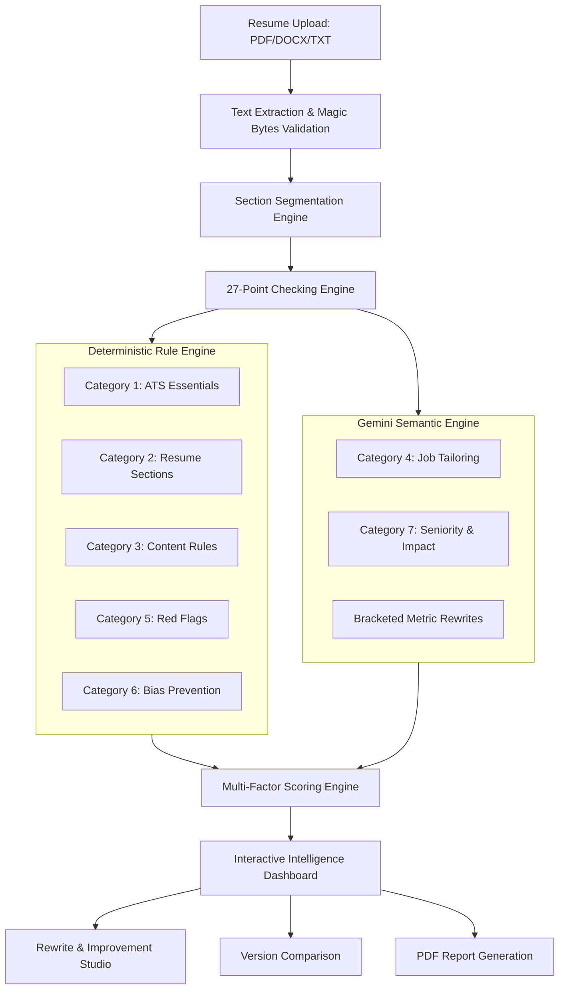

# PrepForge AI — Product Requirements Document (PRD)
## Advanced Resume Intelligence Engine

**Document Version:** 2.0.0  
**Status:** Approved for Architecture & Implementation  
**Product Name:** PrepForge AI — Advanced Resume Intelligence Engine  
**Author:** Principal Software Architect & AI Product Lead  
**Date:** 2026-10-26  
**Baseline Codebase:** PrepForge AI Full-Stack Platform (Phase 0 Audit Verified)  

---

## 1. Product Overview

**PrepForge AI** is an enterprise-grade, full-stack, AI-powered career advancement and preparation platform. The platform empowers job seekers and ambitious professionals to optimize their application assets, evaluate alignment with target job descriptions, undergo context-aware technical and behavioral interview preparation, and manage job applications throughout their hiring lifecycle.

The **Advanced Resume Intelligence Engine** is a comprehensive extension to the existing PrepForge AI application, inspired by industry benchmarks such as Enhancv Resume Checker. It transforms the baseline resume analyzer into an advanced, 27-point resume auditing, scoring, and improvement suite. The engine combines deterministic rule-based algorithms with targeted Google Gemini generative AI semantic evaluations, providing candidates with transparent, reproducible, and explainable feedback.

> [!IMPORTANT]
> **Advisory Disclaimer on Automated Scoring:**  
> All ATS compatibility scores, content metrics, and job match percentages generated by PrepForge AI reflect algorithmic parseability, structural alignment, and semantic overlap. **They do not guarantee interviews, employment offers, or hiring probability.** PrepForge AI is an assistive advisory intelligence tool designed to maximize application asset quality.

---

## 2. Product Vision

To democratize executive-tier career coaching and ATS transparency for every professional. PrepForge AI empowers candidates to:
1. Deconstruct opaque Applicant Tracking Systems (ATS) and recruiter scanning habits with total transparency.
2. Receive rigorous, line-by-line feedback that replaces vague praise with actionable, quantified improvement recommendations.
3. Tailor resumes dynamically to target job postings with semantic skill-gap intelligence.
4. Seamlessly transition from resume optimization to personalized mock interview simulations and application pipeline tracking.

---

## 3. Problem Statement

Modern job applicants face systemic hurdles in automated and recruiter-led hiring pipelines:
1. **Opaque Applicant Tracking Systems (ATS):** Over 75% of resumes are screened or rejected before reaching a human recruiter due to non-standard layouts, complex multi-column tables, unparseable headers, or missing standard sections. Candidates have zero visibility into parser failures.
2. **Generic, Superficial Feedback:** Traditional resume checkers offer vague, generic advice (e.g., "Add more keywords") without identifying exact bullet points that lack metrics, action verbs, or context.
3. **Pervasive AI Hallucinations in Existing Tools:** Many AI resume builders invent fake employment experiences, inflate job titles, or fabricate numerical metrics, putting candidate credibility and background checks at critical risk.
4. **Keyword Stuffing vs. Semantic Alignment:** Candidates blindly stuff keywords into white text or disjointed lists rather than naturally integrating competencies into contextual work achievements.
5. **Fragmented Job Search Workflow:** Candidates are forced to switch between disconnected tools for parsing, formatting, job tailoring, mock interviews, and application tracking, resulting in lost context and wasted effort.

---

## 4. Target Audience & Personas

### Persona 1: "Priya" — Early-Career Software Engineer
* **Background:** Computer Science graduate with 1 year of full-time experience seeking Junior to Mid-level Full-Stack Developer roles.
* **Pain Points:** Struggles to articulate academic and internship projects with quantifiable business impact; uncertain if her resume passes enterprise ATS parsers.
* **PrepForge AI Use Case:** Utilizes the 27-Point Resume Checker to identify weak bullet points; receives bracketed metric rewrite templates; practices tailored technical interview questions generated from her resume.

### Persona 2: "Marcus" — Mid-Career Technical Transitioner
* **Background:** 8 years of traditional IT Systems Administration transitioning into Cloud DevOps & Site Reliability Engineering.
* **Pain Points:** Overly verbose 3-page resume dominated by legacy technologies; lacks clear demonstration of modern cloud tooling (Kubernetes, Terraform); low interview callback rate.
* **PrepForge AI Use Case:** Uses the Multi-Factor Scoring Engine and Job Description Matcher to highlight skill gaps; trims legacy bullet points using the Brevity and Action Verb checks; benchmarks against target DevOps roles.

### Persona 3: "Elena" — Senior Engineering Manager / Product Leader
* **Background:** 12+ years of technical leadership applying for Director-level positions across competitive tech companies.
* **Pain Points:** High stakes per application; requires clean executive presentation, leadership signaling, career trajectory validation, and proof of mentoring and business ownership.
* **PrepForge AI Use Case:** Evaluates Category 7 (Seniority & Impact) checks; exports executive PDF audit reports; leverages side-by-side resume comparison across draft iterations.

---

## 5. Existing System Capabilities (Verified Phase 0 Baseline)

The Advanced Resume Intelligence Engine builds directly on top of the audited and verified PrepForge AI platform:

* **Authentication & User Management:** Live HttpOnly cookie-based JWT authentication, password hashing with bcryptjs, protected frontend route guards, and user profile management (`server/src/controllers/authController.js`).
* **Document Upload & Multi-Format Parsing:** Secure file upload pipeline supporting PDF, DOCX, and TXT files up to 5MB, including MIME verification and header magic bytes validation (`server/src/utils/textExtractor.js`, `server/src/services/storageService.js`).
* **AI Analysis Pipeline:** Google Gemini integration via `@google/genai` featuring a multi-model fallback pool (`gemini-3.7-flash` $\to$ `gemini-3.5-flash-lite` $\to$ `gemini-3.1-flash-lite`), raw JSON repair parsers, and Zod output schema enforcement (`server/src/services/geminiService.js`).
* **Semantic Job Matcher:** Analysis of job descriptions with match scoring, matched vs. missing skill identification, and tailoring tips (`server/src/controllers/jobAnalysisController.js`).
* **Contextual Interview Simulator:** Dynamic interview question generation derived from candidate resumes and job roles, featuring 5-factor answer evaluation (`server/src/controllers/interviewController.js`).
* **Application Tracker:** Full Kanban and list view tracking candidate job applications through various stages (`server/src/controllers/applicationController.js`).
* **Design System:** Tailored SaaS dark theme (`#080B14`, `#0D1220`, `#121A2B`, `#7657FF`, `#3985FF`) with established light mode tokens (`#F8FAFC`, `#FFFFFF`, `#0F172A`).

---

## 6. New Module Requirements: Advanced Resume Intelligence Engine

The new module extends the existing `ResumeAnalyzerPage` and backend services into a comprehensive intelligence suite:

1. **Deterministic & Semantic 27-Point Checking Suite:** Audits resumes across 7 distinct categories with explicit severity ratings and actionable fixes.
2. **Multi-Factor Transparent Scoring Architecture:** Calculates 5 distinct scores (Overall, ATS Compatibility, Content, Structure, Job Match) using deterministic server-side formulas.
3. **Interactive Resume Improvement & Rewrite Studio:** In-place bullet point rewrite generator providing before/after comparisons, bracketed metric templates, and copy-to-clipboard functionality.
4. **Before/After Resume Version Comparison:** Side-by-side diffing of resume versions, tracking score deltas and resolved check failures.
5. **Executive PDF Audit Report Generator:** Client-side and server-ready printable PDF export summarizing all 27 checks, sub-scores, and recommendations.
6. **Universal Global Theme Switching:** Seamless dark/light mode toggle surfaced in the global application header with zero theme flash.

---

## 7. Feature Specifications

---

## 8. 27-Point Checking System Specification

The 27 checks are categorized into 7 distinct domains:

### Category 1: ATS Essentials (6 Checks)
* **CHK-01 (File Format & Critical Parsing):** Validates supported document formats (`.pdf`, `.docx`, `.txt`) via magic bytes and text stream extractability. Differentiates failure types:
  - *Unsupported Format:* Non-PDF/DOCX/TXT file extension or MIME rejection.
  - *Corrupted File:* Truncated binary stream or corrupted header.
  - *Password-Protected File:* Encrypted PDF/DOCX requiring credentials.
  - *Image-Only / Scanned PDF:* Raster document containing $< 20$ extractable characters without OCR.
  - *Critical Parsing Failure:* Inability to extract readable text tokens. **Only genuine critical parsing failures trigger the documented ATS score cap ($\le 40$).**
  - *Successfully Extracted Text:* Text stream extracted and normalized cleanly ($\ge 20$ characters). (Critical)
* **CHK-02 (ATS-Friendly Design & Layout):** Detects multi-column tables, text boxes, and complex graphics that disrupt sequential reading order. (High)
* **CHK-03 (Professional Email Format):** Identifies professional email addresses (`first.last@domain.com`) vs. unprofessional handles or spam keywords. (Medium)
* **CHK-04 (Header Professional Links):** Validates presence and formatting of essential links (LinkedIn, GitHub, Portfolio). Handled independently from primary contact methods. (Medium)
* **CHK-05 (Resume File Naming Convention):** Flags generic names (`resume.pdf`, `doc1.docx`) and recommends standard naming (`FirstName_LastName_Resume.pdf`). (Low)
* **CHK-06 (Date Consistency & Protocol Links):** Checks standardized date formats (`MM/YYYY` or `Month YYYY`) and ensures all URLs include valid protocols (`https://`). (Medium)

### Category 2: Resume Sections (3 Checks)
* **CHK-07 (Essential Section Presence):** Verifies the critical structural sections: Experience, Education, and Skills. (Critical)
* **CHK-08 (Contact Information Completeness):** Differentiates contact fields without imposing rigid universal caps:
  - *Email Address (Critical):* Primary communication channel; omission flags high severity with localized deduction (-20 pts), but does not cap overall resume parseability.
  - *Telephone Number (Secondary):* Essential for phone screens; omission flags warning (-5 pts).
  - *Location (City, State/Country - Optional/Advisory):* Physical street addresses are **strictly NOT mandatory**; city/state is evaluated as optional/advisory for remote or relocation roles.
  - *Professional Links:* Managed independently under CHK-04.
  - **Hard-Cap Policy:** Universal ATS hard caps are **never** triggered by omitting phone numbers, locations, or secondary contact fields. (High)
* **CHK-09 (Structural Section Ordering):** Validates logical section hierarchy and narrative flow: Header $\to$ Summary (optional) $\to$ Experience $\to$ Education $\to$ Skills. (Low)

### Category 3: Resume Content (5 Checks — Configurable Coaching Guidelines)
> [!NOTE]
> The thresholds below represent **configurable career coaching best practices**, NOT rigid universal ATS mandates. Real-world ATS parsers ingest diverse layouts; recommendations adapt to career level, industry, and role type.
* **CHK-10 (ATS Parse Rate):** Measures the percentage of extracted text successfully mapped to structured sections (coaching benchmark $\ge 85\%$). Accommodates creative, academic, and non-standard project sections. (High)
* **CHK-11 (Quantified Achievements):** Evaluates percentage of bullet points containing metrics, percentages, dollar values, or scale indicators (coaching benchmark $\ge 40\%$). Adapts expectations for early-career, legal, infrastructure, and qualitative professions. (High)
* **CHK-12 (Repeated Words & Buzzwords):** Identifies overused corporate clichés ("synergized", "go-getter", "team player") and repetitive leading verbs. (Medium)
* **CHK-13 (Spelling, Grammar & Casing):** Flags spelling mistakes, grammatical irregularities, and inconsistent capitalization of technical acronyms. (High)
* **CHK-14 (Bullet Length & Punctuation Consistency):** Audits bullets against human recruiter scannability guidelines (optimal range: 15–30 words). Recognizes that complex architectural descriptions legitimately require expanded word counts. (Medium)

### Category 4: Job Tailoring (4 Checks)
* **CHK-15 (Hard Technical Skills Match):** Matches candidate's explicit technical proficiencies against target job requirements or domain baseline. (High)
* **CHK-16 (Soft & Leadership Skills Match):** Evaluates evidence of collaboration, stakeholder management, and problem solving supported by context. (Medium)
* **CHK-17 (High-Impact Action Verbs):** Checks that bullet points begin with strong active verbs from the PrepForge taxonomy rather than passive duties. (Medium)
* **CHK-18 (Target Job Title Alignment):** Verifies that the resume headline and recent experience align with the target job title. (Medium)

### Category 5: Recruiter Red Flags (4 Checks)
* **CHK-19 (Resume Timeline Credibility):** Detects chronological anomalies, future dates, or overlapping full-time positions. (High)
* **CHK-20 (Interview Risk Signals):** Detects passive phrasing ("responsible for", "assisted with") and flags lack of personal agency. (Medium)
* **CHK-21 (Peer Experience Benchmarking):** Evaluates depth and breadth of accomplishments relative to stated career level tier (Junior, Mid, Senior, Lead) without fabricating industry datasets. (Medium)
* **CHK-22 (Professional Presence Match):** Validates consistency between headline title, stated years of experience, and documented job entries without claiming external live verification. (Low)

### Category 6: Bias & Discrimination Prevention (2 Checks — Strictly Advisory)
> [!IMPORTANT]
> **Zero Scoring Weight:** Category 6 checks (`CHK-23` and `CHK-24`) are **strictly advisory** ($w_{\text{Cat 6}} \equiv 0$). They never reduce numerical scores in any category.
* **CHK-23 (Age & Date Bias Mitigation):** Flags graduation dates older than 15 years, profile photos, marital status, or demographic data that trigger unconscious bias. Generates advisory suggestions to protect candidates against ageism. (Advisory / Info)
* **CHK-24 (Employment Gap Analysis):** Identifies unannotated employment gaps $>6$ months and provides constructive framing advice with zero numerical penalty. (Advisory / Info)

### Category 7: Seniority & Impact (3 Checks)
* **CHK-25 (Career Progression Trajectory):** Evaluates upward mobility in job titles, scope of ownership, and technical complexity over time. (Medium)
* **CHK-26 (Skills Demonstration Context):** Verifies that skills listed in the skills section are actually demonstrated in work experience bullets. (High)
* **CHK-27 (Ownership & Leadership Marks):** Identifies marks of leadership, code stewardship, cross-team collaboration, and strategic decision-making. (Medium)

---

## 9. Multi-Factor Scoring Architecture

PrepForge AI provides 5 independent, explainable scores calculated deterministically server-side:

### 1. Overall Resume Score ($0 - 100$)
$$S_{\text{Overall}} = \text{round}(0.35 \times S_{\text{ATS}} + 0.35 \times S_{\text{Content}} + 0.30 \times S_{\text{Structure}})$$
Provides an orthogonal, mathematically reproducible composite score with zero circular dependencies or double penalties.

### 2. ATS Compatibility Score ($0 - 100$)
Evaluates machine readability, format integrity, and section extractability:
- Cat 1 (ATS Essentials: `CHK-01` to `CHK-06`) — $50\%$ weight.
- Cat 2 (Section & Contact Presence: `CHK-07`, `CHK-08`) — $30\%$ weight.
- Cat 3 (Technical Parse Rate: `CHK-10`) — $20\%$ weight.
- **Hard-Cap Policy:** Bounded at $\le 40$ **only** upon critical parsing failure (unreadable binary or scanned document with $<20$ characters in `CHK-01`). Missing contact fields apply localized point deductions without triggering global caps.

### 3. Resume Content Score ($0 - 100$)
Evaluates language quality, metric density, substance, and demonstrated competencies:
- Cat 3 (Content Quality: `CHK-11`, `CHK-12`, `CHK-13`, `CHK-14`) — $60\%$ weight.
- Cat 7 (Seniority & Demonstrated Skills: `CHK-25`, `CHK-26`, `CHK-27`) — $40\%$ weight.

### 4. Resume Structure Score ($0 - 100$)
Evaluates narrative hierarchy, section flow, and chronological timeline sanity:
- Cat 2 (Section Flow & Ordering: `CHK-09`) — $25\%$ weight.
- Cat 5 (Recruiter Red Flags / Chronological Sanity: `CHK-19`, `CHK-20`, `CHK-21`, `CHK-22`) — $75\%$ weight.
- **Category 6 Excluded:** Category 6 carries zero scoring weight ($w_{\text{Cat 6}} \equiv 0$), guaranteeing that employment gaps and graduation dates never reduce the Structure Score.

### 5. Job Match Score ($0 - 100$, Conditional)
$$S_{\text{JobMatch}} = \begin{cases} \text{round}(0.40 \times S_{\text{HardSkills}} + 0.25 \times S_{\text{SoftSkills}} + 0.20 \times S_{\text{Verbs}} + 0.15 \times S_{\text{Title}}) & \text{if target JD provided} \\ \text{null (rendered in UI as N/A)} & \text{if no target JD provided} \end{cases}$$
Calculated *only* when a target job description or role is provided. When omitted, it strictly returns `null` (displayed as `N/A`) with zero impact on the Overall Resume Score.

---

## 10. AI Recommendations & Anti-Hallucination Guardrails

All generative AI outputs must follow strict ethical and hallucination prevention rules:
1. **Grounded Ingestion:** The LLM is restricted to facts, achievements, and timelines present in the uploaded document. It must never fabricate employment history, degrees, companies, or certifications.
2. **Bracketed Metric Rewrites:** When suggesting improvements for non-quantified bullets, the AI outputs bracketed placeholders (e.g., *"Optimized SQL query performance, decreasing p99 response time by [X]% across [Y] requests/sec"*) rather than guessing fabricated figures.
3. **Structured Schema Validation:** Responses are validated using Zod schemas (`server/src/validators/`).
4. **Transparent Explanations:** Every recommendation provides:
   - What the issue is.
   - Why recruiters/ATS systems penalize it.
   - Exact before/after suggested rewrite.

---

## 11. Job Description Matching Engine

The Job Match module connects resume intelligence directly to target positions:
* **Semantic Keyword Extraction:** Parses required technical skills, preferred tools, and domain keywords from pasted job descriptions.
* **Match Breakdown:** Categorizes skills into Matched (found in resume), Missing (present in JD, absent in resume), and Unverified (mentioned without context).
* **Targeted Alignment Guidance:** Generates tailored advice explaining how to incorporate missing keywords naturally into experience bullets.

---

## 12. Interactive Resume Improvement Studio

* **Direct Inline Editing:** Candidates can view failing checks and click "Apply Suggestion" to inspect recommended rewrites.
* **Diff Highlighting:** Green and red visual diffing highlights deleted weak words and added strong action verbs/metrics.
* **One-Click Copy:** Seamless copy-to-clipboard for rapid updating in external word processors.
* **Instant Re-Check (`POST /api/v1/resumes/:id/recheck`):** Re-runs fast deterministic checks immediately after candidate makes adjustments.

---

## 13. Resume Comparison Engine

* **Side-by-Side Version Diff:** Allows comparison between two uploaded versions of a resume (e.g., Draft 1 vs. Draft 2).
* **Score Delta Visualization:** Displays numerical score shifts ($\Delta +12$ Overall, $\Delta +18$ ATS) with color-coded badges.
* **Resolved Checks Tracker:** Lists previously failing checks that have now passed, reinforcing candidate progress.

---

## 14. PDF Report Generation

* **Executive Summary Sheet:** Printable, formatted PDF containing Overall Score, category radar charts, and core strengths.
* **Full Audit Report:** Detailed appendix listing all 27 checks, pass/fail status, and line-level recommendations.
* **Export Options:** Downloadable directly from the dashboard for offline review or sharing with career mentors.

---

## 15. User Stories

| ID | Persona | As a... | I want to... | So that... |
|---|---|---|---|---|
| **US-01** | Priya | Early-career applicant | upload my resume in PDF format | I can immediately discover if ATS systems can parse my text correctly. |
| **US-02** | Priya | Early-career applicant | see exact bullet rewrites with metric placeholders | I know how to quantify my achievements without guessing fake numbers. |
| **US-03** | Marcus | Career transitioner | paste a target DevOps job description alongside my resume | I can see the exact technical skills I am missing before applying. |
| **US-04** | Marcus | Career transitioner | check for overused corporate buzzwords and clichés | my resume reads with punchy, modern technical impact. |
| **US-05** | Elena | Senior leader | verify that my executive leadership and mentoring are recognized | recruiters immediately perceive my senior career trajectory. |
| **US-06** | Elena | Senior leader | export a professional PDF audit report | I can review findings offline and track improvements over time. |
| **US-07** | All | Active candidate | toggle between Dark and Light mode from the navbar | I can comfortably review my resume under any ambient lighting condition. |

---

## 16. Functional Requirements Matrix

* **FR-01 (File Ingestion):** The system shall accept PDF, DOCX, and TXT files up to 5MB and validate MIME types and magic bytes.
* **FR-02 (Section Segmentation):** The system shall parse extracted text into structured sections (Contact, Experience, Education, Skills, Projects, Certifications).
* **FR-03 (27-Point Audit):** The system shall execute all 27 checks defined across the 7 categories and return standardized pass/warning/failed statuses.
* **FR-04 (Score Computation):** The system shall compute 5 deterministic scores (Overall, ATS, Content, Structure, Job Match) bounded between 0 and 100.
* **FR-05 (AI Rewrites):** The system shall provide grounded before/after rewrite suggestions using bracketed metric templates.
* **FR-06 (Job Matching):** When provided a job description, the system shall compute semantic alignment, keyword match, and missing skill lists.
* **FR-07 (Version Comparison):** The system shall compare two resume analyses belonging to the same user and render score deltas and resolved issues.
* **FR-08 (PDF Export):** The system shall generate a downloadable, printable PDF report reflecting the latest analysis findings.
* **FR-09 (Analysis History):** The system shall persist all analysis records and provide pagination, viewing, and deletion capabilities.
* **FR-10 (Theme Switching):** The system shall support Dark, Light, and System themes switchable via a header control and persistent across sessions.

---

## 17. Non-Functional Requirements

### 17.1 Performance & Latency
* **Parse & Rule Checks:** Text extraction and deterministic checks must complete in $< 1.5\text{ seconds}$.
* **Complete AI Analysis:** End-to-end AI analysis (including Gemini fallback retries) must complete in $< 15\text{ seconds}$ under normal network conditions.
* **Client Rendering:** Dashboard rendering and tab switching must maintain a 60 FPS frame rate with zero layout shift.

### 17.2 Reliability & Availability
* **Service Availability:** Backend API uptime target of $99.5\%$.
* **AI Failover:** Resilient multi-model retry mechanism (`gemini-3.7-flash` $\to$ `gemini-3.5-flash-lite` $\to$ `gemini-3.1-flash-lite`) to absorb upstream Google AI rate limits or transient errors.

### 17.3 Usability & Accessibility
* **WCAG 2.1 AA Compliance:** Minimum color contrast ratio of 4.5:1 for normal text and 3:1 for large text across both dark and light modes.
* **Responsive Layout:** Flawless usability across desktop ($\ge 1280\text{px}$), laptop ($1024\text{px}$), tablet ($768\text{px}$), and mobile ($375\text{px}$).

---

## 18. Security & Data Protection Requirements

* **Authentication Integrity:** Zero mock authentication. All protected endpoints require valid JWTs delivered via secure, HttpOnly, SameSite cookies.
* **Password Security:** Password hashing utilizing bcrypt with a minimum work factor of 12 rounds.
* **Input Sanitization & Injection Prevention:** Strict Zod schema validation on all inputs; MongoDB query sanitization to prevent NoSQL injection; file signature inspection to block disguised executables.
* **Storage Security:** Resumes stored on disk or cloud storage are obfuscated with non-guessable UUID file names and restricted by user ownership middleware.

---

## 19. Privacy & Ethical Standards

* **Zero Training on User Resumes:** Resumes submitted for analysis are never used to train third-party or public foundational models.
* **1-Click Total Data Erasure:** In accordance with GDPR and CCPA, users can delete their entire account, including all uploaded resumes, text extractions, and analysis histories, with immediate database and storage purge.
* **Unconscious Bias Protection:** Graduation dates older than 15 years, marital status, or demographic markers flag advisory bias warnings for the candidate rather than reducing their score.
* **Transparent Scoring:** No proprietary black-box calculations; all scoring formulas are documented, reproducible, and explainable.

---

## 20. Acceptance Criteria

1. An uploaded standard PDF resume is parsed and analyzed across all 27 checks with complete results rendered within 15 seconds.
2. The 5 scores are accurately computed, bounded in $[0, 100]$, and reflect the specified category weights.
3. If no job description is provided, the Job Match score displays `N/A` without triggering backend errors.
4. AI recommendations contain zero fabricated metrics and employ bracketed templates for non-quantified bullets.
5. The global theme toggle instantly switches between Dark (`#080B14`) and Light (`#F8FAFC`) modes without page reload or styling glitches.
6. The user can export a formatted PDF report that visually mirrors the audit dashboard.
7. Existing Mock Interview, Job Match, and Application Tracker routes remain 100% operational without regression.

---

## 21. Scope & Limitations

### In-Scope (Phase 1–11 Roadmap)
* PDF, DOCX, and TXT parsing up to 5MB.
* 27-point checking engine and 5-factor scoring.
* AI-driven bullet rewrites and skill extraction.
* Single-resume analysis and dual-resume comparison.
* PDF report generation and history management.
* Universal dark/light theme switching.

### Out-of-Scope (Future Releases)
* Direct automated job application submission (bots/scrapers).
* Real-time synchronous video interview evaluation.
* Automated LinkedIn profile scraping (violates terms of service).
* Multi-language resume parsing (English only in current release).

---

## 22. Success Metrics & Key Performance Indicators (KPIs)

| Metric | Baseline (Phase 0) | Target (Phase 11 Completion) |
|---|---|---|
| **ATS Check Coverage** | 5 high-level categories | 27 exhaustive granular checks across 7 categories |
| **Scoring Explainability** | LLM-generated score | Deterministic, transparent 5-score server calculation |
| **Parse Success Rate** | 95% standard PDFs | 99% across standard PDF, DOCX, and TXT files |
| **Rewrite Practicality** | Generic advice | 100% grounded suggestions with bracketed metric templates |
| **Theme Support** | Partial / Settings-only | Global navbar toggle with 100% dark & light parity |
| **Test Suite Coverage** | 39 backend tests | Comprehensive unit, integration, and scoring validation suites |
