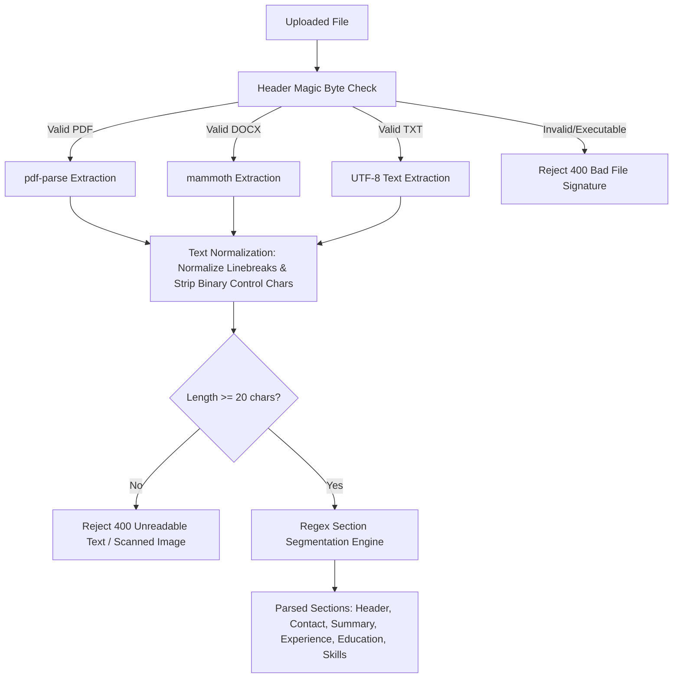

# PrepForge AI — Technical Requirements Document (TRD)
## Advanced Resume Intelligence Engine

**Document Version:** 2.0.0  
**Status:** Approved Technical Architecture Specification  
**Product Name:** PrepForge AI — Advanced Resume Intelligence Engine  
**Author:** Principal Software Architect & Full-Stack Systems Lead  
**Date:** 2026-10-26  
**Codebase Verification:** Phase 0 Codebase Audit Verified  

---

## 1. System Architecture Overview

PrepForge AI is architected as an asynchronous, decoupled, multi-tier client-server enterprise application. It is engineered for high-throughput document processing, deterministic scoring explainability, and resilient generative AI inference.

```
+---------------------------------------------------------------------------------------------------+
|                                            CLIENT TIER                                            |
|   React 19 (Vite 6) + Tailwind CSS 3.4 + Lucide React + React Router v7                           |
|   - Global Theme Provider (Dark #080B14 / Light #F8FAFC)                                          |
|   - AuthContext (Reactive User Session via /api/v1/auth/me)                                      |
|   - 27-Check Interactive Dashboard, Bullet Improvement Studio, Version Diff, PDF Export          |
+---------------------------------------------------------------------------------------------------+
                                                  |
                                                  | HTTPS / REST JSON
                                                  | Credentials: "include" (HttpOnly JWT Cookies)
                                                  v
+---------------------------------------------------------------------------------------------------+
|                                     EXPRESS API GATEWAY & PIPELINE                                |
|   Node.js (LTS v20+ / ES Modules) + Express.js 4.21                                              |
|   - Security: Helmet 8.3, CORS 2.8 (with credentials), Express Rate Limit 8.7                     |
|   - Pipeline: Multer 2.4 (Uploads) -> Magic Byte Validator -> Text Extractor (pdf-parse, mammoth)  |
|   - Orchestration: Section Segmenter -> 27-Point Rule Engine -> Scoring Engine                    |
+---------------------------------------------------------------------------------------------------+
                    |                                                     |
                    | Mongoose 9.11 ODM                                   | Google Gen AI SDK (^2.30.0)
                    v                                                     v
+---------------------------------------------+     +-----------------------------------------------+
|              PERSISTENCE TIER               |     |                 AI SERVICE TIER               |
|   MongoDB Atlas v7.0+ Cluster               |     |   Google Gemini Fallback Pool                 |
|   Cluster: cluster0.oy5eebe.mongodb.net     |     |   Tier 1: gemini-3.7-flash                    |
|   Database: prepforge_ai                    |     |   Tier 2: gemini-3.5-flash-lite               |
|   Collections:                              |     |   Tier 3: gemini-3.1-flash-lite               |
|   - users, resumes, resumeanalyses          |     |   - Grounded Ingestion & Bracketed Rewrites   |
|   - jobanalyses, interviewsessions          |     |   - Robust JSON Repair & Zod Validation       |
|   - applications                            |     +-----------------------------------------------+
+---------------------------------------------+
```

---

## 2. Technology Stack & Verified Dependency Matrix

All versions documented below reflect the **actual verified dependencies** installed and tested during the Phase 0 audit:

### 2.1 Backend Dependencies (`server/package.json`)

| Package Name | Verified Version | Architectural Role & Justification |
| :--- | :--- | :--- |
| **`express`** | `^4.21.2` | Core HTTP framework, routing pipeline, middleware chaining. |
| **`mongoose`** | `^9.11.2` | Object Data Modeling (ODM) for MongoDB Atlas; schema enforcement. |
| **`@google/genai`** | `^2.30.0` | Official modern Google Gemini generative AI client SDK. |
| **`pdf-parse`** | `^2.4.5` | Deterministic server-side PDF text extraction and metadata inspection. |
| **`mammoth`** | `^1.13.0` | DOCX document conversion and raw text extraction preserving layout cues. |
| **`multer`** | `^2.4.0` | Multi-part form data parser for secure file upload handling. |
| **`jsonwebtoken`** | `^9.0.3` | Cryptographic JWT minting, verification, and expiration handling. |
| **`bcryptjs`** | `^3.0.3` | Salted password hashing (work factor 12) for credential protection. |
| **`cookie-parser`** | `^1.4.7` | Parsing secure, signed HttpOnly authentication cookies. |
| **`zod`** | `^4.6.7` | Runtime type checking and strict schema validation for AI JSON output. |
| **`helmet`** | `^8.3.0` | HTTP response header security (CSP, HSTS, X-Content-Type-Options). |
| **`cors`** | `^2.8.5` | Strict origin whitelisting with support for cross-origin credentials. |
| **`express-rate-limit`**| `^8.7.1` | DoS protection, IP-based auth brute-force and AI invocation rate limits. |

### 2.2 Frontend Dependencies (`client/package.json`)

| Package Name | Verified Version | Architectural Role & Justification |
| :--- | :--- | :--- |
| **`react`** | `^19.0.0` | Primary frontend UI framework with modern concurrent rendering. |
| **`react-dom`** | `^19.0.0` | React DOM renderer. |
| **`react-router-dom`** | `^7.1.5` | Client-side routing, route protection guards, query parsing. |
| **`vite`** | `^6.1.0` | Ultra-fast next-generation frontend build tool and dev server. |
| **`tailwindcss`** | `^3.4.17` | Utility-first responsive CSS styling with custom theme tokens. |
| **`lucide-react`** | `^0.475.0` | Cohesive, accessible SVG iconography suite. |

---

## 3. Frontend Architecture

### 3.1 Directory Organization
```
client/src/
├── assets/                 # Brand assets, logos, illustration SVGs
├── components/
│   ├── common/             # Button, Card, Badge, Modal, Toast, Input, EmptyState
│   ├── layout/             # Navbar (with Quick Theme Toggle), Sidebar, PageContainer
│   ├── resume/             # FileUploader, CheckCard, ScoreRadar, RewriteCard, ComparisonDiff
│   └── interview/          # QuestionBox, AnswerEvaluator, SessionTimeline
├── context/
│   ├── AuthContext.jsx     # Global user session state & bootstrap via /api/v1/auth/me
│   └── ToastContext.jsx    # Toast notification queue
├── hooks/
│   ├── useTheme.js         # Reactive theme hook (dark/light/system)
│   ├── useResumeAnalysis.js# Orchestrates resume checks, polling, and cached results
│   └── useAsync.js         # Async lifecycle wrapper (idle -> loading -> success -> error)
├── pages/                  # Top-level route views (Dashboard, ResumeAnalyzer, Settings, etc.)
├── utils/
│   ├── api.js              # Fetch client configured with credentials: 'include'
│   ├── theme.js            # Theme management, localStorage sync, DOM class management
│   └── formatters.js       # Date, score, file-size, and bullet formatting utilities
└── index.css               # Tailwind directives & CSS custom properties for dark/light
```

### 3.2 Global Theme Engine
The application enforces a dual-mode design system with **zero flash of unstyled content (FOUC)**:
* **Storage Key:** `prepforge_theme` in `localStorage` (`'dark' | 'light' | 'system'`).
* **Bootstrap:** An inline script in `index.html` evaluates theme preference and sets the `class="dark"` or `class="light"` on `document.documentElement` before React mounts.
* **Component Parity:** Every UI component utilizes semantic classes configured in Tailwind (e.g., `bg-navy-950 dark:bg-navy-950 light:bg-slate-50`, `text-slate-100 dark:text-slate-100 light:text-slate-900`).

---

## 4. Backend Architecture

### 4.1 Server Middleware Pipeline (`server/src/app.js`)
```
Incoming Request
  │
  ├── 1. Reverse Proxy Trust (`app.set('trust proxy', 1)`)
  ├── 2. Helmet HTTP Security Headers
  ├── 3. CORS (`credentials: true`, specific client origin allowlist)
  ├── 4. Cookie Parser
  ├── 5. JSON Body Parser (50MB threshold for document payloads)
  ├── 6. Rate Limiters:
  │       ├── generalLimiter (100 req / 15 min)
  │       ├── authLimiter (10 req / 15 min)
  │       └── aiLimiter (10 req / 1 min)
  ├── 7. Authentication Guard (`authMiddleware` via JWT in cookie)
  ├── 8. Versioned Route Dispatcher (`/api/v1/...` and backward-compatible `/api/...`)
  └── 9. Global Error Handler (sanitizes error stacks in production)
```

---

## 5. Resume Parsing & Section Segmentation Pipeline



### 5.1 File Validation & Magic Byte Checking
Before any document parsing occurs, `server/src/utils/textExtractor.js` validates raw buffer signatures:
* **PDF:** Must begin with `%PDF-` (`0x25 0x50 0x44 0x46 0x2D`).
* **DOCX:** Must begin with zip header `PK\x03\x04` (`0x50 0x4B 0x03 0x04`).
* **TXT:** Valid UTF-8 encoding without non-printable binary control characters.

### 5.2 Section Segmentation Engine
Extracted plain text is segmented using specialized multi-line regular expressions matching standard section headings:
* **Contact:** Header block, email regex (`\b[A-Za-z0-9._%+-]+@[A-Za-z0-9.-]+\.[A-Z|a-z]{2,}\b`), phone regex, location.
* **Experience / Employment:** `/(?:work\s+experience|professional\s+experience|employment\s+history|experience)/i`.
* **Education:** `/(?:education|academic\s+background|qualifications)/i`.
* **Skills:** `/(?:skills|technical\s+skills|core\s+competencies|technologies)/i`.
* **Summary:** `/(?:professional\s+summary|summary|profile|about\s+me)/i`.

---

## 6. Deterministic 27-Point Checking Engine

The 27 checks execute through a hybrid pipeline combining deterministic rule-based algorithms with targeted LLM evaluations:

```
+---------------------------------------------------------------------------------------------------+
|                            27-POINT CHECKING EXECUTION CLASSIFICATION                             |
+---------------------------------------------------------------------------------------------------+
| TYPE          | CHECKS INVOLVED                               | EXECUTION METHOD                  |
|---------------|-----------------------------------------------|-----------------------------------|
| Deterministic | CHK-01, CHK-03, CHK-04, CHK-05, CHK-06,       | Regular expressions, dictionary   |
| Rule-Based    | CHK-07, CHK-08, CHK-09, CHK-10, CHK-12,       | lookups, date arithmetic, length  |
|               | CHK-14, CHK-17, CHK-19, CHK-21, CHK-22,       | thresholds, section structure.    |
|               | CHK-23, CHK-24                                | Execution time: < 50ms.           |
|---------------|-----------------------------------------------|-----------------------------------|
| Hybrid /      | CHK-02 (ATS Layout), CHK-11 (Quantification), | Deterministic pre-filter verified  |
| LLM-Assisted  | CHK-13 (Spelling/Grammar), CHK-20 (Risk),     | by structured Gemini prompt.      |
|               | CHK-25 (Progression), CHK-27 (Leadership)     | Execution time: 2-4 seconds.      |
|---------------|-----------------------------------------------|-----------------------------------|
| Semantic /    | CHK-15 (Hard Skills Match),                   | Gemini vector/semantic comparison |
| LLM-Evaluated | CHK-16 (Soft Skills Match),                   | against target job description.    |
|               | CHK-18 (Title Alignment),                     | Execution time: 2-5 seconds.      |
|               | CHK-26 (Skills Demonstration Context)         |                                   |
+---------------------------------------------------------------------------------------------------+
```

---

## 7. AI Analysis Pipeline & Gemini Integration

### 7.1 Multi-Model Fallback Pool (`server/src/services/geminiService.js`)
To guarantee high availability and absorb transient Google AI API 429 rate limits or upstream 503 errors, the AI client implements a cascading failover pool:

```javascript
const MODEL_FALLBACK_POOL = [
  'gemini-3.7-flash',
  'gemini-3.5-flash-lite',
  'gemini-3.1-flash-lite',
  'gemini-flash-lite-latest',
  'gemini-3.8-flash',
  'gemini-3.5-flash'
];
```

### 7.2 Strict Schema Validation & JSON Repair
1. **Zod Schema:** The LLM output is parsed and strictly validated against `server/src/validators/resumeAnalysisValidators.js`.
2. **JSON Repair Parser:** If Gemini returns markdown formatting (e.g., ````json ... ````), unescaped control characters, or trailing commas, a specialized regex parser strips delimiters and repairs malformed backslashes before JSON deserialization.
3. **Deterministic Score Override:** Numerical scores calculated by the deterministic server engine always take precedence over LLM-generated estimates to ensure 100% reproducibility.

---

## 8. Multi-Factor Scoring Engine Architecture

The scoring engine executes synchronously on the server after rule and AI checks complete. It computes 5 discrete metrics:

### 8.1 Formula Definitions
```
1. Overall Resume Score:
   Score_Overall = round(0.35 * Score_ATS + 0.35 * Score_Content + 0.30 * Score_Structure)

2. ATS Compatibility Score:
   Score_ATS = round(0.50 * Cat1_Score + 0.30 * Cat2_Presence_Score + 0.20 * CHK10_Score)
   * Hard-Cap Policy: Score_ATS <= 40 ONLY upon critical parsing failure in CHK-01 (corrupted binary
     or scanned raster image with < 20 extractable characters). Missing contact fields (CHK-08) apply
     localized deductions (-20 pts for missing email, -5 pts for missing phone) but NEVER trigger a global cap.

3. Resume Content Score:
   Score_Content = round(0.60 * Cat3_Score + 0.40 * Cat7_Score)
   * Evaluates language quality, STAR metric density (CHK-11), action verbs (CHK-17), and demonstrated skills (CHK-26).
   * Note: Thresholds (85% parse rate, 40% metrics, 15-30 words) operate as configurable coaching guidelines.

4. Resume Structure Score:
   Score_Structure = round(0.25 * CHK09_Score + 0.75 * Cat5_Score)
   * Evaluates section ordering hierarchy (CHK-09) and chronological sanity / timeline credibility (Cat 5).
   * Category 6 (Bias Mitigation) carries zero scoring weight (w_Cat6 = 0) and is completely excluded from this formula.

5. Job Match Score (Conditional):
   Score_JobMatch = round(0.40 * HardSkillsMatch + 0.25 * SoftSkillsMatch + 0.20 * ActionVerbs + 0.15 * TitleAlignment)
   * Set strictly to null (rendered in client as N/A) if no target job description is supplied.
```

---

## 9. Database Integration & Schema Strategy

### 9.1 Additive Mongoose Schema Extension
To preserve existing production data and maintain 100% backward compatibility, `ResumeAnalysis` is extended additively without modifying existing fields:

```javascript
// server/src/models/ResumeAnalysis.js (Additive Fields)
const detailedCheckResultSchema = new mongoose.Schema({
  checkId: { type: String, required: true },
  checkName: { type: String, required: true },
  category: { 
    type: String, 
    enum: [
      'ATS Essentials', 
      'Resume Sections', 
      'Resume Content', 
      'Job Tailoring', 
      'Recruiter Red Flags', 
      'Bias and Discrimination', 
      'Seniority and Impact'
    ],
    required: true 
  },
  status: { type: String, enum: ['passed', 'warning', 'failed', 'info'], required: true },
  score: { type: Number, min: 0, max: 100, default: 0 },
  severity: { type: String, enum: ['critical', 'high', 'medium', 'low', 'info'], required: true },
  summary: { type: String, required: true },
  details: { type: mongoose.Schema.Types.Mixed, default: {} },
  recommendation: { type: String, default: null }
}, { _id: false });

// Extended fields on ResumeAnalysisSchema:
detailedChecks: { type: [detailedCheckResultSchema], default: [] },
subScores: {
  atsScore: { type: Number, min: 0, max: 100, default: 0 },
  contentScore: { type: Number, min: 0, max: 100, default: 0 },
  structureScore: { type: Number, min: 0, max: 100, default: 0 },
  jobMatchScore: { type: Number, min: 0, max: 100, default: null }
},
analysisVersion: { type: String, default: '2.0.0' },
scoringVersion: { type: String, default: '1.0.0' }
```

### 9.2 Indexing Strategy
Compound indexes optimize query throughput and prevent table scans:
* `{ userId: 1, createdAt: -1 }` — High-speed history pagination.
* `{ resumeId: 1, createdAt: -1 }` — Latest analysis retrieval.
* `{ userId: 1, resumeId: 1, createdAt: -1 }` — Candidate resume analysis correlation.

---

## 10. API Route Architecture

### 10.1 Existing Endpoints (Preserved)
* `POST /api/v1/auth/register` — Candidate registration.
* `POST /api/v1/auth/login` — Candidate login (issues HttpOnly cookie).
* `POST /api/v1/auth/logout` — Destroys session cookie.
* `GET /api/v1/auth/me` — Bootstraps client auth session.
* `POST /api/v1/resumes` — Ingests and stores raw resume document.
* `GET /api/v1/resumes` — Lists candidate resumes.
* `POST /api/v1/resumes/:id/analyze` — Initiates complete 27-check analysis.
* `GET /api/v1/resumes/:id/analysis` — Fetches latest analysis result.

### 10.2 Proposed Dedicated Endpoints
* `GET /api/v1/resumes/:id/checks` — Returns lightweight array of all 27 checks with pass/fail statuses.
* `GET /api/v1/resumes/:id/checks/:checkId` — Returns detailed diagnostics, bullet-level failures, and recommendations for a single check.
* `POST /api/v1/resumes/:id/recheck` — Executes fast-path deterministic checks without re-triggering full LLM calls.
* `POST /api/v1/resumes/compare` — Computes side-by-side diff, score deltas, and resolved issues between two resume IDs.
* `GET /api/v1/resumes/:id/report/pdf` — Generates a downloadable, printable PDF audit report.

---

## 11. Security Architecture

1. **HttpOnly Cookie Authentication:** JWT tokens are never exposed to client-side JavaScript or stored in `localStorage`, mitigating Cross-Site Scripting (XSS) token theft.
2. **CORS Allowlist:** Configured strictly to trusted frontend origins with `credentials: true`.
3. **Helmet HTTP Headers:** Sets `Content-Security-Policy`, `X-Frame-Options: DENY`, `X-Content-Type-Options: nosniff`, and `Strict-Transport-Security`.
4. **Rate Limiting:** Multi-tiered limits via `express-rate-limit` block automated brute force and prevent runaway AI API costs.
5. **Ownership Authorization:** Every resume and analysis query enforces `userId: req.user._id` in the database filter, preventing Insecure Direct Object References (IDOR).

---

## 12. Error Handling & Operational Resilience

* **Client Experience:** Async operations use loading skeletons, spinners, and toast notifications. Network errors gracefully display retry buttons.
* **Backend Robustness:** Async controllers are wrapped in `asyncHandler` blocks with centralized error logging. In production, stack traces are masked, returning standard `{ success: false, error: { message, code } }` structures.
* **AI Failures:** If all Gemini models in the fallback pool fail or time out (15s deadline), the system returns a partial result computed from deterministic checks with a notification that deep AI recommendations can be retried.

---

## 13. Performance & Scalability Considerations

* **Memory Management:** Multer processes uploads via memory or temp storage with 5MB strict boundaries. Buffer references are garbage-collected immediately following text extraction.
* **Database Optimization:** Field projections (`.select('...')`) exclude massive raw text strings when fetching history lists.
* **Vite Production Bundling:** Manual chunking in Vite splits heavy dependencies (`lucide-react`, chart libraries) for fast initial paint ($< 1.2\text{s}$).

---

## 14. Deployment & Infrastructure Compatibility

* **Node.js Environment:** Fully compatible with Node.js 20+ runtime on Linux, macOS, and Windows.
* **Database Connectivity:** Direct SSL connection to MongoDB Atlas using Mongoose 9.11 with connection pool management (`maxPoolSize: 10`, `serverSelectionTimeoutMS: 5000`).
* **Environment Variables:** All secrets (`MONGODB_URI`, `JWT_SECRET`, `GEMINI_API_KEY`, `PORT`) are injected via environment configurations without committing credentials to source control.
